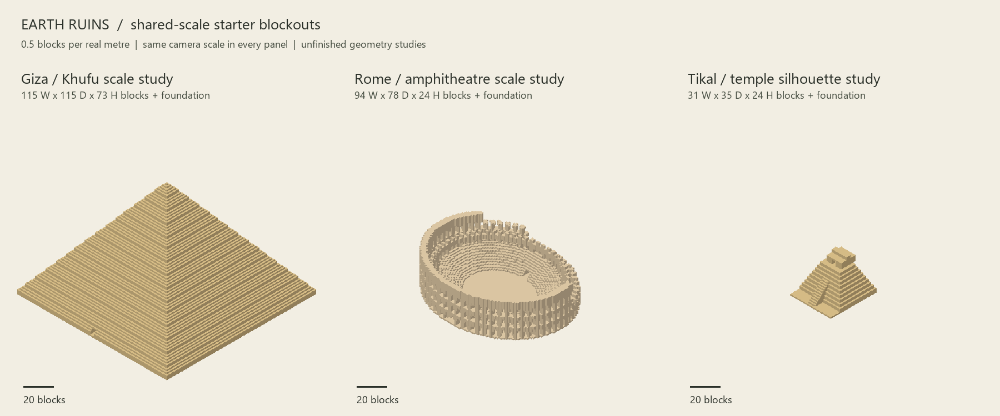

# First geometry studies

Three original blockouts exported in Vintage Story's block-schematic JSON layout. These are **unfinished scale and
silhouette studies**, not accurate reconstructions or finished ruins. The numerical scale is a proposal: one
architectural block represents two real metres. Larger Earth worlds do not resize these building models.



| Schematic | Above-foundation width × depth × height | Status |
|---|---|---|
| `giza-khufu-blockout.json` | 115 × 115 × 73 blocks | Pyramid envelope; invented north-base test passage and chamber |
| `rome-amphitheatre-blockout.json` | 94 × 78 × 24 blocks | Elliptical arcades/seating with a broken upper sector; exact Colosseum plan pending |
| `tikal-temple-blockout.json` | 31 × 35 × 24 blocks | Maya stepped-temple silhouette; exact Tikal building research pending |

Each includes one foundation layer at Y=0. The entrance/ground level is Y=1. The manifest uses X × Y × Z dimensions,
so it includes that additional layer. JSON and manifest files are paired by name. No numeric palette key is assumed
to equal a runtime block ID: the importer must resolve `BlockCodes` as normal.

The schemes use vanilla limestone, granite and travertine masonry. They contain no custom entities, containers,
loot, copied mod assets or third-party meshes. Historical interiors, polished regional decoration, weathering and
terrain placement remain to be authored. The Tikal model's full-block stair is only a massing placeholder.

**Placement restriction:** use an empty creative test area only. `ReplaceMode=1` means replace all recorded cells,
including explicit air. Cells absent from the schematic are left to the placement API; they do not define a safe
whole-box terrain-carving mask. Nothing in this directory is registered in the Earth mod's assets or generator.
An in-game import has not been performed, so these are not claimed to be release-ready assets.

Regenerate from the workspace root with Python 3.10+ and Pillow:

```
python tools/build_ruin_blockouts.py
```

The generator checks export/decode equality, palette references, duplicate indices, dimensions, connection of all
solid voxels to the foundation, and a 2-wide/3-high passage with a floor in the pyramid. It also checks catalogue IDs
and coordinate ranges. `validation.json` records these results and the checks still outstanding. The PNG renders
the exported source geometry at the same pixel scale in all three panels; it is not an in-game screenshot.

Next modelling work: verify exact reference dimensions/plans; agree the architecture profile; complete a Giza
complex layout and Sphinx; make a historically identifiable Colosseum and specific Tikal temple; author one small
regional ruin for each. Only then is broad parallel model production efficient.
