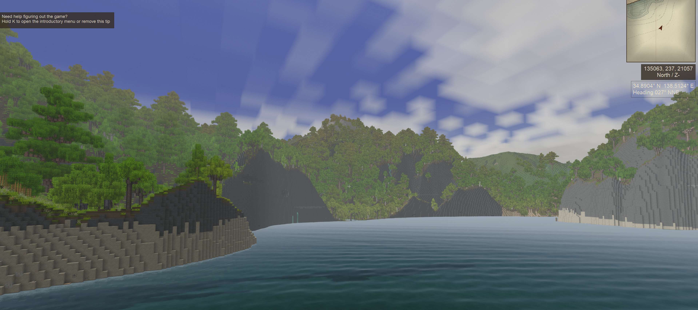

# Mountain height and alpine vegetation

Status: closed in the suite backlog on 12 November 2026 ([EA-0030](../../backlog/items/EA-0030-mountains-swamped-and-too-wooded.md), [EA-0031](../../backlog/items/EA-0031-low-islands-bare-while-mountains-green.md)); the analysis below is kept for reference | Reported: 2026-10-26

Follow-up: an experimental implementation is on `codex/mountain-height-playtest`; see the
[playtest plan](mountain-height-playtest-plan.md) and [review handoff](mountain-height-review-handoff.md). The investigation below predates that implementation.

In a 512-high Earth world roughly 500,000 blocks wide, the user reports that mountains look too wooded and that
exaggerated smaller features overwhelm the high mountains. Descending a short distance from Everest brings trees and
grass back too quickly. The proposed direction is to reserve roughly 100 blocks below sea level and give more of the
existing height to the landscape above it.

The user also reports a contrast between overly green mountains and much lower Mediterranean islands or St Helena,
which appear as bare rock in game. The issue includes this relative distribution of greenery, not just vegetation
near the highest summits.

**Lowering the world's sea level is technically plausible for new worlds. It needs a gentler land-height curve as
well: lowering sea level alone exaggerates the smaller features further. Alpine vegetation needs its own correction.**
This is an investigation and handoff for later work. No implementation, configuration changes or save edits are included.

## Report and screenshot

The user describes this as a view toward Mount Fuji. The screenshot shows wooded ridges, steep exposed rock faces and
water in the foreground. It does not establish which visible ridge is Fuji's summit or its actual generated elevation.

The HUD reads approximately 34.8904° N, 138.5124° E, heading 027° NNE; displayed block coordinates are
135063, 237, 21057. These are the camera's location, not a summit measurement. The exact world settings, seed, installed
mod versions and render distance were not supplied. Calculations below use the current source defaults, not recovered
settings from this save. Source inspected: Earth 0.16.13, Git HEAD `59c17fc`, with pre-existing local work present.

Keep two problems distinct when investigating:

- **Terrain proportions:** minor hills and procedural ridges compete with the main mountain silhouette.
- **Ecology:** forest, shrubs and grass may continue too far into terrain that should read as alpine or bare rock.
  Trees below a local treeline can be appropriate; the concern is the location and breadth of the transition.
- **Surface contrast:** lower islands can look much barer than high mountains. Compare both sides of that contrast;
  neither uniformly removing mountain vegetation nor uniformly greening islands would establish the right result.

## Why the current curve produces this appearance

[`VerticalScale`](../src/Core/VerticalScale.cs) maps land elevation using a logarithmic curve. Its default
`LandCurve` is 200 metres, which heavily enlarges the first few hundred metres and progressively compresses additional
height. Horizontal size does not set this vertical curve. In a default 512-high world, Earth reads sea level y=220
from the game and sets the nominal Everest reference to y=480, leaving 32 blocks above that reference.

At those defaults, 500 m receives about 85 blocks of relief, while the entire interval from 4,000 m to 8,849 m gets only
about 52 blocks. Equal real elevation differences get roughly 45 times as much block height near sea level as near the
Everest reference. This supports the user's concern about smaller features dominating the view.

[`TerrainModel.Detail`](../src/Core/TerrainModel.cs) adds noise in metres before applying the height curve: fine
undulation, a component proportional to local relief and ridged noise in rugged areas. The steep low-elevation part of
the curve can turn these additions into prominent foreground ridges. A lower sea level with the same curve increases
all above-sea relief proportionally; it does not improve the ratio between hills and high mountains.

There is also a source-data limit. The terrain uses a 2-arcminute elevation grid with bicubic interpolation. Narrow
summits may be lower or broader in that grid than their surveyed height. The 8,849 m reference calibrates the mapping;
it does not guarantee the sampled Everest column reaches that height. A new curve cannot recover a missing summit or
crater. Compare the data and the noise separately before deciding whether finer elevation data is needed.

## Reallocating the vertical space

The useful change is to place **real 0 m elevation at a lower positive block Y**, keeping the world bottom at y=0 and
the total height at 512. Renaming the HUD's zero would not create more relief. Negative world coordinates are not
needed for this proposal.

| Layout | Sea level | Sea to nominal Everest at y=480 | Height reserved above reference |
| --- | ---: | ---: | ---: |
| Current defaults | 220 | 260 | 32 |
| Candidate near the requested depth | 128 | 352 | 32 |
| Shallower alternative | 100 | 380 | 32 |

Sea level 128 frees 92 blocks for land relief, an increase of about 35%; sea level 100 frees 120, about 46%. The value
128 is a comparison candidate, not an agreed setting or an engine requirement.

Underground depth is not uniform. Sea level 128 gives roughly 128 blocks from coastal ground to the bottom, but the
rock under a mountain is much thicker. Ocean water also consumes part of the below-sea budget. With the current
`MaxSeaDepth=0.43` rule, the nominal deepest seabed is about y=124 at sea 220, y=72 at sea 128, or y=56 at sea 100.
Thus sea 100 does **not** leave 100 blocks of rock beneath the ocean floor. The design should budget coastal mining
depth, ocean depth and minimum rock beneath the seabed separately. Revisit these alongside caves, ores and strata.

The current underground space is not empty: Earth fills rock from the bottom up to the terrain, and later passes add
caves and deposits. Reducing it trades some mining and cave space for above-ground relief. Keeping total height 512
also does not by itself establish a memory or performance improvement.

## Comparing land curves

These are calculated block Y values for ideal elevations, rounded to the nearest block. They exclude source-grid
averaging, noise, coast adjustments and actual summit sampling. All columns keep the Everest reference at y=480.
The intermediate candidate uses the existing logarithmic formula with `LandCurve=2000`; the final column is a
linear mathematical comparison.

| Real elevation | Current sea 220 and curve 200 | Sea 128 and curve 200 | Sea 128 and curve 2000 | Sea 128 and linear |
| --- | ---: | ---: | ---: | ---: |
| 0 m | 220 | 128 | 128 | 128 |
| 100 m | 248 | 165 | 138 | 132 |
| 500 m | 305 | 244 | 174 | 148 |
| 1,000 m | 342 | 293 | 212 | 168 |
| 2,000 m | 384 | 349 | 272 | 208 |
| 3,776 m reference for Fuji comparison | 424 | 404 | 349 | 278 |
| 4,000 m | 428 | 409 | 357 | 287 |
| 8,849 m reference | 480 | 480 | 480 | 480 |

Judge height **above local ground or sea level**, rather than absolute Y. The gentler candidate gives a 500 m hill
about 46 blocks above sea, instead of 85 now, while expanding the 4,000-to-8,849 m interval from about 52 to 123 blocks.
Fuji's ideal reference gains relief above sea even though its absolute Y falls. Linear scaling preserves elevation
ratios but gives a 100 m hill only four blocks, so lowland rivers and local terrain would need particular attention.

The first useful comparison is the current curve against several gentler curves and a linear reference, with sea
128 as a common candidate. Choose the balance from silhouettes and travel experience. Keep the sea-floor curve
independent so making mountains more proportional does not flatten navigable shallow seas.

## Why lower islands may look barer than high mountains

[`EarthWorldGen.BareRock`](../src/EarthWorldGen.cs) already removes soil and surface plants before vegetation is
generated. It measures a local height gradient in **game blocks**, then lowers its threshold in cold terrain:

| Warmest month at the surface | Gradient required to strip surface cover |
| --- | --- |
| At least 5 °C | 1.5 blocks per horizontal block |
| From 1 °C to below 5 °C | 0.5 blocks per horizontal block |
| Below 1 °C | No minimum gradient |

The gradient comes from opposite neighbours two blocks apart. Temperature uses the chunk-centre climate sample
corrected by the inverse vertical mapping at the column's surface height. The pass can also place persistent snow
on sufficiently cold, gentle ground.

This creates a plausible connection between the two reported problems: the logarithmic curve can steepen low island
slopes enough to strip their soil, while compressing high mountain slopes enough to retain it. Both may be evaluated
correctly in block coordinates while producing an unconvincing geographical contrast. Lowering sea level alone would
also change which slopes cross these thresholds. This needs comparison at the reported sites before assigning it as
the cause; rainfall, species suitability, island shape and source resolution may contribute too.

Any curve experiment should record the fraction of ground stripped by this pass, as well as forest density. Compare
physical slope derived from the source geography with slope in blocks, and consider a rule that combines substrate,
local relief, climate and soil retention without making the height curve accidentally decide all rock exposure.
Preserve actual cliffs. Mediterranean summer dryness and St Helena's own local conditions should be evaluated
separately rather than treating both as an alpine elevation problem. Exact comparison locations on the Mediterranean
islands and St Helena remain to be recorded.

## Why vegetation needs a separate investigation

The source already accounts for elevation, but different paths use different versions of it:

- `TerrainModel.ForestPotential` reduces forest density using warmest-month temperature corrected by the smoothed,
  bilinear source elevation. It fades from no forest at 8 °C to full thermal suitability at 13 °C, multiplied by
  moisture. It does not use the final surface elevation including detail noise.
- [`EarthTrees.Pick`](../src/EarthTrees.cs) caches forest-type factors and coldest/warmest-month temperatures at
  the centre of a 32-block chunk using that smoothed elevation. Planting-site elevation is more local, but those
  cached climate values can disagree with a nearby ridge or valley.
- The per-attempt mean temperature comes directly from vanilla's climate map and altitude adjustment. Some vanilla
  tree limits also use `y / worldHeight`. Those bands change their geographical meaning when sea level or the curve
  changes. Some regional providers replace their original altitude limits with Earth climate envelopes.
- [`RegionalTreePicker`](../src/Core/RegionalTreeCatalog.cs) has species and habitat checks and several selection
  tiers. Its forest-type mix is not a universal local treeline veto. Any new alpine limit must apply consistently to
  native trees, analogues and fallback trees.
- Grass and ground plants follow other generation paths; stopping trees alone does not create a suitable alpine
  ground surface. Shrub density currently follows moisture without the forest density's thermal reduction.

These mismatches are plausible contributors, not a confirmed diagnosis of the supplied world. The existing
[tall-world climate issue](decisions/0009-climate-in-tall-worlds.md) also matters: direct worldgen climate-map reads can
be too cold when altitude compensation saturates. That known error alone does not explain excessive trees. Lowering
sea level increases the above-sea block distances, so it can worsen the climate representation problem unless handled
alongside the terrain change.

Proposed ecology direction: evaluate local thermal and elevation suitability at the actual planting surface, using a
consistent definition of real elevation and the existing Earth climate data. Make forest thin into smaller, sparser
trees before a climate-dependent treeline; allow appropriate alpine shrubs and grass above it, then bare rock, scree
or persistent ice where appropriate. Do not impose a single global elevation cutoff or make grass disappear at the
tree limit. Seasonal snow, permanent ice, rock exposure and treeline are related but distinct.

## Can the sea level change without breaking the game

Vintage Story exposes [`IWorldManagerAPI.SetSeaLevel(int)`](https://apidocs.vintagestory.at/api/Vintagestory.API.Server.IWorldManagerAPI.html#Vintagestory_API_Server_IWorldManagerAPI_SetSeaLevel_System_Int32_).
The API describes changing the world's generation sea level and its use by client climate tinting. This provides a
supported starting point; it does not prove every generator or installed mod will adapt correctly.

Earth currently reads the game's sea level in `EarthMapSystem.ComputeParams` and saves it in `EarthParams`, rather
than choosing its own. A future implementation must establish one sea level early enough that the engine, climate
helpers and all generation systems observe it. Updating only Earth's terrain mapping would leave inconsistent
climate and other generation behaviour.

| Area | Dependency to resolve before calling the change compatible |
| --- | --- |
| Initialization and reload | Check the installed 1.22 engine's setter, initialization order, persistence and server/client synchronization. Earth and vanilla generation must use the same value after reopening. |
| Cylinder World | Its `ComputeParams` saves the game sea level and derives seabed and polar-wall heights from it. Earth's current initialization follows Cylinder World's worldgen. Set the shared value before either captures it; inspect seam terrain and polar ice. |
| Climate and appearance | Align the game sea level, `TerraGenConfig.seaLevel`, climate encoding, altitude helpers and client tinting. Resolve tall-world saturation rather than compensating only through the runtime climate hook. |
| Ecology | Audit absolute relative-height bands as well as temperature. Confirm every tree tier, shrubs, grass, soil and snow uses suitable conditions. |
| Geology and progression | Earth scales some strata thickness with sea level and has sea-relative ore reference heights. Check cave room, host layers, starter ores, deep ores and underground structures under the reduced coastal depth. |
| Rivers and companions | Recompute lake levels and river profiles through the same vertical mapping. Check waterfalls, navigation, Hydrology, spawn/story placement, terrain reservations and underground-city clearance with their actual consumers. |

Use this as a **new-world terrain profile** if implemented. Retain each existing world's saved sea level and curve,
following [save compatibility decision 0002](decisions/0002-save-compatibility.md). Changing a live world's datum would
not move its existing chunks, buildings, entities or water, and new chunks could meet them at large cliffs. A full
save migration is a separate undertaking and is outside this proposal.

## Proposed next investigation

1. Recover this world's actual frozen vertical parameters and mod list. At the screenshot position and along Fuji
   and Everest transects, record source elevation, final surface elevation, detail contribution, temperatures,
   forest potential and chosen tree tier. Confirm the intended peak is loaded and visible at the test render distance.
2. Compare the default and gentler land curves at sea levels 100 and 128, with a linear reference. First inspect
   the source surface without noise, then add restrained detail so procedural ridges do not conceal the main shape.
3. In disposable new worlds, verify a shared sea level is established before vanilla, Cylinder World and Earth save
   their generation parameters. Reopen the world and compare server climate, HUD values and client tinting.
4. Investigate alpine vegetation with the terrain profile held constant. Check Fuji, Everest and its high valleys,
   the Alps and a tropical highland. Include the reported lower Mediterranean islands and St Helena as explicit
   comparisons: record slope, exposed rock, soil, grass, shrubs and trees, alongside warmth and rainfall. Retain
   suitable lowland and cold-region vegetation as controls.
5. Check coast and lake navigation, river steps, seam and polar terrain, cave/ore access and underground structures.
   Only then choose a default profile and record an agreed decision with save-version handling.

The intended result is a recognizable hierarchy of plains, foothills and major mountains, with a visible alpine
transition that follows local conditions. The current 512-block limit can be used more effectively before raising
the total world height.
