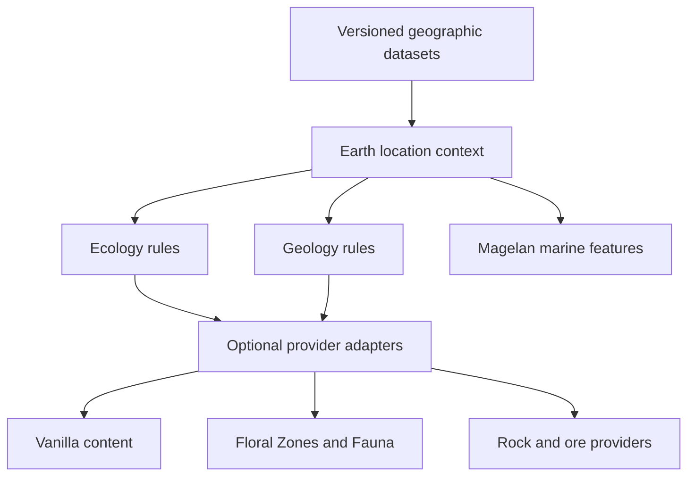

# ADR-001: Regional ecology and geology with optional content providers

**Status:** Architecture adopted in part; regional trees, geology and optional fauna have initial implementations. Ore geography and several proposed habitat/data layers remain future work.
**Date:** 29 September 2026.
**Decider:** Earth mod maintainer.

**Update, 16 October:** later decisions are indexed in [docs/decisions](decisions/README.md). The ore remark in the status line above is out of date: regional ores are implemented (rules v2, 0.13.0) and regional-ore worlds adopt rule fixes automatically (decision 0002); their balance is open (decision 0006).

**Implementation update, 29 September:** see [regional trees](regional-trees-implementation.md),
[regional geology](regional-geology-implementation.md), and [regional fauna](regional-fauna-implementation.md)
for the implemented scope, actual datasets, compatibility checks and limitations. The sections below retain
the broader design intent; they are not a claim that every proposed capability is already available.

**Geology direction clarified, 29 September:** use credible resource locations and matching host rocks, including real regional absence. Travel for unavailable resources is intended. Geology Additions is the preferred first content provider; copper and tin travel/progression must be assessed from starting regions worldwide. Bog ore should be recovered by digging peat. This supersedes the earlier suggestion to recommend a broadly balanced resource distribution. See [global resource access](geology-resource-access-plan.md) and the [Latvia geology example](geology-latvia-pilot.md).

## Context

Earth should make regions differ in their plants, animals, forests, exposed rocks and mineral resources, in addition to elevation, rainfall and temperature. Existing content mods should supply most species and materials. Earth's geographic work must survive changes to those providers. Extinct animals must be configurable. Ocean habitats should support later Magelan features.

This extends the [ecology integration assessment](ecology-integration-plan.md). That assessment inspected eight Floral Zones and twenty Fauna of the Stone Age releases. The initial architecture research inspected seven additional release archives, selected Advanced Geology source, and the installed game's maple/tree definitions without changing gameplay code. Implementation and isolated runtime tests were subsequently authorized; their results belong in the implementation reports linked above. Installed user mods and saves were not changed. Compatibility discussed below describes the architecture; consult those reports for actual tested combinations.

## Decision

**Earth owns geographic context and regional placement policy. Optional content mods own their species, blocks and gameplay. Small adapters translate between them.** Start with one Earth code mod containing separately enabled components, plus versioned rule/mapping files. Separate compatibility code into another mod only where an external DLL dependency or maintenance burden warrants it.

| Component | Responsibility | What should stay outside it |
|---|---|---|
| Earth core | Coordinate conversion; land, ocean and basin identity; climate, season and hydrology; reading versioned region datasets; common diagnostics | Lists of a particular mod's entity codes, rock blocks, recipes or AI |
| Earth ecology component | Native occurrence, local habitat tests, regional plant mixtures and animal density budgets; natural worldgen and runtime spawning | New animal models, combat, breeding systems, drops and domestication |
| Earth geology component | Geological provinces, regional lithology choices, plausible vertical sequences, deposit eligibility and regional abundance | A mandatory replacement for every mining/prospecting mechanic |
| Compatibility mappings | Canonical taxon/material to provider asset; supported versions; provider-specific habitat corrections and growth paths | Independent copies of Earth's geography |
| Optional tree appearance pack/integration | Distinct leaves, seasonal palettes and dormancy support where the provider cannot express them | A new requirement for basic geographic tree placement |
| Magelan | Ships, hunting, equipment and interactions; consumes Earth's marine context | Another ocean-region classification competing with Earth's |



### Keep regions independent of providers

Do not make a universal biome ID carry every meaning. A location has several independent attributes: biogeographic region, local vegetation habitat, freshwater basin, marine region, geological province, surface sediment and current climate. Ecological boundaries and rock boundaries need not coincide. Mediterranean climate in California must not imply Mediterranean-basin species.

Every lookup starts from `EarthGeometry.ToGeo`, preserving the Cylinder World seam/gutter and polar-filler behavior. Extend the existing terrain context rather than building a second coordinate system. `TerrainModel.Column` already distinguishes sea, freshwater lake, salt lake and rivers. Named basins, coastal distance, marine region and brackish-water classification are additional datasets or derived fields, not currently finished capabilities. [Local geometry](../src/Core/EarthGeometry.cs), [terrain context](../src/Core/TerrainModel.cs).

Use broad regions with reviewed species overrides for islands, coastlines and narrow ranges. Blend weights across genuine ecological transitions; retain hard sea/island barriers. Sample categorical IDs without numerical interpolation. For mineral districts, use gradual abundance weights and geologically plausible contacts rather than turning each map polygon into a vertical rectangular slab.

Build the datasets offline into compact, versioned tiles. Runtime generation must require no web service. Use bounded caches and immutable rules that can be queried from worldgen/spawn worker threads. Resolve provider strings to game IDs during asset initialization, not for every animal attempt or terrain block.

### Adapter contract and replacement behavior

Keep a stable Earth catalogue, for example `taxon:acer-saccharum`, `lithology:gneiss`, and `deposit:porphyry-copper`. Range polygons and ecological/geological rules reference these concepts. A separate mapping selects an installed provider's generator, entity variant, rock block or deposit definition.

These are proposed identifiers, not existing APIs. An initial implementation needs a small JSON schema and two narrow adapter contracts; it does not need a general plugin framework.

1. Detect installed providers, versions and actual assets. Mod page slug, manifest mod ID and asset namespace can differ: Material Needs: Geology's manifest ID is `mngeology`, and its rock additions patch `game` assets. Several Floral Zones tree generators also live in `game`.
2. Load only applicable mappings. Prefer validated version ranges and record the exact release/hash tested. Report added, missing or changed assets when upgrading; do not silently assume new animals inherit the geography of an entire pack.
3. Resolve overlapping providers explicitly. Choose a preferred representation for the same species or material. Distinct species may coexist, but duplicate providers should not double the ecological density budget.
4. If a new-world setup lacks a species provider, omit that species and distribute the local budget among other valid native candidates. Do not silently replace it with an unrelated animal. Use documented rock-category fallbacks when a more specific rock is unavailable.
5. Isolate any Harmony patch against provider internals inside that provider's adapter. Prefer public hooks and declarative assets where available. A core update should not be necessary just because a provider renames an entity variant.
6. Keep unrelated mods outside strict mapped-provider enforcement. For a supported provider, unknown natural variants should produce a clear diagnostic and follow a configurable strict/permissive policy.

**Decoupled rules do not make saved blocks portable.** Existing saves retain provider-owned blocks, items and entities. Removing a provider requires an explicit migration or retaining that mod. Never silently apply new-world fallbacks to an old save with a missing required provider. Save the selected generation profile, dataset version and provider mappings with the world. New generation datasets should be opt-in for existing worlds because unexplored chunks can otherwise develop abrupt boundaries.

## Ecology decisions

### Bald cypress, mangroves and saltwater

Bald cypress is suited to freshwater flooding. Some trees tolerate limited brackish exposure, but saltwater intrusion can kill cypress forests; this does not justify normal seawater placement. For Earth, keep it out of ordinary marine water and inland salt lakes. A future brackish habitat can carry a separately calibrated rule. [USDA silvicultural research, printed pp. 365–368](https://www.srs.fs.usda.gov/pubs/gtr/gtr_srs048/gtr_srs048-section11.pdf).

The existing intent was sound, but `EarthTrees.PickPrefix` currently rejects **all** underwater trees when the chunk-center sample is sea. Refine this to per-species habitat checks at the proposed tree position. Allow appropriate mangrove species only where native range, climate, shallow coastal substrate and water conditions agree. Deep open ocean remains unsuitable for these trees. Freshwater swamps and coastal saltwater are separate habitats. [Current tree selection](../src/EarthTrees.cs).

Do not pretend the present sea/lake flag is a measured salinity map. Start with fresh/marine/saline-lake categories; add brackish estuaries when river-mouth and coastal context are available.

### Extinct species configuration

Proposed settings, not implemented configuration:

```json
{
  "ecology": {
    "enabled": true,
    "nativeRangeMode": "historical",
    "includeExtinctAnimals": true,
    "speciesOverrides": {}
  }
}
```

Use `true` for the user's previously selected historical profile, but expose an ordinary on/off option. Keep the two choices independent: turning extinct animals off should still allow living species across their historical native ranges, rather than restricting them to today's remnant populations. Store extinction status and evidence per taxon; uncertain cases need an explicit reviewed classification or species override rather than an inference from the pack name.

The toggle controls new natural worldgen/runtime spawns. It should not erase existing animals, items or player-managed populations. This profile remains a composite of historical species on Earth's current terrain and climate, not a reconstruction of a single prehistoric date. Filter eligibility before allocating regional population weights so removing extinct species does not unintentionally empty a region or multiply the survivors beyond its total budget.

### Regional forests and autumn colours

Tree placement and seasonal appearance need separate treatment:

- **Placement first:** Earth currently groups sugar maple, Norway maple, Japanese maple and other generators into one `Maple` weight. Map individual generators to appropriate native ranges, and do the same for other tree groups. Flora should form regional mixtures, including shrubs and understory, with altitude/wetness/soil preferences added gradually.
- **Preserve identity:** the installed sugar-, Norway- and Japanese-maple generators all place `leaves-grown-maple` and its branchy equivalent. Those leaves use `seasonalMaple`. After generation, that leaf block alone cannot tell which generator created it. Changing generator selection alone therefore cannot provide distinct species palettes. [Audited definitions and hashes](research/regions-2026-09-29/vanilla-tree-blocks.json).
- **Appearance second:** prefer provider-owned leaves with species identity. Where missing, a small optional Earth tree-variants pack can reuse existing geometry/wood while adding distinct leaf/sapling definitions and colour maps. Sapling growth must preserve the selected species. Rendering should use species plus local seasonal conditions; moving a tree should not turn it into a different species.

The North American autumn example is a good target, but sugar-maple foliage can be yellow, orange or deep red. Aim for characteristic mixtures and variation rather than uniformly red trees. [US Forest Service sugar-maple account](https://research.fs.usda.gov/feis/species-reviews/acesac). The vanilla Crimson King variant has distinct leaves, but it represents a Norway-maple cultivar; it should not be substituted for a native North American autumn-red species. [Dawes Arboretum taxon record](https://dawesarb.arboretumexplorer.org/taxon-19585.aspx).

Existing options:

| Option | Evidence and role |
|---|---|
| Vanilla + reviewed Floral Zones | First choice for geographic composition. East Asiatic includes an `acerginnala` generator in the inspected archive. Validate each provider's leaf identity/palette before promising species-specific seasonal colour. |
| [Deciduous Trees 1.8.2](https://mods.vintagestory.at/deciduoustrees) | Advertises 1.22.0–1.22.7; temperature-driven leaf loss and return. Optional visual/lifecycle integration, not a native-range or maple-speciation solution. Eco Machina is optional for fancy branches. Modded species need reviewed evergreen/deciduous configuration. Test Earth's real seasonal temperatures, both hemispheres and multiplayer. |
| [Wildcraft: Trees and Shrubs 1.3.4](https://mods.vintagestory.at/wildcrafttree) | Additional content if the first two sources leave regional gaps. Advertised through 1.22.2; manifest requires Herbarium `1.4.2-rc.1`. Inspected patches also change vanilla leaves/classes/drops, so it is a broader compatibility task than simply adding tree generators. Do not make it a core dependency. |

Start by fixing species composition. Add appearance integration after checking what that already delivers in representative forests. Full tree propagation/succession mods would also need their natural spread paths checked against the chosen policy; they are not required to achieve regional autumn colour.

## Geology provider assessment

Release metadata was retrieved on 29 September 2026. API records, manifests and SHA-256 hashes are in the [archive audit](research/regions-2026-09-29/archive-audit.json). Version tags below are publisher declarations, not Earth test results.

| Candidate | Inspected release / advertised game version | Fit for Earth |
|---|---|---|
| [Material Needs: Geology](https://mods.vintagestory.at/materialneedsgeology) | 2.0.10 / 1.22.3 | Optional later palette for specific gaps. Ten rocks; content-only archive, game-only dependency. Adds strata and ore-host patches; Earth still needs to control their regional distribution. |
| [Geology Additions](https://mods.vintagestory.at/show/mod/8054) | 1.4.8 / through 1.22.3 | **Preferred first provider for the clarified design.** Fourteen rocks including gneiss, schist, quartzite, gabbro and dolostone, plus bog iron and other minerals. Contains `geologylibrary.dll`, with no dependency list in its manifest. Author requires a new world. Bog-iron generation/access and mudstone-to-bauxite conversion require an Earth profile review. |
| [Advanced Geology](https://mods.vintagestory.at/advancedgeology) | **2.0.1 / 1.22.7**, released 29 September | Promising later deposit-generation backend. It is a substantial ore/prospecting overhaul, not merely a rock palette. Keep optional and validate independently before making it a recommended combination. |
| [Rock Strata Variety](https://mods.vintagestory.at/rockstratavariety) | 0.0.4 / 1.22.0 | Changes rock distribution rather than adding geographic data. A server-side code mod. Possible interim choice while Earth leaves strata vanilla; potentially competing ownership once Earth controls regional strata. |
| [Interesting Ore Gen](https://mods.vintagestory.at/interestingoregen) | 2.3.8 / through 1.22.2 | An alternative ore-generation integration, not a requirement for extra rocks. Treat as a separate backend candidate instead of stacking competing ore systems by default. |

Material Needs: Geology adds arenite, arkose, komatiite, marl, monzonite, pyroxenite, serpentinite, syenite, tufa and wacke. Its recommended Terra Prety/Rock Strata Variety companions are not manifest dependencies. The author advertises compatibility with Geology Additions, but that does not establish compatibility with a new Earth geological pass. [Provider description](https://mods.vintagestory.at/materialneedsgeology).

**Recommended sequence:** validate the common geological rules against vanilla content and Geology Additions as the first optional provider. Prove copper acquisition and tin-bronze progression across credible resource regions before extending to all minerals. Add MNG later only where its rock types fill a specific regional gap. Recheck the chosen combination on the 1.22.7 test target before recommending a released bundle.

### Why Advanced Geology needs a distinct adapter

The current Mod DB API reports 2.0.1, while cached search pages still exposed earlier development releases. Source inspected at commit `346df7cf3d439759d159109844aca91152af9d7c` matches the release timing; binary/source equivalence was not independently established.

Its `AssetsLoaded` processing suppresses conventional ore-deposit assets across namespaces. It then loads procedural definitions, registers its own TerrainFeatures generation and creates prospecting maps. The reviewed candidate selector is private, and the template interface/registry is internal; this review found no ready-made public Earth geography callback in those components. [Asset suppression](https://github.com/funions123/vs-AdvancedGeology/blob/346df7cf3d439759d159109844aca91152af9d7c/AdvancedGeology/source/AdvancedGeology.cs), [generator](https://github.com/funions123/vs-AdvancedGeology/blob/346df7cf3d439759d159109844aca91152af9d7c/AdvancedGeology/source/WorldGen/ProceduralDeposits/ProceduralDepositWorldGenSystem.cs), [internal registry](https://github.com/funions123/vs-AdvancedGeology/blob/346df7cf3d439759d159109844aca91152af9d7c/AdvancedGeology/source/WorldGen/ProceduralDeposits/ProceduralDepositTemplateRegistry.cs).

Consequently, patching vanilla ore JSON alone would not geographically control its main deposit system. A future integration should supply a regional weight/eligibility callback used consistently by deposit planning **and prospecting**, ideally through an upstream hook. A version-specific bridge is possible but has higher maintenance cost. Do not promise a simple load-order fix. Do not combine it with another ore overhaul without a deliberate compatibility profile.

## Turning real geology into playable regional geology

Earth currently fills base terrain with the default rock and leaves later strata/deposit stages to the game. Changing that initial fill alone is insufficient: subsequent stages can replace it. Integrate regional lithology at the strata stage and before deposits, maintaining top-rock maps, surface stones, sand/gravel variants and host-rock mappings. Resolve exact 1.22 stage ordering during the implementation spike. Do not perform a late blanket replacement that erases ores or leaves prospecting inconsistent. [Current terrain generation](../src/EarthWorldGen.cs).

Use three related layers:

1. **Regional rocks and surface cover.** Start with broad dominant lithology and geological provinces. Keep unconsolidated/glacial/alluvial cover distinct from bedrock; a surface sediment map is not automatically a basement-rock map. Small intrusions and local outcrops can be deterministic procedural detail inside an appropriate province.
2. **Plausible underground structures.** Generate scaled sedimentary sequences, crystalline basement, volcanic bodies and localized intrusions from province templates. Global surface maps cannot supply a complete true 3D subsurface. Mark generated depth relationships as geological approximation.
3. **Regional mineral potential.** Require a credible geological province, compatible host rock and deposit process, with documented districts and depth constraints. Allow a reviewed region to have zero accessible copper, tin or other resources. Separate confirmed occurrence, geologically plausible occurrence and unassessed ground; absence from a catalogue alone is not scientific proof of absence. In the implemented strict profile, unassessed areas must be reported as incomplete coverage rather than silently filled with generic ore. Generate individual deposits deterministically within supported regions rather than copying modern mine workings block for block.

| Dataset | Proposed use and limits |
|---|---|
| [GLiM](https://doi.pangaea.de/10.1594/PANGAEA.788537) | Global surface lithology with 16 first-level classes. The linked CC-BY-3.0 distribution is gridded at 0.5 degrees: useful as a coarse baseline, too coarse for small islands and individual quarries. Do not confuse that download with the finer source polygons described by the publication. |
| [Global Unconsolidated Sediments Map](https://doi.pangaea.de/10.1594/PANGAEA.884822) | Candidate for glacial, alluvial and other cover differences. The CC-BY-3.0 release includes shapefile and gridded data. Preprocess only the useful fields; do not ship the full research archive to players. |
| [Macrostrat](https://macrostrat.org/) and regional geological surveys | Potential detailed overrides and stratigraphic context. API and map compilation support richer regional work, but source coverage/resolution and redistribution terms need checking per imported dataset. [Primary platform paper](https://strata.geology.wisc.edu/reprints/Peters_etal_2018.pdf). |
| [USGS MRDS quality records](https://catalog.data.gov/dataset/record-quality-tables-for-the-mineral-resources-data-system) | Worldwide mineral occurrences with a US focus and varying record quality. Useful supplementary district evidence after quality filtering, not an unbiased global ore-density map. Add other regional survey sources where needed. |

Store source, date, resolution, confidence and attribution with each imported layer. None of these datasets has yet been imported into Earth by this work.

**Credible regional distribution is the requested default.** Do not insert copper, tin or bauxite into an unsuitable region to make it self-sufficient. Tune deposit size, grade, visibility and density inside credible regions; keep geological eligibility intact. A documented deep deposit must not become a shallow starter mine merely because the game's vertical space is compressed. If it cannot be represented credibly within the available depth, retain the geological record but omit the accessible deposit in that profile.

**Theoretical occurrence is allowed:** suitable regional geology plus compatible local rocks can permit a low background chance even when no deposit has been mapped. Documented deposits provide stronger hotspots. Keep inferred potential distinct from observed occurrences and unassessed ground; catalogue absence is not a zero-probability rule. See the [copper/tin heatmap design](copper-tin-heatmap-design.md).

**Copper first, tin second are the acceptance gate.** For starting regions worldwide, measure routes to sufficient first copper, copper-stage tin and useful combined copper-to-tin journeys. Validate clay vessels/moulds, fuel, harvesting tiers and travel prerequisites. Resource-poor starts may need travel or imported metal; that dependence is intentional. Report game-block distances and estimated time for the actual Earth scale, distinguishing walking from available water transport. Provide discoverable geological clues. Do not compensate for circular progression by fabricating local ores. Alternative bronze recipes and trader/loot imports need explicit review; none are changed by this report. See the [global access assessment method](geology-resource-access-plan.md).

Geology can later inform drainage, soil acidity/texture and plant preferences. Begin with broad substrate affinities rather than hard-gating every tree on a poorly resolved soil prediction. This gives visible ecological links without building a full ecosystem simulation.

## Options considered

| Option | Complexity and cost | Growth and maintenance | Familiarity / integration risk |
|---|---|---|---|
| Hard-code selected mods into Earth | Lowest initial code cost | Asset churn repeatedly changes the core; difficult provider replacement | Familiar current Harmony/JSON techniques, but broad coupling |
| **One core, optional components, separate mappings** | Moderate initial schema and diagnostics work | Reuses geography across providers; independent rule updates; limited packaging overhead | Builds on existing Earth data and hooks; a small new adapter boundary |
| Separate core, ecology, geology, seasons and one code mod per provider immediately | Highest early packaging, versioning and support cost | Strong isolation, but many moving dependencies before boundaries are proven | Extra release coordination for a small project; postpone until justified |
| Delegate regional policy to Biomes or a geological overhaul | Potentially less custom generation code | Earth becomes tied to another mod's geography and public hooks | Prior Biomes audit found geographic assumptions that do not match real continents; ore overhauls still need Earth-specific regional integration |

The recommended option keeps content replaceable without prematurely turning Earth into a collection of interdependent mods. Independence is a design boundary first; separate downloads can follow real maintenance needs.

## Consequences and trade-offs

- Earth remains useful with vanilla assets. Optional providers improve fidelity instead of being needed for world creation.
- Most content work stays with the existing authors, but Earth still owns curated geographic rules and combined validation. More installed packs should not automatically mean more animals per chunk.
- Finer species or geological detail costs research, mappings and data size. Start with a few convincing regional contrasts and expand after testing.
- Exactly one system should control a given stage within a profile: geographic tree selection, regional strata, and major ore-deposit placement each need explicit ownership. Avoid independent filters that accidentally intersect to produce empty regions.
- Provider additions require client content; a server-side geographic rule cannot supply missing client textures or blocks. Distinct Earth leaf blocks would likewise become saved content with their own compatibility obligations.
- Changing natural spawn rules can affect future populations without changing existing terrain. Changing geology affects new chunks and generally belongs to a new-world profile. Neither should silently rewrite established player areas.
- Magelan can consume marine regions, water depth and coastal/pelagic classification later. The prior fauna audit found no reviewed open-ocean whale/dolphin provider; freshwater Baiji and coastal sirenians do not fill that role.

## Action items and validation order

1. [ ] **Core context and a small compatibility catalogue:** define stable identifiers, dataset versions, adapter validation and a proposed `/earth region` diagnostic showing location, habitat/province, selected providers and exclusion reasons. Freeze a representative coordinate test set including seams, islands and both hemispheres.
2. [ ] **Ecology vertical slice:** vanilla trees + Mediterranean/Circumboreal/Cosmopolitan flora, rhinos and selected regional deer. Implement individual native rules, extinct toggle and freshwater/mangrove distinction. Cover worldgen, runtime spawns, shrub/ground vegetation and any mapped natural growth paths. Keep planting and breeding policy separate.
3. [ ] **Global copper/tin access slice:** build researched source districts and assess representative starts worldwide, including ore-rich, ore-poor and island regions. Prove pre-metal acquisition, travel, extraction and bronze production. Report route blocks/time at selected scales, regional absence, credible host rocks/depths, local panning/nuggets, quantities and truthful prospecting. Latvia is one example, not the global centre.
4. [ ] **Geology Additions and regional materials:** validate 1.4.8 on 1.22.7; implement the peat-digging bog-ore adapter with limited natural deposits. Constrain peat, clay classes and carbonate/gypsum formations; review mudstone-derived bauxite/fireclay. Preserve a vanilla fallback for worlds created without the provider. Evaluate MNG or richer ore backends later for specific needs.
5. [ ] **Forest appearance:** compare similar-climate regions using native tree mixtures. Add species-preserving leaf variants only for demonstrated gaps; optionally integrate Deciduous Trees after seasonal/multiplayer checks.
6. [ ] **Marine extension:** classify coastal vs pelagic habitats and depth constraints, select a real whale/dolphin provider, then expose context to Magelan.

Each stage needs checks that reveal meaningful failures: same climate on different continents; native island versus nearby mainland; cypress swamp versus ocean; extinct on/off; correct provider absence on a new world and blocked unsafe removal from an existing one; consistent cross-chunk ore bodies/prospecting; North/South seasonal response. Measure density and generation cost against the current Earth baseline. Do not call a profile supported solely because the mods load without crashing.

## Research record

The [29 September research folder](research/regions-2026-09-29/README.md) contains API snapshots, seven uninstalled archives, manifest/hash audit, selected public source and vanilla tree identity evidence. This is development evidence, excluded from the mod's explicit build/package inputs. The [28 September ecology report](ecology-integration-plan.md) retains the species-family inventory and earlier Biomes analysis.
