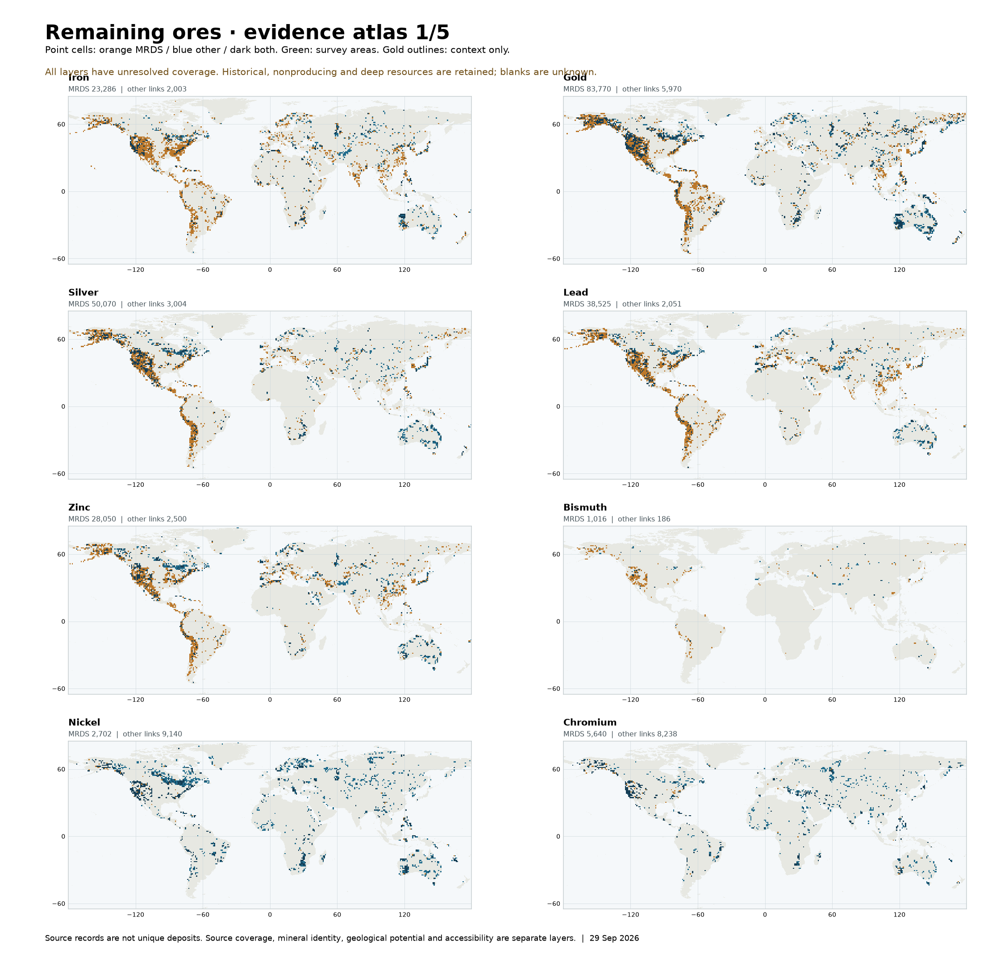

# Remaining ores: global evidence atlas and data package

**Coverage correction:** the original maps omitted major known resource regions. Read the [42-resource audit and correction report](resource-coverage-correction.md) before interpreting this baseline acquisition report. The linked atlas has been regenerated with added historical, nonproducing and geological-area evidence; old counts below describe the original inputs. Unknown coverage is never proof of absence. A separate salt exclusion bug was also corrected in source.

## v2 evidence model (2 October 2026)

The shipped grid `assets/earthmap/config/ore-heatmaps-v1.json` was dataset **`earth-resource-evidence-2026-10-02-v2`** (now v3, which adds an authored best-guess layer; see the v3 section below), rebuilt by `tools/bake_ore_heatmaps.py` from `tools/ore-heatmap-settings.json` (version 2). The file format (720x360, observed/potential/deep uint8 planes plus uint16 depth), the 44 layer codes and the deposit bindings are unchanged; top-level `model`, `planes` and `provenance` fields were added. Python dependencies: `tools/requirements-ore.txt` in the project `.venv`. A review on 2 October found the v1 grid saturated by US-heavy MRDS records (one 0.7 peak and a 75 km kernel for every record), missing several prepared inputs and dropping invalid polygons. The v1 grid is archived in [baseline-v1/](research/ore-heatmaps-v1/baseline-v1/) for comparison.

| Review finding | v2 behaviour |
|---|---|
| Every record had the same peak | Tiered peaks (below); MRDS by development status x MRDS information score; a commodity known only from an ore-mineral mention is capped at 0.3. |
| Dense US survey saturates | MRDS weights x enrichment (local commodity share among all MRDS records in a 2.5° window / its global share, pseudo-count 5, floor 0.35) x effort damping ((60 / window records)^0.2, floor 0.6). Lone records in sparse windows get wider kernels (up to 75 km); dense windows keep 25-45 km. Kernel tails below 0.06 are not stamped. 4,540 MRDS records (8,391 record-commodity links) at 453 shared placeholder coordinates (>= 5 differently named records at one point, e.g. country or state centroids) are dropped. |
| 47% of ice-free land without metal evidence | Low-weight host-rock and climate priors in the potential plane (below). |
| Prepared inputs never read | FSU coal points, global potash sites, LVGMC peat/clay areas and Cu/Sn specialist links are now in [the registry](research/remaining-ores-2026-09-29/corrections/overlay-registry.json); BGS/GA coal context polygons are used at 0.25 in the potential plane. |
| Invalid / antimeridian polygons dropped | `shapely.make_valid`, MultiPolygons split, parts drawn across 180° unwrapped to 0-360° and rasterised modulo 360. All 192 porphyry, 48 sediment-hosted Cu and 84 potash tracts and all 3,918 coal polygons are used. |
| Any touching polygon lit the whole cell | weight x (0.3 + 0.7 x covered fraction); fractions of one source layer are summed per cell (capped at 1). |
| Pyrite counted as native sulfur | MRDS `S` kept only with the source label `Sulfur` (8,500 pyrite-only or pyrite-feed links dropped); specialist `S` only from Major Deposits (1,288 sulfide/pyrite links dropped). |
| Sylvite without halite | Every K weight (all planes, with depth) is mirrored into NaCl; potash tracts also add a 0.2 gypsum prior. |
| Bad coordinates | Natural Earth admin-0 check (0.5° tolerance, sovereign states incl. overseas territories, a few de-jure unions such as Crimea and Western Sahara). 141 source records are repaired when exactly one sign-flip or lat/lon swap lands inside the reported country (35 Peruvian MRDS records with both signs dropped, 72 Ukrainian/Kazakh Ni-Cr-PGE records with swapped axes, Black Rock Mn, Big Bell Au, ...); 106 are dropped (mostly offshore points or wrong country labels). The reviewed [coordinate-corrections.csv](research/remaining-ores-2026-09-29/corrections/coordinate-corrections.csv) relocates Mir-Sputnik to the Mir pipe and the Kivu tin record into eastern DRC and drops Koma Bangou. Log: [coordinate-check-log.csv](research/ore-heatmaps-v1/coordinate-check-log.csv). |
| `int()` truncation west of 0° | `math.floor` cell indexing everywhere (unit-tested). |

**Evidence tiers** (peak / kernel radius; kernel floor 25% of peak; the containing cell always gets the peak): USGS Major Mineral Deposits of the World 0.95 / 75 km. Specialist deposits with tonnage or producing mines (SEDEX/MVT, laterite, VMS >= 1 Mt, phosphate producers, porphyry/sediment-hosted Cu assessment deposits, GA AIMR producing mines, USGS minfac mines, potash mines/deposits, reviewed gypsum sites) 0.85 / 70 km. Other specialist deposits, Ni-Cr-PGE mines/deposits, PP1802, FSU coal deposits, Polish/Latvian deposit areas 0.75 / 60 km. Prospects, potash drill holes/structures, coal sample sites 0.55 / 45 km. Specialist occurrences 0.4 / 35 km. MRDS before density normalisation: Producer 0.55-0.75, Past Producer 0.5-0.7, Prospect 0.4-0.55, Occurrence 0.25-0.5 (A/B 0.5, C 0.4, D 0.3, E 0.25), Unknown 0.25-0.45. MRDS "score" is the USGS rating of how much information a record holds; it is used as a documentation-quality proxy, not as deposit size.

**Priors** (potential plane only, from the dominant 0.5° GLiM class; never observed evidence): evaporite -> NaCl 0.25, gypsum 0.25, K 0.15; carbonate -> Pb, Zn, F 0.15 (Mississippi-Valley type); basic plutonic -> Cr, Ni 0.2, Pt, Ti, V 0.15; basic volcanic -> Cu 0.15; acid/intermediate volcanic and intermediate plutonic -> Cu 0.2, Au, Ag, Mo 0.15; acid plutonic -> Sn, W 0.2, U, F 0.15, Mo 0.1; (meta)sediments within one cell of granite -> Sn, W 0.15; metamorphic -> Au 0.12 (0.15 next to granite or mafic rocks), graphite 0.1; humid-tropical bedrock (mean T >= 22 °C, VS rain >= 150) -> bauxite 0.2; flat, wet boreal/temperate and humid-tropical lowlands -> peat <= 0.2. GLiM at 0.5° cannot separate greenstone, banded iron formation or ophiolite, so there is no Fe, diamond, P or generic coal prior; coal only gets the basin-context polygons. GUM fine-sediment classes now feed the clay **potential** plane (same 0.59 weight as before).

**Coal and peat.** Coal adds the 446 FSU points, 355 USGS minfac coal-mine links and the context polygons. Peat combines PEATMAP (per-cell peatland area fraction, 4.18 million km² after weighting Canada's polygons by their peat percentage; 0.85 x (0.3 + 0.7 x fraction)), GUM organic classes (0.78), LVGMC peat extraction areas and the climate/relief prior.

**New sources (2 October, approved by the user, all free and openly licensed):** USGS *Mineral operations outside the United States* (minfac; 2,243 extraction sites, plants excluded; public domain), PEATMAP (Xu et al. 2018, CC BY 4.0) and Natural Earth 1:10m countries (public domain, bake-time check only, not shipped). URLs, sizes and SHA-256: [acquisition-2026-10-02.json](research/remaining-ores-2026-09-29/acquisition-2026-10-02.json). The USGS critical-minerals release (PP1802) was already in use. The USGS GIS compilations for Africa, Latin America, Asia-Pacific and Eurasia (ScienceBase) could not be fetched: ScienceBase answers scripted requests with a Cloudflare challenge, which was not bypassed.

**Licences.** PIG-PIB MIDAS (Poland) is published on the national open-data portal under CC BY 4.0, and LfULG (Saxony) geodata under dl-de/by-2-0; both were checked on 2 October and stay in the grid ([verification record](research/remaining-ores-2026-09-29/corrections/licence-verification-2026-10-02.json)). GEMDATA/DIADATA, LGRB MIN4EU and BGS licensed gypsum linework stay excluded; Mindat and IAEA UDEPO are not used. Registry entries with a `status` starting with `hold` are excluded automatically.

### Before / after (v1 -> v2)

| Metric | v1 | v2 |
|---|---:|---:|
| Ice-free land with any metal heat (observed or prior) | 53.1% | 64.8% |
| ... observed/deep metal evidence only | 49.9% | 44.1% |
| Africa: any metal heat / observed only | 26.6% / 26.2% | 51.2% / 23.0% |
| North America / South America / Europe / Asia / Oceania, any heat | 63 / 56 / 54 / 58 / 58% | 72 / 62 / 64 / 69 / 57% |
| US share of total metal heat (US = 7.4% of ice-free land) | 28.7% | 16.4% |
| US / rest-of-world saturation (share of land >= 0.5, mean of 19 metals) | 5.64x | 2.19x |
| Western US: metal layers lit per cell / at >= 0.5 | 13.2 / 6.7 | 9.1 / 1.5 |
| Central/East Africa: metal layers lit per cell | 0.63 | 1.15 |
| US land with gold >= 0.69 | 35.8% | 6.1% |
| Native-sulfur land cells | 8,368 | 1,771 |
| Peat land cells | 433 | 13,777 |
| Gypsum >= 0.5 in Spain / Baden-Württemberg; gypsum lit in Iran / European Russia | 61% / 63%; 1.2% / 2% | 37% / 0%; 36% / 26% |
| Latvia: peat cells >= 0.5 / clay maximum / gypsum cells >= 0.5 | 3 / 0.59 / 2 | 35 / 0.75 / 2 |
| Cells where K exceeds NaCl | 5,277 of 5,762 K cells | 0 |

Per-commodity cell counts (lit land, observed/deep, potential, deep, cells >= 0.5, US share) are in [commodities-v1-vs-v2.csv](research/ore-heatmaps-v1/commodities-v1-vs-v2.csv). Point-record US shares stay high where MRDS is the only global source (Au 85%, U 95%, Hg 88%): normalisation changes weights, not who surveyed. The [regression test](../tests/RegionalOresTests/test_ore_regression.py) asserts 81 famous deposits/districts (v1 passes 67, v2 all 81), nine repaired tracts and the regional thresholds; the v1 grid fails 33 checks, v2 none ([report](research/ore-heatmaps-v1/regression-v1-vs-v2.json), [table](research/ore-heatmaps-v1/spotcheck-v1-vs-v2.csv)). Newly present: Kuzbass, Donbas, Karaganda, Pechora, East Kalimantan, Quang Ninh, Hwange, Zonguldak and Asturias coal; Mirny; Gorleben K/NaCl; Vasyugan, Kalimantan, Irish and Latvian peat; Latvian clay deposits.

**Remaining gaps in v2 (reported, not asserted; filled by best guesses in v3, below):** Tavan Tolgoi and Moatize coal, Nord-Pas-de-Calais coal (closed 1990), Chu-Sarysu (Inkai) uranium and Sicilian native sulfur; Kibali gold is weak (0.4). Observed-only coverage fell slightly because v1's uniform 75 km kernels and placeholder coordinates overstated it; priors are permissiveness, not evidence. Recommended next data: the four USGS mineral-industry GIS compilations (Africa doi:10.5066/P97EQWXP and its Latin America, Asia-Pacific and Europe-Central Eurasia companions; public domain; coal occurrence areas, exploration sites, occurrences), downloaded manually in a browser from ScienceBase; BRGM historical coalfield outlines for France; and an openly licensed Italian abandoned-mine inventory for Sicilian sulfur.

Reproduce with `.venv\Scripts\python.exe`: `docs/research/remaining-ores-2026-09-29/normalize_supplements.py`, `.../corrections/nonmetals/latvia_lvgmc.py`, `.../corrections/minfac/normalize_minfac.py`, `.../corrections/peat/normalize_peatmap.py`, `.../corrections/authored/build_best_guess.py`, then `tools/bake_ore_heatmaps.py`, `.../corrections/authored/impact_best_guess.py`, `tools/render_ore_heatmaps.py`, `docs/research/ore-heatmaps-v1/evaluate_heatmaps.py` and `tests/RegionalOresTests/check_artifacts.py`.

### v3: authored best-guess layer (2 October 2026)

The USGS regional GIS compilations could not be downloaded, so the shipped grid is now **`earth-resource-evidence-2026-10-02-v3`**: v2 plus one authored layer, **best-guess, authored from general knowledge, not survey data** (source id `authored-best-guess-2026-10-02`, no third-party data). The table [best-guess-districts.csv](research/remaining-ores-2026-09-29/corrections/authored/best-guess-districts.csv) lists 480 mines, districts and basins in 94 countries (220 points, 206 districts, 54 basins; 309 high, 155 medium, 16 low confidence) using only the 44 runtime layer codes. `build_best_guess.py` converts it to GeoJSON and requires every entry to lie **inside** its Natural Earth country polygon with no tolerance (nine coastal/border coordinates were moved inland, Zabargad peridot was dropped because its island is not in Natural Earth). Of 1,078 authored entries, 598 were pruned because the v2 grid already met or exceeded the authored weight in every kernel cell; they are listed in [best-guess-pruned-noops.csv](research/remaining-ores-2026-09-29/corrections/authored/best-guess-pruned-noops.csv). These include Kempirsai Cr, Jwaneng, Witbank, Geita, Kumtor, Bisie, Jordan phosphate, Salobo, Berezniki and Saskatchewan potash, which were already 0.85-0.95.

Weights (`tools/ore-heatmap-settings.json` → `authoredBestGuess`) are set by size x confidence and never exceed the 0.85 deposit tier: world-class 0.85/0.75/0.55, major 0.75/0.70/0.50 and medium 0.65/0.60/0.45 (high/medium/low confidence). Each entry uses the normal kernel with its own radius: points 40-75 km, districts 45-120 km and basins 50-150 km. This is at least the MRDS producer radius because authored positions are uncertain by 10-30 km. The layer goes into the observed plane only, without depth (in-situ-leach uranium at 300-500 m is not modelled as deep). Maximum combination means the layer can only raise cells. `impact_best_guess.py` re-stamps every entry against the archived [v2 grid](research/ore-heatmaps-v1/baseline-v2/) and reports per-entry changes. All 480 entries change cells: 1,131 layer-cells are raised in 42 layers, 608 of them previously blank. The shipped grid matches the prediction exactly. All other v2 cells are byte-identical.

| Metric (v2 → v3) | |
|---|---|
| Former gaps, now asserted ≥ 0.5 | Tavan Tolgoi coal 0 → 0.85, Moatize coal 0 → 0.85, Nord-Pas-de-Calais coal 0 → 0.75, Inkai U 0 → 0.85, Sicilian sulfur 0 → 0.85 |
| Strengthened | Kibali Au 0.40 → 0.85, Cigar Lake U 0.25 → 0.85, Schlema U 0.40 → 0.85, Freiberg Pb 0 → 0.75, Jharia coal 0.37 → 0.85, Wanshan Hg 0.60 → 0.85, Mogok corundum 0 → 0.85 |
| Ice-free land with any metal heat | Africa 51.2 → 51.3%, Europe 64.3 → 64.4%; Asia 69.1%, North America 71.9%, South America 62.1% and Oceania 57.3% unchanged (observed-only: Africa 23.0 → 23.2%) |
| Coal, lit land / ≥ 0.5 cells | world 8,022 / 2,475 → 8,155 / 2,558; Africa 94 / 40 → 114 / 49; Asia 2,933 / 583 → 2,998 / 636; Europe 726 / 236 → 773 / 254 |
| Uranium, lit land / ≥ 0.5 cells | 5,903 / 316 → 5,960 / 343 (Asia ≥ 0.5: 47 → 57) |
| Gems, lit land / ≥ 0.5 cells | topaz 63 / 9 → 114 / 24; tourmaline 115 / 9 → 156 / 22; beryl 308 / 17 → 351 / 34; spinel 34 / 2 → 52 / 10; corundum 269 / 40 → 305 / 56; garnet 470 / 37 → 491 / 45; emerald 95 / 20 → 110 / 27; lapis 12 / 4 → 20 / 7; olivine 72 / 17 → 78 / 19 |
| Native sulfur lit land cells (limit 3,000) | 1,771 → 1,778 |

Continental shares barely move because a 40-150 km kernel covers only about 3-15 cells of the 0.5° grid, and most famous metal districts were already in v2. The gain is in specific places and in the near-empty layers. Per-layer tables: [coverage-v2-vs-v3.json](research/ore-heatmaps-v1/coverage-v2-vs-v3.json), [commodities-v2-vs-v3.csv](research/ore-heatmaps-v1/commodities-v2-vs-v3.csv), [spotcheck-v2-vs-v3.csv](research/ore-heatmaps-v1/spotcheck-v2-vs-v3.csv). The regression test keeps the 81 famous-deposit checks and adds the five former gaps as asserted checks (v2 fails exactly those five). It also checks that authored peaks stay at or below the deposit tier.

**Deliberately left out:** commodities without a runtime layer (lithium, cobalt, REE, niobium-tantalum, jade, opal, turquoise, iodine except as nitrate-field evidence); US entries (MRDS is already dense there); authored polygons (all entries are kernels); processing alum such as Yorkshire alum shale, consistent with the alum policy below; and depth. Brine potash (Uyuni) is entered at medium weight only. Replace any entry with survey data when it becomes available, and prefer the USGS regional compilations over these guesses.

**Proposal, not implemented: Mindat as filler for blank areas (4 November 2026).** A player suggested the [Mindat API](https://api.mindat.org/) (OpenMindat). It is not used now. Mindat lists every place a mineral was found, including single specimen finds, and it has no amounts. Its coverage follows collectors and published papers, so the US, Western and Central Europe, Australia and Canada are dense and much of Africa, Central Asia and South America is thin. Many US localities appear to cite MRDS, so Mindat would not reduce the US bias and must not be added where survey evidence already exists. If adopted, use it only for cells that are blank in the observed plane (or covered only by the best-guess layer), at or below the specialist-occurrence tier (0.4 / 35 km), with the same enrichment and effort damping as MRDS and the Natural Earth coordinate check. Likely value: European areas outside the national surveys already used (Czechia, Austria, Scandinavia, the Balkans) and named minerals for layers with sparse evidence (gems, lapis, native sulfur). Before any import: verify the OpenMindat data licence and API terms for redistribution in a mod (it may be non-commercial/share-alike), record them in the licence-verification file, and add the source to `ore-heatmaps-SOURCES.txt`.

Research snapshot: 29 September 2026. **This package provides evidence maps and source catalogues, not calibrated ore-generation heatmaps.** No ore spawning, gameplay configuration, installed mods or saves were changed by this research work. Copper and tin remain in their existing separate package.

The [browsable atlas](research/remaining-ores-2026-09-29/index.html) contains **40 individual commodity maps**, five overview sheets and three sheets of explicit mineral mentions. The maps distinguish the broad MRDS baseline from specialist sources. A coloured one-degree cell means at least one imported record; it is neither a deposit footprint nor a probability of finding ore throughout that cell.

Other overview sheets: [titanium, manganese and additional metals](research/remaining-ores-2026-09-29/maps/contact-sheet-2.png), [borates, phosphate, nitrate, salts, sulfur and graphite](research/remaining-ores-2026-09-29/maps/contact-sheet-3.png), [coal, industrial minerals and principal gems](research/remaining-ores-2026-09-29/maps/contact-sheet-4.png), [other gems and alum](research/remaining-ores-2026-09-29/maps/contact-sheet-5.png).

## What was acquired

| Evidence source | Spatial records retained | Role and limitation |
|---|---:|---|
| MRDS worldwide digest, reused from Cu/Sn research | 185,733 unique source IDs | 321,772 commodity associations across 40 layers; excludes 2,318 processing plants. A source ID is not a unique geological deposit. |
| Major mineral deposits of the world | 3,161 | Broad global complement, with commodity/deposit-model attributes; significant known deposits are preferentially represented. |
| Ni–Cr–PGE occurrence compilation | 17,914 | Wider geographic coverage and associated commodities. Forty cross-reference/handling entries withheld. Includes anomalies and small showings as well as mines. |
| World phosphate inventory | 1,187 | Host lithology, mineralogy and references. Another 448 source entries lack usable coordinates and remain in the preserved raw tables. |
| Sediment-hosted Pb–Zn compilation | 240 | Deposit types and grades; does not cover every lead/zinc mineral system. |
| Nickel laterites | 120 | Host/alteration context, depth and grade fields; **not pentlandite evidence**. |
| Podiform chromite compilation | 1,045 | Host, mineral and chromic-oxide grade data; 79 entries lack numeric coordinates. |
| Volcanogenic massive-sulfide compilation | 1,090 | Minerals, host rocks and grades; associated commodity presence requires explicit evidence. |
| Global potash assessment | 981 records + 84 tracts | Distinguishes mines, occurrences, drillholes, structures, concessions and basin records. Seven tract geometries are invalid and must be withheld pending review. |
| Former-Soviet coal study | 266 deposit-location points + 180 coal-quality locations | Regional supplement, originally Pulkovo 1942 coordinates; transformed for display with original coordinates retained. Layers may overlap. |

The seven specialist mineral compilations total **24,757 retained source records** and **3,838 positive grade rows**. Grade rows can describe different commodities or production/resource/reserve bases at one site. They are not 3,838 unique deposits, and their counts must not be added to MRDS as independent geological evidence. Forty thousand poorly documented records do not outweigh one well-mapped geological province. [USGS major deposits](https://mrdata.usgs.gov/major-deposits/), [Ni–Cr–PGE](https://mrdata.usgs.gov/nicrpge/), [phosphate](https://mrdata.usgs.gov/phosphate/), [Pb–Zn](https://mrdata.usgs.gov/sedexmvt/), [laterites](https://mrdata.usgs.gov/laterite/), [chromite](https://mrdata.usgs.gov/podchrome/), [VMS](https://mrdata.usgs.gov/vms/).

Normalized record tables retain source IDs/URLs, source status, coordinate precision limitations and available host/mineral text. Compact MRDS GeoJSON joins to these full tables by `record_id`. Missing grades, economic status and early accessibility remain null. Zero/negative/ambiguous grade values are not invented into positive measurements; the original files remain available for review. Positive chromite grades are **wt% Cr₂O₃**, not elemental chromium; precious-metal grades are g/t, and nickel production/resource/reserve grades retain their separate bases.

## Mineral scope and provider compatibility

The [scope checklist](research/remaining-ores-2026-09-29/game-mineral-scope.csv) audits 82 provider/deposit entries against 96 installed/archived asset files. It includes nested deposits and repeated generators rather than pretending each entry is a separate mineral. Asset hashes, exact paths, host/grade declarations and parse results are in the [asset audit](research/remaining-ores-2026-09-29/game-asset-audit.json).

Vanilla coverage includes hematite, magnetite, limonite; gold and silver child deposits; galena, sphalerite, bismuthinite, pentlandite, chromite, ilmenite and rhodochrosite; cinnabar, sulfur, graphite, fluorite, borax, kernite, alum, quartz, olivine, lapis, phosphorite and saltpeter; coal ranks; halite/sylvite; diamond, emerald and peridot. **Uranium, wolframite and corundum are declared ore variants, but no standalone natural deposit JSON was found for them in the installed vanilla assets.** Their evidence maps are preparation, not a claim that all three currently generate naturally.

Geology Additions 1.4.8 is inspected as an optional provider, not installed here. Its additional ore forms include cerussite, smithsonite, hemimorphite, pyrite, native platinum, sperrylite, freibergite, tetrahedrite, vanadinite, wulfenite, franckeite, teallite and peat-associated bog iron proposed for Earth. Its additional copper forms remain under the existing Cu/Sn work. Its garnet, beryl, corundum, spinel, topaz and tourmaline variants need species/colour/quality evidence beyond generic gemstone points. Decorative jade/jasper, ordinary rocks, peat and clay belong to the separate geology implementation; their absence from these 40 commodity maps is intentional.

**An element record never selects a mineral automatically.** Iron does not identify limonite, and nickel laterite is not pentlandite. Phosphate in apatite is not proof of sedimentary phosphorite. PGE evidence may not identify platinum. Sulfur recovered from pyrite is not a native-sulfur deposit. Alum made by processing shale is not a layer of natural alum crystals. An ore-mineral mention establishes reported mineral presence, not hand-mineable grade or a suitable game recipe.

The [explicit-mineral catalogue](research/remaining-ores-2026-09-29/explicit-mineral-coverage.json) and [mineral map sheets](research/remaining-ores-2026-09-29/maps/mineral-forms-1.png) keep these distinctions visible. Only explicit MRDS **ore-field** mentions appear in those maps; gangue mentions are not silently treated as mineable ore. Trace or mineralogical evidence still needs further classification. Fictional materials, alloys and manufactured chemicals receive no geological occurrence layer. Meteoric iron needs a separate meteoritic distribution model, not an ordinary bedrock-iron heatmap.

## The US bias remains a coverage problem

Raw MRDS record shares are approximately **90% US for gold, 86% for silver/iron, 85% for lead, and 96% for uranium**. The specialist sources improve non-US coverage, especially nickel and phosphate, but are still selective and sometimes repeat MRDS or older national records. The [country coverage table](research/remaining-ores-2026-09-29/normalized/country-coverage.csv), [commodity coverage table](research/remaining-ores-2026-09-29/normalized/commodity-coverage.csv) and specialist counterparts expose that bias.

The maps use one fixed-strength presence mark per one-degree cell, so one hundred co-located records are not drawn as one hundred times stronger evidence. **That is a display measure, not a correction for unequal survey coverage.** Neither raw density, per-country rescaling nor production volume should become ore abundance. An empty cell means no imported evidence, not demonstrated geological absence. The displayed map window omits the far polar margins for readability; normalized files preserve all admitted coordinates.

Source-ID duplicates are checked. There are **1,215 exact-name/country/coordinate duplicate candidate groups** within MRDS and two equally strict cross-source candidates. These deliberately conservative checks miss many real duplicates: different names, district-versus-working records, rounded coordinates and copied national catalogues require more sophisticated review. Candidate groups are retained with source references; no globally unique deposit count is claimed. Do not stack source weights before this matching work.

## Geological potential and low-chance background

The requested rule remains appropriate: **an unmapped region can have a low spawn chance when its geological province, local rocks and mineral-forming process are compatible.** A generic rock name is not enough. The [permissiveness review catalogue](research/remaining-ores-2026-09-29/permissiveness-review-catalogue.json) records the relevant mineral-system families, primary model references and missing spatial layers for each commodity. The USGS deposit-model compendium describes such combinations of geology and process; a model description is not itself a polygon showing where it applies. [USGS mineral deposit models](https://pubs.usgs.gov/bul/b1693/html/bull7tkj.htm).

For example, distinguish chromite in ophiolitic bodies from chromite in layered intrusions; primary sulfide nickel from weathered nickel laterites; and ilmenite-bearing intrusive rocks from source-linked heavy-mineral sands. Known occurrence points establish local positive evidence after review; the background layer should follow reviewed provinces, formations, intrusions, structures and weathering/transport history. A circular buffer around every mine is not an adequate substitute.

The new package has a real expert spatial potential layer for **potash**, not for all 40 commodities. The [84 potash tracts](research/remaining-ores-2026-09-29/normalized/PotashTracts.geojson) include solid-salt, mixed and brine systems; the [separate potential map](research/remaining-ores-2026-09-29/maps/evaporite-permissive.png) shows the 77 valid geometries. Their assessment-depth field is in kilometres, commonly 3 km. They therefore must not automatically enable shallow halite throughout each basin. The original boundaries may be displaced by kilometres and were compiled from maps of different scales. Keep GUM salt/gypsum classes, documented halite and reviewed buried evaporites distinct. [USGS evaporite assessment](https://pubs.usgs.gov/sir/2010/5090/s/).

## Historical supply and early access

The [historical overlay](research/remaining-ores-2026-09-29/historical-evidence.json) seeds eight reviewed cases: Ngwenya iron/pigment extraction, Las Médulas gold, Iwami Ginzan silver, Almadén and Idrija mercury, Hallstatt salt, Wieliczka/Bochnia salt, and Peak alum-shale processing. Geometries remain null until extraction footprints can be verified. A heritage property boundary commonly contains settlements, waste or transport infrastructure; it is not an ore-body outline.

These cases show why historical extraction must remain separate from current mine status. Las Médulas records hydraulic extraction of gold-bearing conglomerate; historic ore landscapes may be exhausted or altered today. Hallstatt's prehistoric salt mining accessed rock salt beneath cover rather than collecting a universal surface layer. Peak produced alum from shale through processing, so it does not establish natural alum crystals. [Las Médulas](https://whc.unesco.org/en/list/803), [Hallstatt field research](https://www.nhm-wien.ac.at/hallstatt/en/salt_mine/beginnings), [Peak alum works](https://historicengland.org.uk/listing/the-list/list-entry/1018146).

Preserve separate fields for exposed ore, shallow workings, primary bedrock, placer/transported supplies, depth, required processing and sufficient recoverable quantity. Generic “Past Producer” is not proof of ancient mining. A grade alone does not establish economic viability or early extraction. Bog iron stays a finite peat/wetland resource proposal and **does not bypass copper or the first-anvil requirement**.

## Vanilla rarity controls and future quality coupling

The installed assets verify these settings:

| Setting / field | Verified current role | Future Earth requirement |
|---|---|---|
| `globalDepositSpawnRate` | Patches `/chanceMultiplier` in `worldgen/deposits.json`. | Reuse the player's setting as the main frequency input, especially the eligible background outside strong evidence zones. |
| `surfaceCopperDeposits`, `surfaceTinDeposits` | Patch the first deposit's `/0/triesPerChunk` in `nativecopper.json` and `cassiterite.json`. | Preserve the surface-supply controls when integrating geographic sources. |
| `triesPerChunk`, `withOreMap` | Per-deposit attempt rate and optional spatial quantity factor; host/depth/generator constraints also apply. | Geographic evidence must affect actual generation and prospecting consistently. |
| `gradeDistribution`, allowed grade variants | Grade choice is separate from occurrence frequency. `RandomPlusDepthBonus` can add a depth bonus. Child deposits have their own grade selection. | **Add explicit Earth coupling** so a lower configured/background chance also favours poorer ore, while valid documented grade evidence can inform a district-specific distribution. |

Official source at pinned `vsessentialsmod` commit `06673b67318e002332b6aa8b3d0308f11d2aba99` multiplies `TriesPerChunk × ore-map factor × chanceMultiplier × optional world-height scale` for top-level attempt counts. Grade selection occurs separately in `DiscGenerator`, and child-deposit grade selection is also random. Thus changing vanilla frequency alone does **not** implement the requested quality change. The reviewed current source is not asserted binary-identical to installed 1.22.7; installed asset hashes are recorded separately. [Generation source](https://github.com/anegostudios/vsessentialsmod/blob/06673b67318e002332b6aa8b3d0308f11d2aba99/Systems/WorldGen/Standard/ChunkGen/5.GenDeposits/GenDeposits.cs), [grade source](https://github.com/anegostudios/vsessentialsmod/blob/06673b67318e002332b6aa8b3d0308f11d2aba99/Systems/WorldGen/Standard/ChunkGen/5.GenDeposits/Generators/DiscGenerator.cs).

The quality coupling is a gameplay policy, not a conclusion that poorly surveyed places contain lower-grade ore. Do not reduce geological grade merely because a country has fewer records. Probability, grade, deposit size, mineral form and evidence confidence remain separate inputs; a low-frequency but locally rich small deposit should remain representable. The [existing heatmap design](copper-tin-heatmap-design.md) is the place to define that later policy.

## Gaps before generation

The most urgent gaps are **global coal-bearing formations and coal ranks**, regional permissive polygons for most commodities, exact mineral forms, surface/depth accessibility, and cross-source entity matching. MRDS has only 240 broad coal records in this selection; the regional Soviet-era supplement improves one part of the map but does not solve global coal coverage. The modern GEM coal tracker would help but requires a personal-data sign-up form and is excluded, while older exhausted workings and coal-basin geology still require surveys. The PP1802 critical-mineral shapefile link returned HTTP 403 at this stage (the data were later imported through the USGS WFS; see corrections/metals). [GEM coal methodology](https://globalenergymonitor.org/projects/global-coal-mine-tracker), [USGS coal study](https://pubs.usgs.gov/of/2001/ofr-01-104/).

Alum, nitrates, native sulfur, lapis and many gem variants have especially sparse or indirect evidence. A generic elemental or gemstone map cannot fill these gaps by renaming everything to the corresponding game block. Global historical coverage and economic/subeconomic classification are still incomplete; source production/resource grades are dated and are not current mine-economics assessments.

Reproducible scripts, hashes, validation summaries, licenses and acquisition failures are indexed in the [research README](research/remaining-ores-2026-09-29/README.md). Raw GIS, source archives and copied source excerpts are research materials only; **do not package them into the runtime mod**. The next generation step should consume compact, reviewed, versioned layers with explicit uncertainty and provider-independent mineral IDs.
