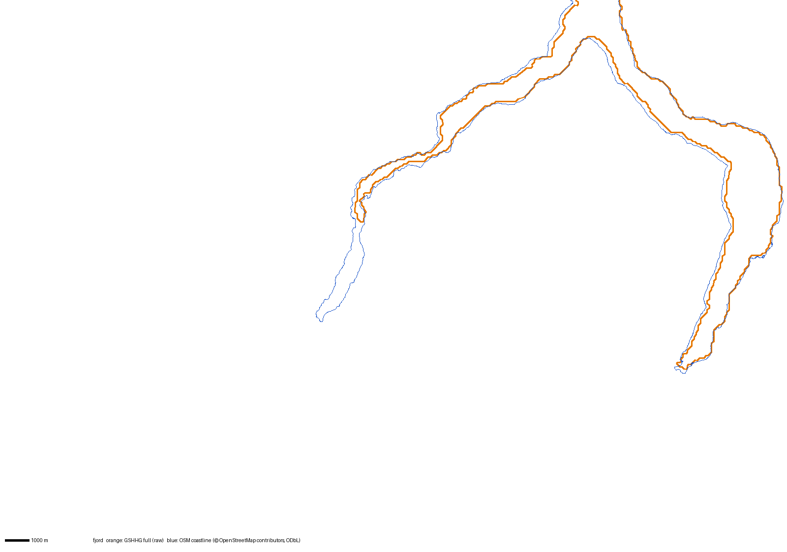
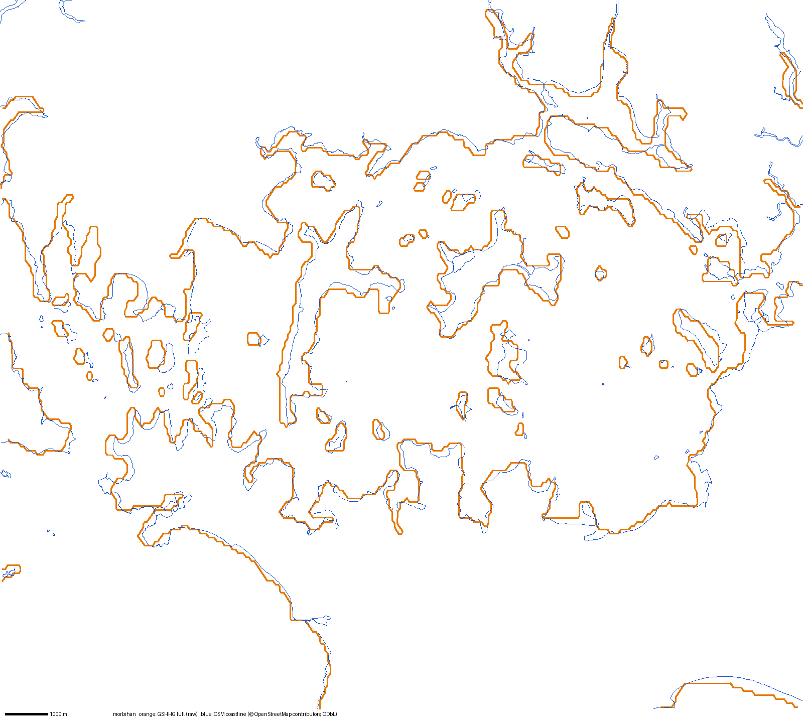
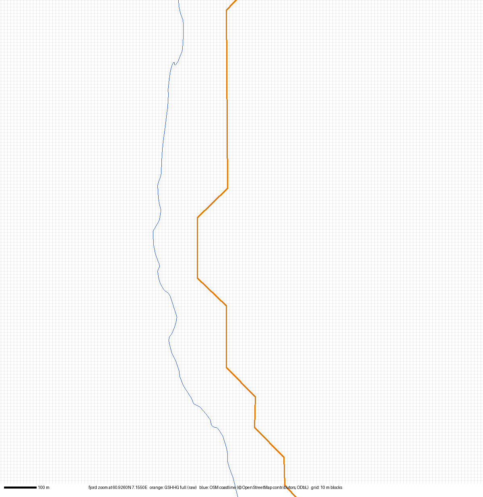
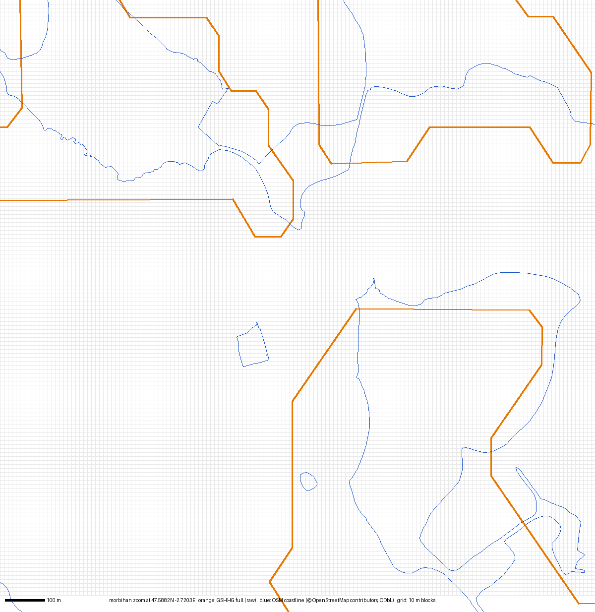
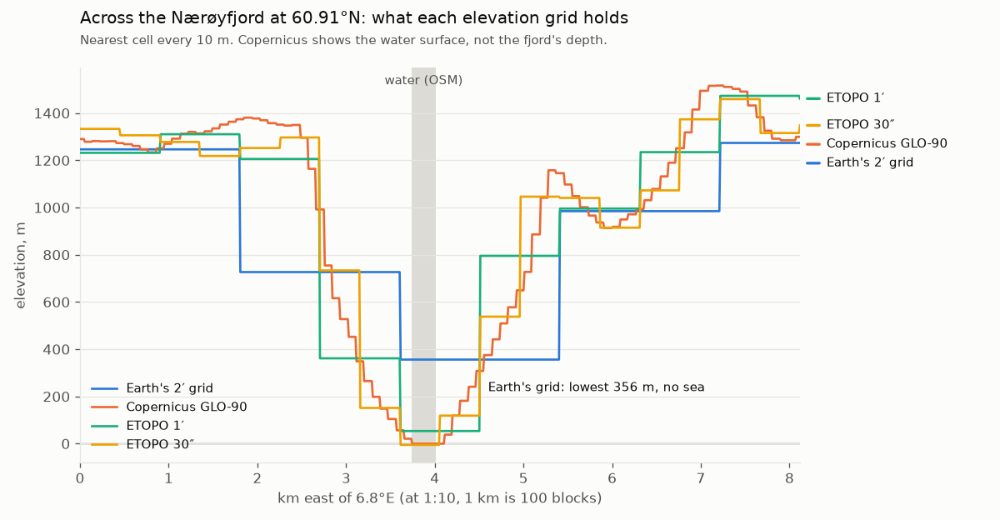

# Coast and elevation sources for a 1:10 Earth, 2026-11-03

**Prompt.** A player on Discord asked for worlds beyond 4M blocks and suggested GSHHG's full resolution would support
them. The user asked about a true 1:10 world (about 10 m per block) with about 1,000 blocks of height. That is a
proposal, not an agreed change. Then:

> problem is our data access or that GSHHG is just raster image

> but that is only coast. What about elevation?

This note answers both questions with measurements. Nothing here changes Earth. The server cost of a 1024-high world
is measured separately in [tall-world-cost-2026-11-03](tall-world-cost-2026-11-03.md).

**Sources:**
- GSHHG 2.3.7 full resolution, level 1 (`rawdata/gshhg/GSHHS_shp/f/GSHHS_f_L1`), the file the bake reads.
- OpenStreetMap `natural=coastline` ways from the Overpass API: the fjord box from overpass-api.de (data of
  2026-11-03), the Morbihan box from overpass.private.coffee (data of 2026-05-31), because the main server was full.
  The raw OSM data is not kept here. The images are © OpenStreetMap contributors, under the ODbL.
- ETOPO 2022 60″ and 30″ surface (`rawdata/ETOPO_2022_v1_60s_N90W180_surface.tif`,
  `rawdata/etopo-30s/ETOPO_2022_v1_30s_N90W180_surface.tif`), and the bake's 2′ downsampling (`tools/bake_earth.py`).
- One Copernicus DEM GLO-90 tile, `Copernicus_DSM_COG_30_N60_00_E006_00_DEM.tif` (60–61°N, 6–7°E; 2.7 MB), from the
  public AWS bucket `copernicus-dem-90m` on 2026-11-03. It is not kept here. The profile chart is produced using
  Copernicus WorldDEM-90 © DLR e.V. 2010–2014 and © Airbus Defence and Space GmbH 2014–2018, provided under
  COPERNICUS by the European Union and ESA; all rights reserved.

Scripts and images are in [coast-and-elevation-sources-2026-11-03/](coast-and-elevation-sources-2026-11-03/).

## GSHHG's staircase is in the source

Earth reads GSHHG correctly: the bake takes the full-resolution file and stores its points at 1/20 000° (5.6 m), finer
than any step in it ([coast-outlines.md](../coast-outlines.md)). The steps are already in GSHHG's own vertices. Southern
Brittany, raw:

```
-2.500833 47.278722
-2.509167 47.278778
-2.510000 47.279583
-2.510917 47.279583
-2.511667 47.280389
```

The points sit on a grid of about 0.00083° (3″), and neighbours share a latitude or longitude: the outline of a raster,
traced. 3″ is about 93 m north–south, and east–west about 63 m at 47°N and 46 m at 60°N. At 10 m per block one step is
about 9 blocks one way and 5–6 the other. GSHHG's README says its land–sea shorelines derive from the World Vector
Shoreline (Soluri and Woodson, 1990).

`gshhg_steps.py`, over larger boxes:

| Box | Edges exactly N–S or E–W | Median edge |
|---|---|---|
| Western Norway, 4.5–7.5°E, 59–63°N | 8% | 127 m |
| Brittany, 5°W–2.5°W, 47.2–48.9°N | 27% | 111 m |

## OSM against GSHHG

`coast_compare.py` clips both to a box and compares them every 5 m along the shore.

| | Fjords (Nærøyfjord, Aurlandsfjord; 60.80–61.00°N, 6.60–7.20°E) | Gulf of Morbihan (47.50–47.65°N, 2.95–2.70°W) |
|---|---|---|
| Points per km of shore, OSM / GSHHG | 64 / 5.6 | 72 / 7.3 |
| Median edge, OSM / GSHHG | 11 m / 130 m | 12 m / 111 m |
| Edges exactly N–S or E–W, OSM / GSHHG | 0.2% / 8% | 0.1% / 39% |
| GSHHG line to the nearest OSM line, median / 90th percentile | 75 m / 174 m | 61 m / 170 m |
| OSM shore more than 100 m from GSHHG | 46% | 32% |

- **OSM is at about block level for 1:10.** It follows headlands, coves and islets that GSHHG doesn't have.
- **GSHHG is out of place, not only stepped.** In the Aurlandsfjord its west shore runs about 100 m (10 blocks at
  1:10) east of OSM's for long stretches. Smoothing the steps, as `CoastLayer.Smooth` does, can't move it.
- **GSHHG stops short of the inner Nærøyfjord.** Its nearest shore is 4.5 km from Gudvangen at the fjord's head; OSM's
  is 32 m away. In game the fjord ends 8 km short ([coast-outlines.md](../coast-outlines.md)). Both shores of that
  stretch, roughly a tenth of OSM's 83 km in the box, are part of the fjord box's 46%.

| | |
|---|---|
|  |  |
|  |  |

[The inner Nærøyfjord](coast-and-elevation-sources-2026-11-03/fjord-zoom.png) has only OSM's line.

### What switching to OSM would take

- **Size.** OSM has about 10× the points per km in both boxes. Scaled from `coasts.bin` (9.5 MB for 5.1 M points),
  that is roughly 100 MB, far over the 40 MB package limit, so it would be a separate data download. The global OSM
  land polygons are reported at about 630 MB (a secondary source; osmdata.openstreetmap.de did not connect from here).
  Both boxes are well-mapped coasts; the ratio elsewhere is not measured.
- **Licence.** A coast file baked from OSM is a derived database under the ODbL: published under the ODbL, with
  "© OpenStreetMap contributors". GSHHG is LGPL.
- **Modern coastline.** OSM has today's harbours, breakwaters and reclaimed land; the Morbihan zoom shows a square basin
  and straight built edges. A world set in 1318 would have to remove them, as Earth already leaves out modern dams.

## Elevation

Earth's `terrain.bin` is a 2′ grid: the mean of 2×2 cells of ETOPO's 1′ (`bake_earth.py`, "downsampling to 2'").
`elev_compare.py` reads the local 1′ and 30″ files, a window at a time.

Highest cell within 0.05° of each summit, in metres:

| Summit | 2′ mean (Earth) | 1′ | 30″ | Real |
|---|---|---|---|---|
| Everest | 7464 | 8157 | 8354 | 8849 |
| K2 | 7349 | 7596 | 8248 | 8611 |
| Aconcagua | 6041 | 6188 | 6666 | 6961 |
| Denali | 5667 | 5770 | 5997 | 6190 |
| Mont Blanc | 3749 | 4169 | 4504 | 4806 |
| Matterhorn | 3398 | 3624 | 3834 | 4478 |
| Fuji | 2666 | 3378 | 3666 | 3776 |
| Galdhøpiggen | 2077 | 2190 | 2282 | 2469 |

Earth's grid has these summits 390–1,390 m low. In game, detail noise and the vertical curve change heights again;
this measures the data only. At 30″ they are 110–640 m low; a sharp peak such as the Matterhorn needs finer data still.

West to east across the Aurlandsfjord at 60.926°N, 7.00–7.32°E (the fjord is near 7.15°E):

| Grid | Cell east–west | Lowest | Highest | Cells below sea level |
|---|---|---|---|---|
| 2′ mean (Earth) | 1.8 km | −139 m | 1,454 m | 1 |
| 1′ | 0.9 km | −351 m | 1,688 m | 3 |
| 30″ | 0.45 km | −386 m | 1,736 m | 6 |

At 2′ the fjord is one cell, a dip between walls that are themselves averaged down.

### The Nærøyfjord in Copernicus GLO-90

`fjord_profile.py` samples a west-to-east line at 60.91°N, 6.80–6.95°E, in all four grids, nearest cell every 10 m.
OSM's coastline puts 275 m of water on the line. The GLO-90 cells there are 90 m east–west by 92 m north–south: above
60°N its tiles have half as many columns (this one is 1,200 × 600).

| Grid | Lowest | Highest | At or below sea level |
|---|---|---|---|
| Earth's 2′ | 356 m | 1,274 m | none |
| ETOPO 1′ | 54 m | 1,473 m | none |
| ETOPO 30″ | −5 m | 1,459 m | 444 m |
| Copernicus GLO-90 | 0 m | 1,517 m | 368 m |



- **Earth's grid has no fjord here.** Its lowest cell is 356 m, a dry valley 1.8 km wide. The coast outline is what
  makes any water; [coast-outlines.md](../coast-outlines.md) has the inner Nærøyfjord as land.
- **GLO-90 has the fjord at about its real width** (368 m at sea level against OSM's 275 m, about one cell wider)
  and walls that rise 1,000 m in about 1.1–1.2 km, step by step, where the coarser grids jump in one or two cells.
- **ETOPO 30″ finds sea level** but its walls are 450 m wide steps.
- **GLO-90 is the water surface.** The fjord is 0 m, with no depth; a fjord floor would come from bathymetry
  (ETOPO, GEBCO), joined at the shore.

### Cell size at 1:10

| Grid | Cell north–south | Blocks per cell at 1:10 | Status |
|---|---|---|---|
| 2′ | 3.7 km | 370 | Earth's `terrain.bin` |
| 1′ | 1.85 km | 185 | local, used by the bake |
| 30″ | 925 m | 93 | local, 1.5 GB |
| 15″ (ETOPO 2022) | 463 m | 46 | NOAA, public domain; not downloaded |
| 3″ (Copernicus DEM GLO-90) | 93 m | 9 | AWS open data; one tile measured above |
| 1″ (Copernicus DEM GLO-30) | 31 m | 3 | AWS open data, a few countries excluded; not downloaded |

- At about 200 m per block the README already lists broad mountains from the 2′ grid as a known issue. A true 1:10
  vertical scale would show the averaging directly: summits short by hundreds of metres, which is tens of blocks, and
  fjords and valleys as smooth dips.
- Copernicus DEM tiles are 1° squares (3600 × 3600 cells at 30 m near the equator). The one GLO-90 tile measured is
  2.7 MB for 1,200 × 600 cells of mountains. All GLO-90 elevation files are 71.1 GB and GLO-30's are 589 GB. Even
  compressed for Earth, GLO-90 is about 9 GB (see [Compressing GLO-90](#compressing-glo-90)), so it needs a separate
  download and a tiled, streamed terrain file, not one 40 MB package.
- Each tile also has a water-body mask (`AUXFILES/*_WBM.tif`; 38 kB for the Nærøyfjord tile). It matches the
  elevation cell for cell under the same licence, so it is a possible coast and lake source beside OSM. Its contents
  were not examined.
- Copernicus DEM is a surface model: it includes forest canopy and buildings, 1–3 blocks at 10 m per block. Its free
  licence requires attribution. Bare-earth versions exist with other licences; their terms were not checked.
- Coasts and elevation must agree. An OSM coast over a 2′ grid would need Earth's coastal profiles as now; a finer
  elevation grid makes both meet more closely.

## Compressing GLO-90

The user asked whether FFT or similar could compress the data, or whether the best compression is already used.
`dem_codecs.py` compresses the same GLO-90 tile (720,000 cells, steep mountains and fjords) several ways.

| Method | Bits per cell | Size | Largest error | RMS error |
|---|---|---|---|---|
| Copernicus file as published (float32, deflate) | 29.7 | 2,669 kB | 0 | 0 |
| 0.1 m steps, MED predictor + Brotli | 8.6 | 772 kB | 0.05 m | 0.03 m |
| 1 m steps, MED predictor + xz | 5.6 | 503 kB | 0.5 m | 0.28 m |
| 1 m steps, JPEG-LS lossless | 4.9 | 440 kB | 0.5 m | 0.28 m |
| 1 m steps, JPEG XL lossless | 4.6 | 412 kB | 0.5 m | 0.28 m |
| 2 m steps, MED predictor + xz | 4.6 | 416 kB | 1 m | 0.55 m |
| 5 m steps, MED predictor + xz | 3.4 | 303 kB | 2.5 m | 1.38 m |
| JPEG-LS near-lossless on 1 m steps (near = 1) | 3.5 | 313 kB | 1.5 m | 0.86 m |
| LERC + zstd, error limit 1 m | 7.1 | 635 kB | 1 m | 0.54 m |
| DCT in 16 × 16 blocks, coefficient step 4 | 4.1 | 370 kB | 15.7 m | 1.12 m |
| DCT in 16 × 16 blocks, coefficient step 8 | 3.0 | 273 kB | 31.7 m | 2.15 m |
| FFT of the whole tile, largest 10% kept (6 bytes each) | 2.4 | 217 kB | 267 m | 11.4 m |

MED is the median edge detector of LOCO-I and JPEG-LS: each cell is predicted from its west, north and north-west
neighbours, and only the remainder is stored.

- **The published files are not compressed for a game.** They keep float32 heights exactly, sub-millimetre noise
  included, at about 30 bits per cell.
- **Rounding, then prediction, is the method that fits.** 1 m steps change no column by more than one block at 10 m per
  block (4.7% of columns move by one, where they were within 0.5 m of a block edge). With prediction they take 4.6–5.6
  bits per cell, 5–6× less than published, with a guaranteed error limit. MED + Brotli is the same family as
  `terrain.bin` (log-quantised, Brotli per tile), and .NET has Brotli built in. JPEG XL and JPEG-LS save another
  15–20% but would need native libraries in the mod.
- **FFT and DCT lose on terrain.** Fjord walls and cliffs are sharp edges, and a transform spreads each edge over the
  whole block or tile as ripples. At sizes like the prediction coders', DCT blocks are off by up to 16–32 m, and the
  FFT by hundreds of metres even with 10% of its coefficients kept.
- **LERC**, the error-bounded GIS codec, is larger than the prediction coders here at the same error limit.

Global GLO-90 has roughly 18 billion land cells (about 149 million km² at about 90 × 90 m). If all land were as rugged
as this tile:

| Storage | Global GLO-90 |
|---|---|
| As published | about 68 GB |
| 1 m steps, MED predictor | about 13 GB |
| 1 m steps, JPEG XL lossless | about 10.5 GB |
| JPEG-LS, 1.5 m error limit | about 8 GB |

These are upper bounds. The 100-tile sample below measures the real size.

### Measured on 100 random tiles

The bucket's own listing (`bucket_size.py`, metadata only) gives the published sizes:

| | GLO-90 | GLO-30 |
|---|---|---|
| Elevation tiles | 26,475 | 26,450 |
| Elevation files (`*_DEM.tif`) | 71.1 GB | 589 GB |
| Whole bucket (masks, previews, documents) | 185 GB | 1.38 TB |

`glo90_sample.py` picked 100 of the 26,475 GLO-90 tiles at random (seed 20261103) and downloaded them, 278 MB, to
`rawdata/copernicus-glo90-sample/` (not versioned). `glo90_measure.py` compressed each at 1 m steps and scaled the
sample's compressed share of the published bytes to all 71.1 GB, with a bootstrap 95% interval over tiles:

| Storage | Bits per cell | All GLO-90 | 95% interval |
|---|---|---|---|
| As published | 21.1 | 71.1 GB | — |
| 1 m steps, MED + xz | 2.57 | 8.6 GB | 7.9–9.4 GB |
| 1 m steps, MED + Brotli | 2.67 | 9.0 GB | 8.2–9.7 GB |
| 1 m steps, JPEG XL lossless | 2.08 | 7.0 GB | 6.3–7.7 GB |

| Tiles by mean neighbour miss | Tiles | Bits per cell, MED + xz |
|---|---|---|
| Flat, under 1 m (plains, deserts, ice sheets, open water) | 56 | 1.10 |
| Hilly, 1–5 m | 30 | 3.28 |
| Mountains, 5 m and more | 14 | 5.22 |

- **All GLO-90 is about 9 GB in Earth's own kind of format** (MED + Brotli, which .NET reads), about 8× less than as
  published and a third below the rugged upper bound. None of it comes near the 40 MB package limit.
- **The files hold about 27.8 billion cells**, more than the land estimate: coastal and island tiles are mostly sea,
  stored as 0 m. Tiles that are all sea, or all the Caspian's −28 m surface, compress to almost nothing.
- **The Norwegian tile is among the most expensive.** Only eight sampled tiles exceed 5 bits per cell: Tibet, the
  Loess Plateau, the hills between Bangladesh and Myanmar, Patagonia, Balochistan, Laos, the Altai and one in the
  Amazon (S07 W057, top 446 m). The Amazon tile is rugged only in the surface model: forest canopy, which a
  surface model includes, makes neighbouring cells differ.

### Bigger tiles or bigger cells

`tile_size.py`, same tile, 1 m steps, MED + xz:

| Compression tiles of | Bits per cell |
|---|---|
| 0.0625° (37 × 75 cells) | 5.96 |
| 0.125° (75 × 150) | 5.61 |
| 0.25°, 0.5° and 1° | 5.58–5.59 |

| Cells (mean of k × k) | Bits per cell | Size, share of 90 m | Global, rugged upper bound |
|---|---|---|---|
| 90 m | 5.6 | 100% | about 13 GB |
| 180 m | 6.6 | 30% | about 3.9 GB |
| 270 m | 7.3 | 14% | about 1.8 GB |
| 360 m | 7.8 | 9% | about 1.2 GB |
| 540 m | 8.8 | 4% | about 0.5 GB |

- **Bigger tiles don't help.** The predictor only looks at neighbouring cells, so beyond about 0.125° a tile's edges
  cost nothing measurable; 1° tiles are already as good as it gets.
- **Bigger cells do, almost in proportion to the cell count.** Each coarse cell is less predictable, so bits per cell
  rise, but there are 4× fewer cells at twice the size. The cost is detail: at 180 m (18 blocks at 1:10) the 275 m
  Nærøyfjord is under two cells wide, and at 270 m it is gone.
- **Prediction already adapts to flat land.** Where neighbours agree, the leftovers are near zero and cost almost
  nothing: the sample's flat tiles take 1.1 bits per cell, so plains need no separate coarse layer. Keeping 90 m only
  near steep relief and coasts would mainly help in rugged tiles like this one.
- The global column scales this tile's ratios to its rugged upper bound. Flat tiles were not measured at coarser cells.

Two things reduce what a world needs:

- **Resolution by world scale.** A world needs data at about its block size: 90 m data for 1:10, nothing finer than
  ETOPO's 30″ or 15″ for the 256k world (about 200 m per block). One pyramid of resolutions can serve every size.
- **Tiles on demand.** The Copernicus tiles are free from a public bucket in 1° squares. A server could fetch a tile
  when it first generates terrain there, convert it to Earth's own format (about 0.4 MB for this tile at 1 m steps)
  and cache it. The dataset version would have to be pinned so terrain cannot change between chunks. Clients receive
  generated chunks: Earth's client loads only the climate files, not `terrain.bin` (`EarthMapSystem.OnParams`,
  `LoadData(false)`), so only the server needs the elevation. In singleplayer that server is the player's own machine.
  - Without a connection a missing tile can't be fetched, and generating that chunk from the 2′ grid instead would
    leave a seam once the tile arrives. Such a world would have to wait for the tile, or download its region in
    advance (at world creation, or as regional packs).

## Reproduce

From `Earth/`, with the bake's virtual environment:

```bash
python -I docs/research/coast-and-elevation-sources-2026-11-03/gshhg_steps.py rawdata/gshhg/GSHHS_shp/f/GSHHS_f_L1 4.5 59 7.5 63
```

```bash
curl -s --data-urlencode 'data=[out:json][timeout:90];way["natural"="coastline"](60.80,6.60,61.00,7.20);out geom;' https://overpass-api.de/api/interpreter -o fjord.json
```

```bash
python -I docs/research/coast-and-elevation-sources-2026-11-03/coast_compare.py fjord fjord.json rawdata/gshhg/GSHHS_shp/f/GSHHS_f_L1 60.80 6.60 61.00 7.20 docs/research/coast-and-elevation-sources-2026-11-03 60.926 7.155 zoom-aurlandsfjord
```

```bash
python -I docs/research/coast-and-elevation-sources-2026-11-03/elev_compare.py rawdata/ETOPO_2022_v1_60s_N90W180_surface.tif rawdata/etopo-30s/ETOPO_2022_v1_30s_N90W180_surface.tif
```

```bash
curl -s -o Copernicus_DSM_COG_30_N60_00_E006_00_DEM.tif https://copernicus-dem-90m.s3.amazonaws.com/Copernicus_DSM_COG_30_N60_00_E006_00_DEM/Copernicus_DSM_COG_30_N60_00_E006_00_DEM.tif
```

```bash
python -I docs/research/coast-and-elevation-sources-2026-11-03/fjord_profile.py rawdata/ETOPO_2022_v1_60s_N90W180_surface.tif rawdata/etopo-30s/ETOPO_2022_v1_30s_N90W180_surface.tif Copernicus_DSM_COG_30_N60_00_E006_00_DEM.tif fjord.json 60.91 6.80 6.95 docs/research/coast-and-elevation-sources-2026-11-03/naeroyfjord-profile.png
```

```bash
python -I docs/research/coast-and-elevation-sources-2026-11-03/dem_codecs.py Copernicus_DSM_COG_30_N60_00_E006_00_DEM.tif
```

```bash
python -I docs/research/coast-and-elevation-sources-2026-11-03/tile_size.py Copernicus_DSM_COG_30_N60_00_E006_00_DEM.tif
```

```bash
python -I docs/research/coast-and-elevation-sources-2026-11-03/bucket_size.py copernicus-dem-90m copernicus-dem-30m
```

```bash
python -I docs/research/coast-and-elevation-sources-2026-11-03/glo90_sample.py rawdata/copernicus-glo90-sample 100 20261103
```

```bash
python -I docs/research/coast-and-elevation-sources-2026-11-03/glo90_measure.py rawdata/copernicus-glo90-sample
```

The Morbihan box is 47.50 −2.95 47.65 −2.70; without a zoom centre the script picks the 1.5 km square with the most OSM
shore more than 50 m from GSHHG. `elev_compare.py` and `fjord_profile.py` share the windowed ETOPO reader in
`etopo_grid.py`.
