# Dams taken out of GLO-90 (prototype and global bake)

Date: 7 November 2026 (night). Asked by the tall line's session, after tall.18: finish taking modern dams out of new
Earth worlds on full GLO-90 heights, starting with a proposal and a prototype, not a release. Proposed as
[0053](../decisions/0053-scales-included-glo90-and-glo90-rivers.md) item 19. The author then asked for the global
bake ([below](#the-global-bake)), then for the second pass, which wires it into new worlds for a test build
([below](#second-pass-8-november-the-shore-below-a-dam-wall-ends-jebel-aulia-bridges-new-worlds)). Committed on
`claude/tall-glo90` at the author's word; not agreed, published or released.

## What tall.18 leaves of a dam

Items 17 and 18 leave the reservoirs' water out (no modern dams in 1318): the lakes file drops HydroLAKES reservoirs,
and the river file drops the river pixels of 5,919 of the 6,687 HydroLAKES reservoirs, found from their dams. GLO-90
itself still has what the dams made:

1. **The dam walls.** A dam is a ridge across the valley in GLO-90: Three Gorges' crest at 185 m over the Yangtze at
   62 m below it, Gezhouba's up to 89 m over 40 m, the Riga HPP's up to 27 m over the Daugava at 1–2 m.
2. **Flat reservoir floors.** GLO-90 is a surface model and its water is flattened, so where the reservoir's water is
   left out the land is a plain at the reservoir's level, cut only by the course's channel.
3. **Steps at the dams.** The courses' levels come from GLO-90 (`rivers-glo90.bin`, snapped and armed), so a course runs
   flat through a reservoir and drops at its dam: at 1:10 (height 1024, linear) the Daugava steps 110 → 109 at the Riga
   HPP, the Yangtze 9 blocks at Three Gorges (124 → 115) and 2 at Gezhouba.
4. **Reservoirs that stay** (768): 417 whose flat water by the dam is more than twice their area (water joined to a
   neighbour's or to a lake they raised: Lake Marion and Lake Moultrie, the Sheksna reservoir) and 351 not found (no
   flat water of the size needed by the dam; the largest are regulated natural lakes the mask has as lakes: Habbaniyah,
   Leech Lake, Coeur d'Alene, Kissimmee).
5. **Other modern water in the mask:** canals, harbours, dredged channels. Not handled here: some canals are older than
   1318 (the Grand Canal), so this needs a dated list, not a rule.

## The prototype

`tools/bake_dam_removal.py OUTDIR COURSES.bin name:latS:latN:lonW:lonE ...` works on one mosaic per area (GLO-90 and
its water mask at 1,200 pixels a degree both ways), for the HydroLAKES reservoirs whose pour points lie inside. GRanD
is not used (not on disk; its download would need the author's yes).

1. **Reservoirs.** Each is found from its pour point (its dam) as `bake_river_outlines.py` finds it: the highest flat
   water by the dam, then up in half-metre steps to 3 m above it. If it is still under 0.8 times its HydroLAKES area,
   it goes on rising to 30 m (Three Gorges' upper reaches: 11 m, 687 of 853 km²).
2. **Dam walls.** A wall is ground within 2 km of the pour point that is within 300 m of both the reservoir and the
   water or ground below the dam (at least 1 m lower; another reservoir's water counts: a cascade). It must stand no
   more than 30 m above the reservoir's level: Three Gorges' crest is 30 m above the water GLO-90 has, and higher
   ground there is the valley's side.
3. **Courses.** Each run of course stations through the reservoirs and walls falls evenly by length between knots:
   - the level where the river comes in (the station above, or where another run left it);
   - at each dam, the foot: the lowest level within 2 km below it, but not below the ground just below the dam (less
     a metre; added for the global bake, where the river below a mountain dam falls on steeply). A run that leaves its
     reservoir short of the dam (water by the dam at other levels, locks, islands) is followed on to the station
     nearest the pour point;
   - where a tributary's run ends, its main river's new level (within 5 km).

   Levels are never raised and never rise downstream, and stations on the step's ramp below a dam take the foot's
   level. A cascade falls dam to dam.
4. **Walls come down** to the valley's cross-section a short way below them: the highest ground 300–600 m downstream,
   square to the wall's line, plus half a metre. Across the river that is the riverbed; at its ends, the valley's
   sides. Where that ground is the next reservoir (a cascade), its height above that reservoir's level is set on the
   course's foot at the dam. (The lowest ground there brought the walls further down, 11.7 m above the river below on
   average, but dug pits into the valley sides at Three Gorges where a wall's end looks down onto the river.)
5. **Valley floor.** The courses (their new level plus half a metre) and the walls are fixed. Between them and the
   ground just outside (shores, islands, the water below the dam), a smooth harmonic surface. A reservoir without a
   course falls from its shore by 10 % to the foot of its dam, its walls capped as in 4. Nothing is raised above GLO-90.
6. **Output.** `dams-glo90-1.bin` (`EMDM`):
   - per GLO-90 square, the points that change, as whole metres;
   - the lowered course levels, keyed to the course list they were made for (`DamRemovalData.KeyOf`: FNV-1a over river
     courses 3 as a world builds them).

   The bake also writes `dams.tsv` (per reservoir), a preview, and `reservoirs-dams.npz`: the river pixels of its own
   reservoirs. With that file, `bake_river_outlines.py` leaves the same reservoirs out of the river outlines (its filter
   now takes several tile names, comma-separated).

In the mod (prototype, `src/Core/DamRemoval.cs`):

- `FineElevation.Dams` lowers a square's heights as the square loads, before anything reads them.
- `EarthParams.BuildModel(data, dams)` lowers the courses when the key matches. Otherwise it leaves them and says why
  (`DamCourseError`).
- Both are gated by `EarthParams.DamRules` (ProtoMember 105), which is 0 in every world: nothing gives it to new worlds
  yet, and no published file exists.

### The two test areas

| | Riga (56–58° N, 23–27° E) | Yangtze (29–32° N, 105–112° E) |
|---|---|---|
| Reservoirs | 3, all found | 76: 68 found, 4 wider than twice their area, 4 not found |
| Zone (reservoirs and walls) | 17,475 px, walls 218 | 157,110 px, walls 2,366 |
| Course stations lowered | 137 (2 on ramps below dams) | 1,657 (33 on ramps) |
| Ground lowered | 4.8 m on average, at most 36.5 m | 8.8 m, at most 128.7 m |

The courses through the cascades:

- **Daugava:**
  - from the Pļaviņas reservoir's head, 73 m → 33 m at its dam (41.5 km);
  - below Ķegums' head, 26 m → 17 m at the Ķegums dam (20.6 km) → 1 m at the Riga HPP (53.7 km).
- **Yangtze:** 166 m above Chongqing's reach → 64 m at Three Gorges (512.5 km) → 40 m at Gezhouba (551.5 km).

The walls: on average 38.4 m above the river below their dam before, 21.9 m after (71 walls; a wall's mean includes its
ends on the valley sides).

| Dam | Wall px | Wall mean, m | Highest, m | River below, m |
|---|---|---|---|---|
| Three Gorges | 41 | 169.8 → 94.8 | 184.9 → 182.9 | 62.5 |
| Gezhouba | 34 | 68.1 → 54.9 | 88.7 → 68.1 | 40.0 |
| Riga HPP | 68 | 16.9 → 10.7 | 26.7 → 19.4 | 1.5 |
| Ķegums | 55 | 34.1 → 32.4 | 46.5 → 42.3 | 17.0 |
| Pļaviņas | 95 | 72.0 → 68.7 | 80.8 → 77.2 | 32.0 |

The highest points left are the walls' ends on the valley sides. Where the course crosses a wall it is at the river's
level (its pins), so no wall stands across a river.

The file for both areas: 57,061 bytes, 21 squares, 73,364 GLO-90 points lowered, 1,794 course levels; sha256
`92a37d97590fd89afcdbab80a9cb2e50b85a373728f6f24512ae6d317be7590b`.

## The global bake

`tools/bake_dam_removal.py OUTDIR COURSES.bin --global 16`, every HydroLAKES reservoir, on 16 workers:

1. **Regions** (7 minutes). Each reservoir's region is found on a mosaic of 3 × 3 squares round its dam. While it
   reaches the mosaic's edge, the mosaic grows to 5 × 5, 7 × 7, then 9 × 9: 21, 4 and 3 reservoirs needed them.
2. **Groups.** Reservoirs whose regions or dams lie within 12 km of each other are done together on one mosaic, so a
   cascade's walls, feet and courses see each other. That gives 4,052 groups: most cover one square, the largest 32
   (the Angara's Bratsk and Ust-Ilimsk; the Volga's Kuybyshev and Saratov). The Volgograd reservoir's region stops
   more than 12 km below the Saratov dam, so it is a group of its own.
3. **Bake** (5 minutes). The prototype's rules per group. A square two groups touch keeps the lower height of each
   point, and a course station keeps the lower level.

The prototype's areas come out the same. Two reservoirs the prototype cut at its areas' edges (at 105° E and 112° E)
are now whole, and the course levels are the same 1,794. Walls move by a pixel's rounding at a few small dams.

The first global run showed a fault at Guatapé (Colombia). The course below the dam falls 1,834 → 1,538 m within
2 km, so the foot (the lowest level within 2 km) put the course 333 m under the reservoir: a trench through its flat.
The foot is now no lower than the ground just below the dam (the 10th percentile within 600 m of the reservoir, less
a metre). That gives 1,760 m there, and the deepest cut is 111 m. The rule holds 820 of the 1,407 feet. It changes
none in the prototype's areas, where foot and ground below agree to the metre (Three Gorges 64 and 62.5, Gezhouba 40
and 40).

| | Global bake |
|---|---|
| Reservoirs | 6,687: 5,919 found (1,756 risen past 3 m), 417 wide, 351 not found (the same as item 18) |
| With a wall | 5,624 (295 found without one) |
| Ground lowered under a reservoir | median of the means 4.9 m (90th percentile 13.5 m); deepest 199.5 m (Sayano-Shushenskaya, a 245 m dam) |
| Deepest over 150 m | 6 reservoirs, all behind dams over 190 m high: Sayano-Shushenskaya, Ertan, Nurek, Dworshak, Chicoasén, New Bullards Bar |
| Walls, mean above the river below | 33.8 m before, 19.4 m after (medians); 61 walls still more than 100 m above it |
| `dams-glo90-1.bin` | 4,245,225 bytes, 2,604 squares, 13,197,769 points lowered, 69,387 course levels; sha256 `29de8f74f413fa959f71121ee64f169cde4df3aa68a8aec5ef1a98cb072768a8` |
| River outlines rebaked (3 minutes) | 30,282,208 bytes, 2,307,573 reservoir river pixels left out (tall.18: 30,314,258 bytes, 2,067,317); sha256 `139f7a9b46beaca80919b5f2a4e0df74395568fcad8432e2acc8f4df5273e4bb` |

One reservoir still reaches the 9 × 9 mosaic's edge: Jebel Aulia on the White Nile. Its region rises the full 30 m
along a river that barely falls, and is cut at that edge, four squares from the dam's (666 of 934 km²).

## Probes

Setup:

- **Harness:** a scratch probe harness (`damlook`) runs the mod's own terrain model on the whole GLO-90 store at 1:10
  (W 5,009,920, 10 m a block), map height 1024 with linear heights.
- **Before:** tall.18's rules and files.
- **After:** the dam file, with the river outlines rebaked from the dam bake's reservoirs for the 79 squares it
  touches. 1,794 course stations are lowered (the key matched).

"Steps" count river columns beside water lower by one block, or by two or more.

| Window (blocks) | One-block steps | Two-block steps | Columns lowered (mean, most) |
|---|---|---|---|
| Riga HPP (2,000) | 388 → 356 | 0 → 0 | 148,930 (1.0, 2) |
| Ķegums (1,600) | 26 → 0 | 0 → 0 | 31,951 (1.0, 1) |
| Pļaviņas (1,600) | 104 → 0 | 0 → 0 | 117,208 (2.4, 4) |
| Three Gorges (2,000) | 1,232 → 131 | 0 → 0 | 318,729 (6.0, 10) |
| Gezhouba (1,600) | 559 → 265 | 44 → 0 | 202,889 (1.7, 3) |
| Badong (2,000), in the Three Gorges reservoir | 0 → 131 | 19 → 19 | 393,580 (7.2, 9) |

- **Steps.** The one-block steps left at Three Gorges and Badong are the river's own fall, one block at a time, where
  tall.18 had flat reservoir water. In the Riga HPP window, the step at the dam itself is gone (23 columns at 110).
  The rest are 2 km south-west of the dam, where a side channel at 109 meets water at 108, the same before and after.
  Badong's 19 two-block steps are the same before and after.
- **No new spills:** river water beside lower dry ground is unchanged (one face at Riga, none elsewhere).
- **Cost unchanged:** 0.36–0.48 µs per column before and after. The heights are lowered once per square as it loads.
- **Raised columns** (140–11,674 a window): water the rebaked outlines leave out, where tall.18's river bed was lower
  than the rebuilt ground. At Three Gorges, river columns go 236,414 → 227,576.

Profiles (block heights; sea 110):

- **The Yangtze from Badong to Yichang:**
  - before, its water at 125 → 124, then down 9 blocks at Three Gorges and 2 at Gezhouba;
  - after, 117 → 112, a block at a time.

  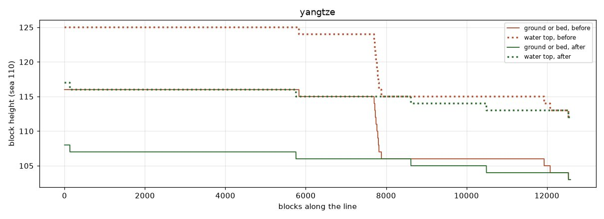
- **The Daugava from above Pļaviņas to Riga:** before 116 → 112 at Pļaviņas, then 111 → 110 → 109; after 113 → 109, a
  block at a time.

  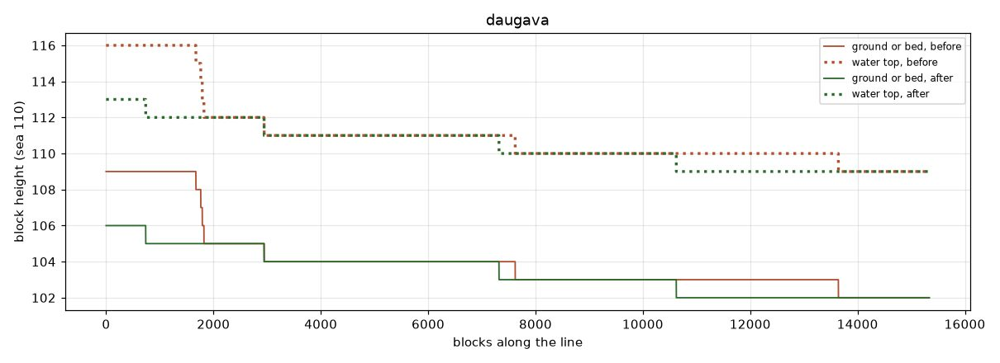
- **Across the valley at Three Gorges and at Badong:**
  - the water falls 119 → 115 at Three Gorges and 125 → 117 at Badong;
  - GLO-90's flat at the reservoir's level becomes the valley's sides down to the river.

  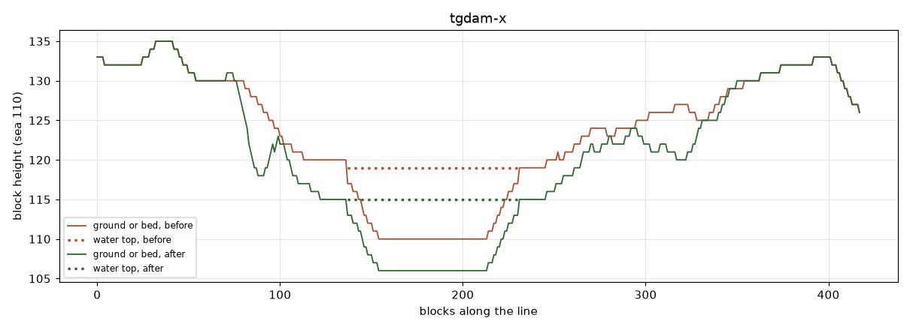
  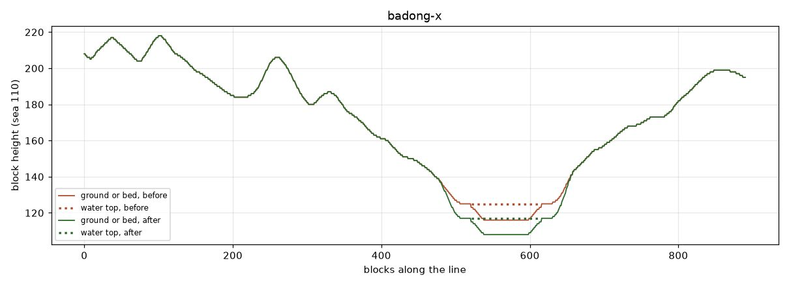

Close-ups (blocks, relief shading; before left, after right):

- **Three Gorges:**
  - the dam's lines across the valley are gone, and the river falls through;
  - two small knobs remain where the wall's ends meet the valley's side.

  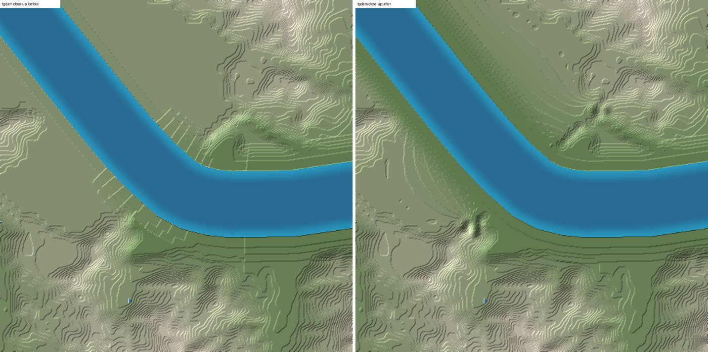
- **Gezhouba:**
  - the step is gone;
  - the shore of the water below the dam is still the dam's straight downstream face, where it meets the course's
    channel (narrower than the mask's water below).

  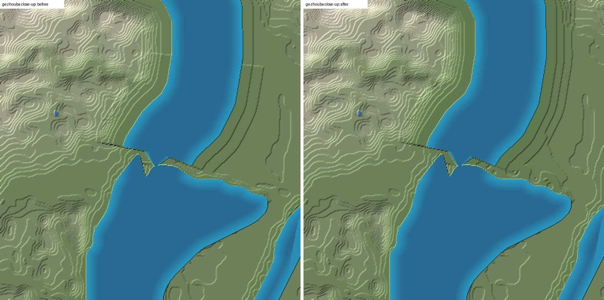
- **Riga HPP:** the wall's lines are gone; the course's channel above the dam meets the mask's Daugava below it at one
  level.

  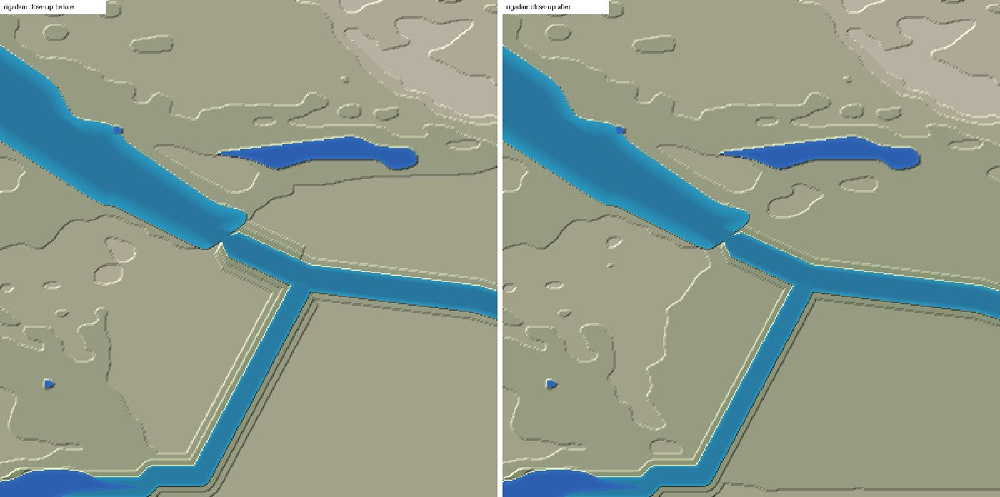
- **Pļaviņas:** the reservoir's flat becomes a valley round the river; the river narrows where the mask's water below
  the dam meets the course's channel.

  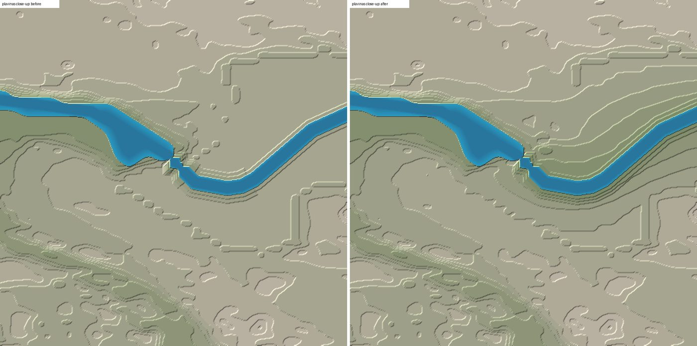
- **Wider views, 20 km across** (Three Gorges' dam and Badong in its reservoir):

  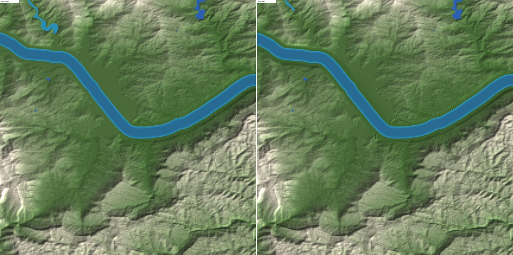
  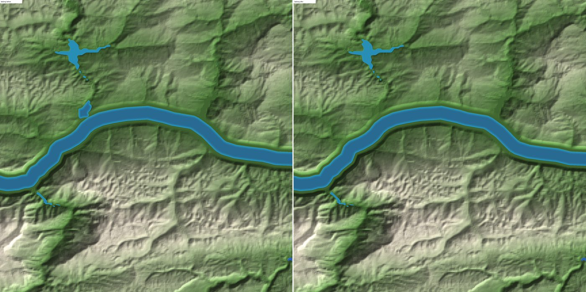

### Probes of the global files

The same harness, with the global dam file (with the foot rule) and the global river outlines rebaked from it; 69,387
course stations lowered.

| Window (blocks) | One-block steps | Two-block steps | Columns lowered (mean, most) | River beside lower dry ground |
|---|---|---|---|---|
| The prototype's six | the same as above | the same | the same within 0.1 % (Riga 149,003, most 3) | the same |
| Zhiguli, Kuybyshev reservoir (2,000) | 601 → 0 | 57 → 0 | 240,805 (1.9, 3) | 0 → 0 |
| Volgograd (2,000) | 807 → 96 | 0 → 0 | 562,007 (2.3, 7) | 4 → 0 |
| Sayano-Shushenskaya (2,000) | 886 → 39 | 0 → 0 | 204,406 (11.8, 21) | 0 → 0 |
| Hoover (1,600) | 374 → 27 | 0 → 0 | 287,015 (5.5, 14) | 0 → 0 |
| Aswan High Dam (2,000) | 466 → 248 | 0 → 0 | 361,918 (3.1, 8) | 14 → 12 |
| Kariba (2,000) | 309 → 40 | 0 → 0 | 950,753 (5.1, 10) | 6 → 0 |
| Nurek (2,000) | 644 → 378 | 0 → 0 | 485,945 (6.5, 16) | 1 → 1 |
| Guatapé (2,000), no river in the window's outlines | 0 → 0 | 0 → 0 | 43,503 (2.9, 18); first run 77,814 (6.2, 40) | 0 → 0 |

- **Sayano-Shushenskaya:**
  - the reservoir's flat becomes slopes down to the river;
  - the gap in the river's water at the dam stays: the mask has no water on the crest (see "the shore below a dam",
    below);
  - across the dam, the water falls 148 → 142 and the ground along the wall's line 150–151 → 143.

  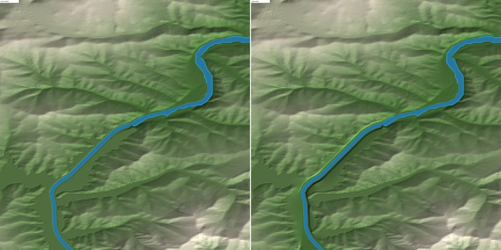
  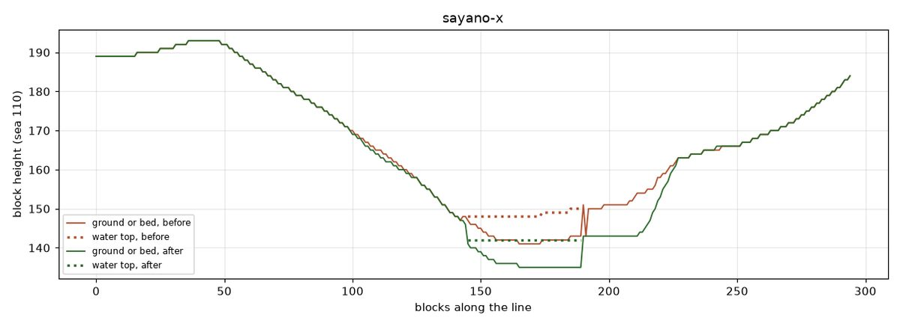
- **Nurek:** the reservoir's long flat becomes a valley floor falling to the river from both sides.

  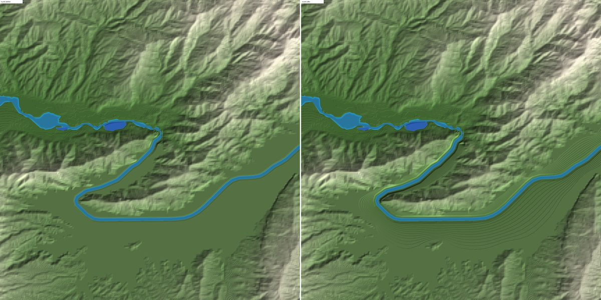
- **Guatapé:**
  - with the foot rule, a channel at most 18 blocks deep runs through the reservoir's flat (40 in the first run);
  - much of the flat stays near the reservoir's level.

  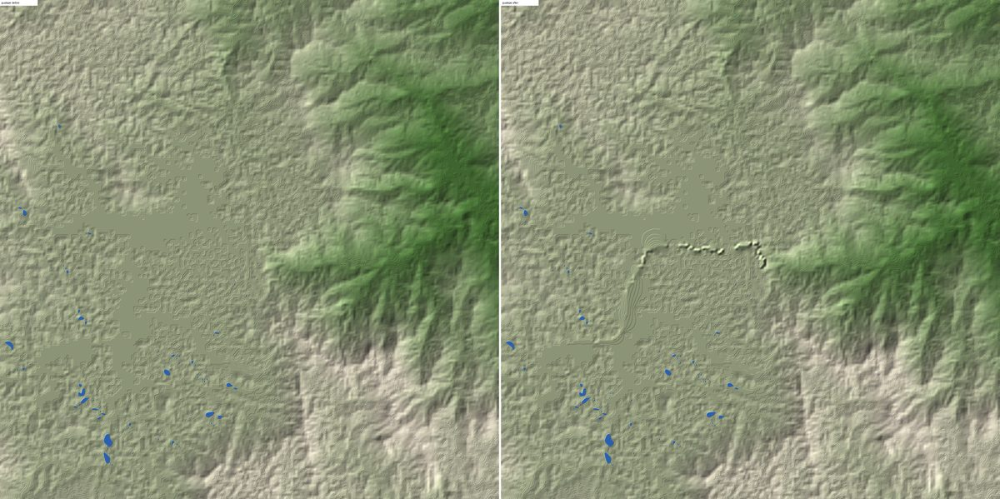

The EarthMapTests suite (this worktree, with these changes; `DamRules` is 0, so the suite does not use the file):

- 256: only 4M Dalmatia fails;
- 384: only Lake Geneva fails;
- 384 with COURSES=3: water walls, the Tagus and Lake Geneva fail.

These are the known failures. Against tall.18's runs, every check line is the same except tall.19's six new
geothermal checks, which pass.

## Second pass (8 November): the shore below a dam, wall ends, Jebel Aulia, bridges, new worlds

The author asked to close the first pass's three open points and to wire the dams into new worlds for a test build.
The parent session added the bridges the mask has as land, in the same new river-outline file. The author had seen
one at 1:10 at Riga.

### River corridors (the shore below a dam)

The first pass left the reservoir's river water out and let the course's channel run through. Where that narrower
channel met the mask's water below the dam, the shore was the dam's straight face. At Sayano-Shushenskaya the river's
water had a gap on the crest.

Rule 5 of the bake now lays a **river corridor** along each course run that is the river through a zone: one that
reaches a dam, or one with at least half the flow of the largest run in its reservoir:

- **Width:** as wide as the mask's river where the course comes in or goes out. That is the median, over the course
  stations within 3 km outside the zone, of the river water's half width there. Only river water counts, not lakes or
  other reservoirs. Where neither end has any, the half width is 3 m times the root of the flow.
- **Limits:** inside a zone the corridor is at most half the old water's width there, smoothed over 1 km along the
  river. It lies only on the mask's old water and on the dams, and reaches 3 pixels beyond the zone to meet the river
  below.
- **Level:** the rebuilt floor holds the corridor at the course's new level plus half a metre, as it held the course
  line before. On the line alone, the floor stood up to 20 m over the corridor's edges, as a trench with vertical
  walls at Badong.
- **Into the outlines:** the bake writes the corridors to `corridors.npz`. `bake_river_outlines.py` adds them to the
  river outlines as river at the course's level, so the river keeps its width through a former reservoir and across
  its dam.

- **Tributaries keep their courses' channels**, as in the first pass:
  - The first global run laid corridors along every run, tributaries too.
  - At Kariba that gave 120 two-block river steps at 1:10, where there had been none. They lie in a tributary's corridor
    in an arm of the old reservoir, 9 km south-west of the dam.
  - The model draws an outline's water at its course's pools. That tributary falls about 7 m a kilometre through the
    old reservoir, so its pools step two blocks at a time, now across a corridor 450–700 m wide.
  - The river through the dam, which the first pass's shores were about, keeps its corridor.
  - The second global run laid corridors only along the runs that reach a dam. That left Jebel Aulia's White Nile
    without one: no wall is found there (the river falls too little), and the course leaves the old reservoir and comes
    back in 11 runs. A run with at least half the flow of its reservoir's largest run now has one too. At Kariba the
    tributary above has 85 m³/s against the Zambezi's 1,133 and keeps its channel; two runs of the Zambezi at the
    reservoir's head (1,083 m³/s) get corridors.

A reservoir's zone also closes gaps of one or two pixels (`ZONE_GAP`), so a bridge across a reservoir is rebuilt with
its floor rather than left standing.

### Wall ends

The measure here is a wall's mean height after the bake, against the ground below the dam (the lowest tenth within
600 m of the reservoir). The first pass left 61 walls more than 100 m above it; the median was 19.4 m.

- **Tried: the dam's downstream face added to the wall** (rule 3: ground below the reservoir's level but more than 5 m
  above the water below, within 1 km downstream and 100 m beyond the wall's ends):
  - In the first global run of this pass it made walls higher, not lower. 3,792 walls stood higher than in the first
    pass and 669 lower; walls more than 100 m above the river below went 61 → 139.
  - The rule is off (`FACE_REACH` 0). The code stays.
- **Tried: the walls filled with the reservoirs' floors** (no height of their own, their ends meeting the valley's
  sides, the valley below and the floor above): walls more than 100 m above went 61 → 122, the median 19.4 → 23.1 m.
  In zones with no course through them (most of the Alps' small reservoirs) the floor is the shore's height falling
  10 % from the nearest ground outside the zone, and a wall's nearest ground is the hillside beside it.
- **Back to the first pass's rule** (rule 1): each wall pixel comes down to the highest ground 300–600 m below it,
  square to the wall's line, plus half a metre. It is fixed in the fill where a course runs, and a cap elsewhere.
  Globally, walls more than 100 m above the river below are back to 62 (35 of them in zones with no course), the
  median 19.2 m. Before the bake there were 243.
- **What stays high is not a ridge.** On one Alpine square, across the middle of each wall (heights in metres, before
  → after):

  | Dam | Reservoir | Wall | 200–300 m below | 600 m below | Wall mean |
  |---|---|---|---|---|---|
  | 1353362 (46.61° N 8.32° E) | 1,837 | 1,837 → 1,745, 1,837 → 1,703 | 1,777, 1,744 | 1,451 | 1,852 → 1,747 |
  | 1354169 (46.43° N 8.44° E) | 2,214 | 2,238 → 2,147 | 2,262, 2,226 | 2,066 | 2,229 → 2,122 |
  | 1353930 (46.48° N 8.57° E) | 2,302 | 2,311 → 2,266, 2,325 → 2,266 | 2,269 (wall), 2,257 | 2,293 | 2,315 → 2,245 |

  The walls lie at or below the ground just downstream. That ground is a natural rock step, and the gorge below it
  falls 300 m within 600 m, so the measure still counts these walls as high. The rest of a wall's mean is its ends on
  the valley's sides, which the rule leaves as hillside.
- **Not done:** the floor of a zone with no course stays near the old water's level (1353362's reservoir at 1,837 m
  across its middle), so where the wall comes down further it is a dip: 1354169's wall pixel at 2,147 m lies 67 m
  below the floor just upstream. A course line drawn through such zones would let the fill bring the floor down too.

### Jebel Aulia

Pass 1's mosaics now grow to 15 × 15 squares (`MOSAIC_R` up to 7). A region found earlier on a smaller mosaic and
still at its edge is found again.

Jebel Aulia's region is now whole: 788 km² of its 934 km², risen 15 m (cut at 666 km² before). No reservoir reaches
its mosaic's edge.

No wall is found there: within 2 km of the dam nothing lies a metre below the reservoir. The course falls only 372 →
370 m through it. What changes is the river: the White Nile runs on through the old reservoir in corridors along 11
runs (17,218 pixels; see the corridors above), where the first pass's outlines left it out.

### Bridges

GLO-90 is a surface model. Where the mask has a bridge's deck as land across a river, the river outlines stopped at it.
At 1:10, Riga's Southern Bridge (Dienvidu tilts) was a land dam 13 m above the Daugava.

Most decks are water in the mask already:

- **Riga:** the Stone and railway bridges.
- **Budapest, Cologne, Prague and London:** every bridge in the city window. The Thames there is the mask's river
  class.

A crude count (land the closing fills, with river on two opposite sides) finds 0–11 "gaps" per city, but they are other
things:

- single high pixels at the bank, i.e. bridge towers and abutments (Budapest's Chain Bridge);
- quay walls and strips along the river (Cologne's harbours, Prague's islets);
- in Riga, the north end of Zaķusala, a real island the mask has one to three pixels wide.

The rule (`bridges()` in `bake_river_outlines.py`, version 2 only) fills land with all of these:

- **Gap:** land that a 3 × 3 closing of the water fills (decks up to 2 pixels wide).
- **Water beside it:** the river on one side, and water of any class on the other.
- **Shape:**
  - a line at most two pixels thick (a plug of land is a blob);
  - no shorter across the river than along it.
- **Ends:** both reach land within 3 pixels along it. The mask has a deck's end spans as water: Riga's Southern Bridge
  touches neither bank. Pieces under 3 pixels count only where land is right at both ends.
- **Open water:** across it, on both sides, for as long as it is (4 to 8 pixels).
- **A channel it spans:** beside it on both sides, the water is no wider than the deck and its reach, plus 2 pixels.
- **Touch:** it touches the river.

Its pixels are river in the outlines, but they don't count towards their piece's median level.

Test squares:

| Square | Filled | Kept as land |
|---|---|---|
| Riga | the Southern Bridge (4 px, its whole land part) | Zaķusala's north end, Lucavsala's strips, quays along Ķīpsala |
| Vienna | none in the city | the Danube Island (it passed an earlier version: 134 px) |
| Budapest, Cologne, Prague, Rome, London, St Petersburg | none in the city | Margaret Island, the quays, the islets |
| Yichang | 5 pieces, 1–5 px | |
| Amazon (S04 W060) | 9 pieces, 36 px: canopy over narrow channels, and two 5–7 px plugs where a channel meets a floodplain lake | the levees between the river and its floodplain lakes (26 false bridges before the bank and thickness tests) |
| Deltas (Ganges, Mississippi, Volga, Lena, Ob, Mackenzie) | 0–19 small pieces a square | |

Not handled:

- the bank towers and abutments: single high pixels at the bank, not across the water;
- decks with no river beside them (sea or lake on both sides): the file holds river pieces, and those decks belong to
  the coast's and the lakes' data;
- deck bumps in GLO-90 over rivers too narrow for the mask, where only Earth's own courses run (not checked).

### The second pass's global files

| File | |
|---|---|
| `dams-glo90-1.bin` | 4,829,546 bytes, 2,703 squares, 14,649,218 points lowered, 75,925 course levels, river corridors in 1,214 squares (1,660,432 pixels); sha256 `6e50b73c106fc26ad4ac86bd40559ef31943149b936defb5026fba436be1af66` |
| `rivers-outline-glo90-2.bin` | 30,630,118 bytes, 2,321,155 reservoir river pixels left out, 21,639 bridge pixels in 8,972 pieces; sha256 `6e10438fa0cdd68f679c2bcc3a443f7d5bdc43b3194cc8627a2ce6a8b820aaf1` |

The bake took about 5 minutes on 16 workers (the regions found before reused), the outlines about 4.

### Probe (the second pass's global files, 1:10)

At 1:10 (height 1024, linear), tall.18 against the dam file and the version 2 river outlines. Places are as in the
first pass, plus Riga's Southern Bridge and Jebel Aulia.

| Place | One-block steps | Two-block steps | River columns |
|---|---|---|---|
| Riga HPP | 388 → 356 | 0 | 137,811 → 169,546 |
| Ķegums | 26 → 0 | 0 | 38,346 → 51,815 |
| Pļaviņas | 104 → 0 | 0 | 44,011 → 75,676 |
| Three Gorges | 1,232 → 50 | 0 | 236,414 → 135,568 |
| Gezhouba | 559 → 281 | 44 → 0 | 215,664 → 133,035 |
| Badong | 0 → 52 | 19 → 19 | 237,581 → 87,366 |
| Zhiguli | 601 → 0 | 57 → 0 | 281,093 → 359,191 |
| Volgograd | 807 → 249 | 0 | 529,368 → 626,339 |
| Sayano-Shushenskaya | 886 → 99 | 0 | 102,630 → 146,524 |
| Hoover | 374 → 47 | 0 | 37,099 → 48,789 |
| Aswan | 466 → 236 | 0 | 84,716 → 93,212 |
| Kariba | 309 → 74 | 0 | 59,393 → 87,709 |
| Guatapé | 0 | 0 | 16 → 3,528 |
| Nurek | 644 → 631 | 0 | 87,974 → 155,077 |
| Riga's Southern Bridge | 0 | 0 | 90,900 → 91,821 |
| Jebel Aulia | 0 | 0 | 63,727 → 180,056 |

- **Spills** (river beside lower dry ground): 1 → 2 at the Riga HPP, 14 → 21 at Aswan, 6 → 0 at Kariba, none new
  elsewhere.
- **Elsewhere every one-block step left is the river onto its own water**, not onto other water below a dam:
  - At Sayano-Shushenskaya, Volgograd, Hoover and Kariba each is a single pool step 3.4–9.4 km from the dam.
  - They have more columns than in the first pass (Sayano-Shushenskaya 39 → 99) because the river there is now its
    full width, not the course's channel.
  - At Nurek the Vakhsh falls through the gorge by the dam in 20 such lines.
- **Riga HPP:** the same 356 steps as in the first pass, in 4 lines 2.2–4.9 km from the dam. They are the only
  ones onto water other than the river's (the mask's other water classes there); they were in tall.18 too.
- **Gezhouba and Aswan** have the same lines as in the first pass: 265 → 281 and 248 → 236 steps.
- **Three Gorges' and Badong's river columns go down:** the reservoir's water is left out, and the corridor is the
  river's width.
- **Jebel Aulia:** with the flow test, the corridors' river is back; without it, the river columns stayed 63,727.
- **Kariba's two-block steps:** 120 with corridors on every run, 0 now.

### New worlds

- **Saved rules:** a new world on full GLO-90 with river courses rules 3 saves `DamRules` 1 (EarthParams 105) and
  `RiverOutlines` 2.
- **When the dam file is read:** `EarthMapSystem` reads it (`EarthElevationSystem.LoadDams`) before it builds the
  model, so `BuildModel` lowers the course levels. `AttachServer` then gives its heights to the GLO-90 squares.
- **Where it comes from:** the GLO-90 folder, else Earth's data release, checked by size and SHA-256 as the outline
  files are.
- **Without it:**
  - a world that can't get the file, or whose courses don't match its key, the first time it needs it, stores
    `earth-dams-off` and keeps the dams for good;
  - it then reads `rivers-outline-glo90-1.bin`, as tall.18 did, so its rivers and heights agree;
  - a world that had the dams and loses the file logs an error, and keeps the dams for that session's new chunks.
- **Older worlds** keep 0 and 1.

## Dam rules 2 (8 November: 0063 rule 3)

The author's 1:10 world showed two faults of dam rules 1 ([0063](../decisions/0063-rivers-follow-the-real-channel.md)
causes 7 and 8):

- **Rīgas HES:** the corridor necked to about 137 m at the wall against 490–690 m above it. 624 of 1,148 runs that
  reach a dam were under half their width near it.
- **Kakhovka:** the corridor was about 1.1 km wide (its width measured in the tailwater basin), and its levels fell
  26 → 0 m inside a reservoir whose surface GLO-90 has at 14.5 m.

### Rules (`tools/bake_dam_removal.py` version 2, `dams-glo90-2.bin`)

- **Width:** the smaller of the river's half width coming in and going out. Each is the median, over 5 km of course
  stations, of the mask's river water (class 3, outside every reservoir zone). Going in, it is measured above the zone;
  going out, from 2 km below the dam's foot (past the tailwater basin). It is at most 10 m times the root of the flow
  or 186 m (two pixels), whichever is more. Where neither end has river water, it is 3 m times the root.
  - Measured runs have a median half width of 10.0√Q. The cap cut 73 of 1,730 (backwater the mask has as river:
    532 m at 347 m³/s by Jupiá). Rīgas HES' run is 7.6√Q and Kakhovka's 6.4√Q.
  - A literal flow width (the mod's 4√Q) would be narrower than the mask's Daugava, so it is not used as the cap.
- **Across a wall:** within 1 km of a wall pixel the corridor keeps that width, with no share of the old water's
  width. From 1 to 2 km it eases to the zone's cap (half the old water's width, smoothed over 1 km).
- **Where it may lie:** the old water and the zones near the run, as before, plus the tailrace's banks. Those are
  ground below the reservoir's level less 1 m within 1 km of a wall. The floor fill pins the corridor at its level
  plus half a metre on the zone, the walls and those banks.
- **Levels:** no level stands above GLO-90's lowest ground beside it, less 1 m (`LEVEL_BANK`). "Beside" means within
  the corridor's half width plus a pixel; "ground" means not sea and not other water outside the zone. Where a level
  is too high, a knot is added at the worst station and the levels are drawn again by length, never rising
  downstream. The bank is 1 m because the reservoir's flat holds water to half a metre below its level, and the
  corridor's floor stands half a metre above the river.
  - The cap lowered 1,694 of 2,079 runs. Course levels in the file went 75,925 → 104,019.
- **Cascades:** a dam's foot is looked for only on stations outside every zone. A dam whose next river is another
  reservoir gets no knot of its own, and the levels fall by length to the next measured foot:
  - Ķegums' foot falls 17 → 16 m.
  - Three Gorges' foot goes from Gezhouba's surface (64 m) to 49 m, on the way to the foot below Gezhouba (41 m).
- **Course list as input:** the bake reads either the probe harness's export (`EMCX`) or a full course list as an EMRV
  file (record version 2 or 3). For an EMRV file it works out `DamRemovalData.KeyOf` itself; on courses rules 3's
  list it matched the exported key, 9573d2e3e5bfbb59. Dam rules 2 is for courses rules 4
  (`DamRemovalData.CourseRules2`). The file baked here is on courses rules 3's list, for testing.

### The global bake (courses rules 3's list)

| | |
|---|---|
| Time | 12.3 minutes on 4 workers at below-normal priority, the regions reused |
| `dams-glo90-2.bin` | 5,119,779 bytes, 2,713 squares, 15,505,732 points lowered, 104,019 course levels, corridors in 1,232 squares (1,573,632 pixels); sha256 `feef9721b27d9b0e3b0c0d2095cb64dd781c4a69d64779d98b096ffcfbaef54e` |
| `reservoirs-dams.npz`, `corridors.npz` | 9,738,082 and 10,237,686 bytes |
| `corridor-runs.tsv` | per corridor: flow, widths coming in and going out, drawn half widths, levels, knots the cap added |

**Necked runs.** inv-D's count (the capped half width within 500 m of a wall against the run's width) went 624 → 0
runs under half and 134 → 0 under a quarter. That count measures the cap only, so the drawn corridor was also checked.
On the course line within 1 km of a wall, its 10th-percentile distance to the corridor's edge is at least half the run's
width in 1,080 of 1,196 runs (median ratio 1.00). That measure reads low wherever the course line is off the
corridor's middle, so the 116 under half (82 under a quarter) are not all necks:

- At the Iron Gates (the widest), the corridor is about 1.3 km across at the wall, but courses rules 3's line runs
  along its left edge.
- At Glen Canyon a point of the line within 1 km of the wall lies outside the corridor. The corridor there is
  150–450 m wide and unbroken.
- The rest are not checked one by one.

Runs where at least a tenth of the river's disc may not be corridor: 613 → 139.

**Cross-sections** (width of the river water the outlines get, across the course; dam rules 1 → 2):

| Place | At the wall | Levels |
|---|---|---|
| Rīgas HES | 80–100 m → 420–490 m; land left in a 400 m band: one 10 m sample at 9 m | 2 → 1 m, as before |
| Pļaviņas | 60–170 m → 320–400 m | 35 → 33 m (rules 1: 35 → 33/34) |
| Three Gorges | 20–110 m → 730–1,220 m | 49 m at the wall (rules 1: 64, Gezhouba's surface) |
| Zhiguli | 280–470 m → 1,400–1,550 m | 28 m, as before |

**Kakhovka, from DniproHES (220 km) to the dam:**

- The corridor is 470–670 m wide through the old reservoir, 190–400 m in the channels below Khortytsia (rules 1:
  810–1,130 m).
- Its levels fall 13 → 0 m against GLO-90's 14 m surface. Rules 1 had 26 → 0 m, up to 12 m above it.
- Above DniproHES, the old rapids fall 47 → 13 m evenly over about 96 km.

### Probe (1:10, height 1024 linear; tall.18 against each rules' files)

Each probe uses the dam file and its river outlines: rules 1's from the GLO-90 folder, rules 2's rebaked from the new
npz files for the seven squares of the windows.

| Window (blocks) | One-block steps (rules 1 → 2) | Two-block steps | River columns |
|---|---|---|---|
| Rīgas HES (2,000) | 356 → 347 | 0 → 0 | 169,546 → 175,542 |
| Ķegums (1,600) | 0 → 0 | 0 → 0 | 51,815 → 63,413 |
| Pļaviņas (1,600) | 0 → 0 | 0 → 0 | 75,676 → 76,567 |
| Three Gorges (2,000) | 50 → 121 | 0 → 0 | 135,568 → 171,638 |
| Gezhouba (1,600) | 281 → 365 | 0 → 0 | 133,035 → 150,290 |
| Zhiguli (2,000) | 0 → 0 | 0 → 0 | 359,191 → 385,103 |
| Kariba (2,000) | 74 → 65 | 0 → 0 | 87,709 → 88,373 |
| Kakhovka (2,000) | 0 → 0 | 0 → 0 | 290,507 → 243,489 |

- **The item 19 counts hold.** One-block steps are still 0 at Pļaviņas, Ķegums and Zhiguli, and two-block steps
  still 0 at Gezhouba and Kariba. River beside lower dry ground: Rīgas HES 2 → 1, none elsewhere.
- **Three Gorges:** its one step line is the river's own fall onto its own water. It now lies 0.9 km below the dam
  (114 → 113), where rules 1's lay 7.5 km on. It spans the corridor's full width.
- **Gezhouba:** the same four lines as before, wider (205 → 263 columns).
- **Rīgas HES:** the same four lines onto the mask's lake class, 1.2–4.7 km from the dam.
- **Across the wall line** (river columns in one run, rules 1 → 2): Rīgas HES 23 → 83, Ķegums 49 → 64, Pļaviņas
  27 → 61, Three Gorges 8 → 85, Zhiguli 117 → 170.

## Open

- **Dam rules 2's final file:** the file above is baked on courses rules 3's list.
  - The one new worlds read is baked on courses rules 4's list.
  - Its size and SHA-256 then go into `DamRemovalData.FileBytes2` and `FileSha2562`, which accept no file until then.
  - River outlines 3 are baked from that bake's npz files.
- **The shore below a dam** (closed in the second pass): the river corridors carry the river's width through the old
  reservoir and across its dam, so the course's channel no longer meets the water below at the dam's straight face.
  Tributaries keep their channels.
- **Wall ends.** The walls come down to the valley's cross-section below them (median 19.2 m above the river below,
  62 walls more than 100 m). What stays high stands above a gorge that falls steeply below a natural rock step, or is
  a wall's end on the valley's side. The wall is any ground within 300 m of both sides and up to 30 m above the
  reservoir, so a dam's abutments and the hillside beside them look alike. A tall dam's downstream face is lower than
  the reservoir, so it probably counts as the ground below the dam rather than as wall (Sayano-Shushenskaya has 8 wall
  pixels; not checked pixel by pixel).
- **Bridges:** bank towers and abutments stand as knobs; deck bumps over rivers too narrow for the mask are not
  checked.
- **The foot rule** (the ground just below the dam) holds 820 of 1,407 feet. Where the river below a dam falls on
  steeply, the dam's real foot is unknown without dam heights (GRanD); the ground within 600 m is a stand-in.
- **Deep floors.** Six reservoirs are lowered more than 150 m somewhere, all behind dams over 190 m. A narrow
  reservoir behind such a dam becomes a steep valley (Guatapé's channel, 18 blocks at 1:10).
- **Lakes inside a zone.** The lakes file's outlines inside a reservoir zone (a lake the reservoir drowned or joined)
  keep GLO-90's level while the ground round them is lowered. Not seen in the two areas; not checked elsewhere.
- **Long embankments** more than 2 km from the pour point (the Volga's and the Dnieper's reservoirs) are not walls
  under this rule.
- **Reservoirs without a course** fall 10 % from their shores to the foot. That is a guess; there is no river to pin
  the floor to. Narrow ones keep a floor near the old water, and a wall that comes down can end as a dip below it.
- **The coarse included-GLO-90 grid** (worlds not on full GLO-90) is not touched; the rule is for full GLO-90 only, as
  items 17 and 18.
- **The 768 reservoirs that stay** (item 4 above). Rising to 30 m grows the found ones (Three Gorges' upper reaches)
  but finds none of the 768: the global bake has the same 417 wide and 351 not found.
- **Canals, harbours and dredged channels** (item 5 above): not handled; they need a dated list.
- **The global files** are in a scratch folder only (see the hand-over); the bake takes about 15 minutes to repeat.
- **Publishing** the dam file and the version 2 river outlines on Earth's `earth-glo90` release needs the author's yes.
  Until then a test build finds them only in the GLO-90 folder. New worlds are wired (second pass, "New worlds").
- **Not used:** GRanD's dam points and heights; they would need a download.
