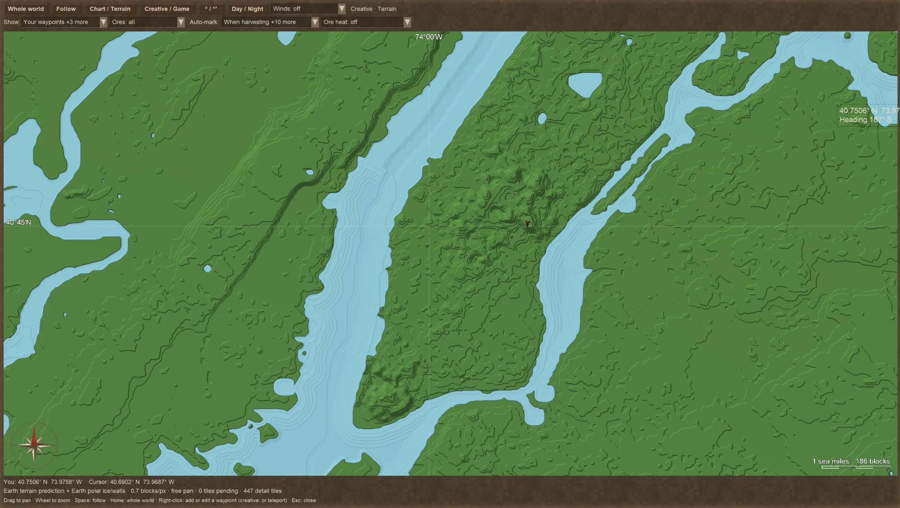

# Buildings in GLO-90: Manhattan's "hills"

Status: note for future work; no code change | Reported: 2026-11-08 by the author, from the world map

## Report

World map, Terrain view, a 1:10 world (1 sea mile = 186 blocks), player at 40.7506° N 73.9758° W (Grand Central /
the Chrysler Building). Manhattan shows hummocky "hills" in Midtown and at the southern tip. The island between them,
Central Park, Brooklyn and Queens are smooth. The author's reading: hills from buildings.

## Finding: correct, they are buildings

GLO-90 (Copernicus DEM) is a surface model; it includes modern buildings and forest canopy
([0051](../decisions/0051-glo90-elevation-on-demand.md) "A surface model"; [source survey](coast-and-elevation-sources-2026-11-03.md)).
That survey put buildings at 1–3 blocks at 10 m per block. Manhattan's high-rise cores are much more.

Measured in the player's GLO-90 store (`ModData/earth/glo90`, N40W074 and N40W075, whole metres, EGM2008):

| Area | min | p10 | median | p90 | max | mean step between neighbouring 90 m cells |
|---|---|---|---|---|---|---|
| Midtown (40.745–40.765 N, 73.995–73.970 W) | −1 | 20 | 52 | 105 | 171 | 12.6 m |
| Financial District (40.702–40.712 N, 74.015–74.004 W) | 0 | 0 | 40 | 98 | 143 | 15.0 m |
| Central Park interior (40.775–40.790 N, 73.970–73.960 W) | 22 | 36 | 41 | 50 | 70 | 3.4 m |
| Greenwich Village, low-rise (40.728–40.738 N, 74.005–73.995 W) | 9 | 13 | 18 | 25 | 44 | 3.2 m |
| Flatbush, Brooklyn, low-rise (40.640–40.660 N, 73.965–73.945 W) | 9 | 12 | 19 | 27 | 39 | 2.2 m |

- The two high-rise cores are about 4–7 times rougher (3.7–6.8) than the park and the low-rise districts next to them.
  That matches where the screenshot's hummocks are. (The Financial District's zeros are probably harbour water at the
  box's south-west edge.)
- Single towers barely show: the cell at the Empire State Building is 34 m, at One World Trade Center 9 m. Dense
  clusters of tall buildings raise whole 90 m cells (the cell at the player's position is 128 m).
- At 1:10 (about 10 m per block both ways, [0050](../decisions/0050-tall-worlds.md)) Midtown's p90 is about 9 blocks
  above the low-rise districts' median and its peaks about 15 blocks; neighbouring cells differ by 1.3 blocks on average
  against 0.2–0.3 elsewhere.
- The long ridge along the New Jersey shore of the Hudson (left in the screenshot) is the Palisades, a real rock cliff.
  A fix must keep it.

## Scope

- Not only Manhattan: every dense high-rise core (the Chicago Loop, Hong Kong, Pudong, Dubai and others) should show
  the same. Not measured.
- Forest canopy is the same problem at lower heights (10–30 m): noted at Angkor (Earth Ruins dossier), in the river snap
  and in the habitat slope fit (fitted over 400 m for this reason).
- In a world set at 1318, all modern buildings are wrong, not only the tall ones.

## Possible fixes (proposals, nothing decided)

1. **A bare-earth model where one exists.** FABDEM (Copernicus 30 m with buildings and forests removed) is
   CC BY-NC-SA 4.0 (non-commercial; see the Earth Ruins Giza dossier). That term is the author's call. Others (FathomDEM,
   national lidar ground models such as USGS 3DEP for New York) were not checked for licence or coverage.
2. **Correct GLO-90 in Earth's own baking**, as a difference file beside the published store (as
   `dams-glo90-*.bin` does for dams), so `egl-v1` stays as published:
   - mark built-up cells from an open global layer (ESA WorldCover's built-up class, the GHSL built-up surface;
     licences to check);
   - in marked cells take the ground from a local low percentile or a morphological opening over about 300–500 m, or
     subtract a building-height layer (GHSL GHS-BUILT-H, 100 m).
   - Harmonic infill from the edges (used for monuments in the Hagia Sophia dossier) suits only small patches: across
     a whole built-up island such as Manhattan it would flatten the island to its shore level and lose the natural
     relief.
3. The same correction could later take canopy out with a canopy-height layer.

Either fix changes heights, so it would be a new GLO-90 rules number for new worlds only; saved worlds keep their
heights ([0002](../decisions/0002-save-compatibility.md)).

Related, not part of this fix: much of Manhattan's shore is landfill made after 1318 (Battery Park City in the 1970s–80s,
Lower Manhattan beyond its old shore, the East River side). That belongs to reclamation in
[0064](../decisions/0064-coasts-and-waters-as-of-1318.md) steps 2–4.

## Reproduce

[`manhattan_glo90.py`](glo90-buildings-2026-11-08/manhattan_glo90.py) decodes the first 480 rows of the two EGLO tiles
and prints the points and the table. It needs `brotli` and `numpy` (Earth's `.venv` has both):
`"C:\VS mods\Earth\.venv\Scripts\python.exe" -I manhattan_glo90.py`.
