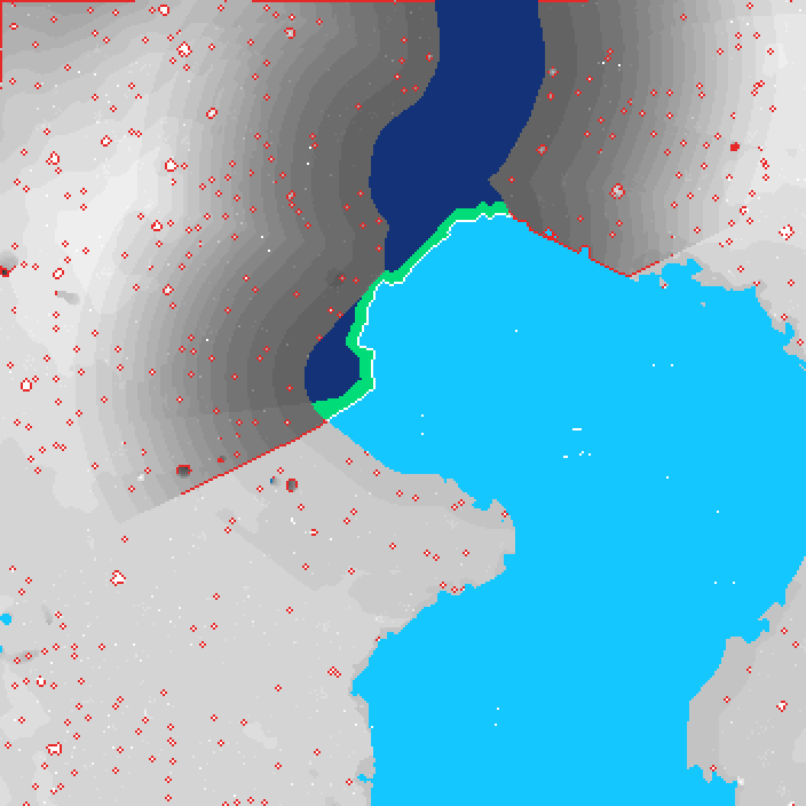
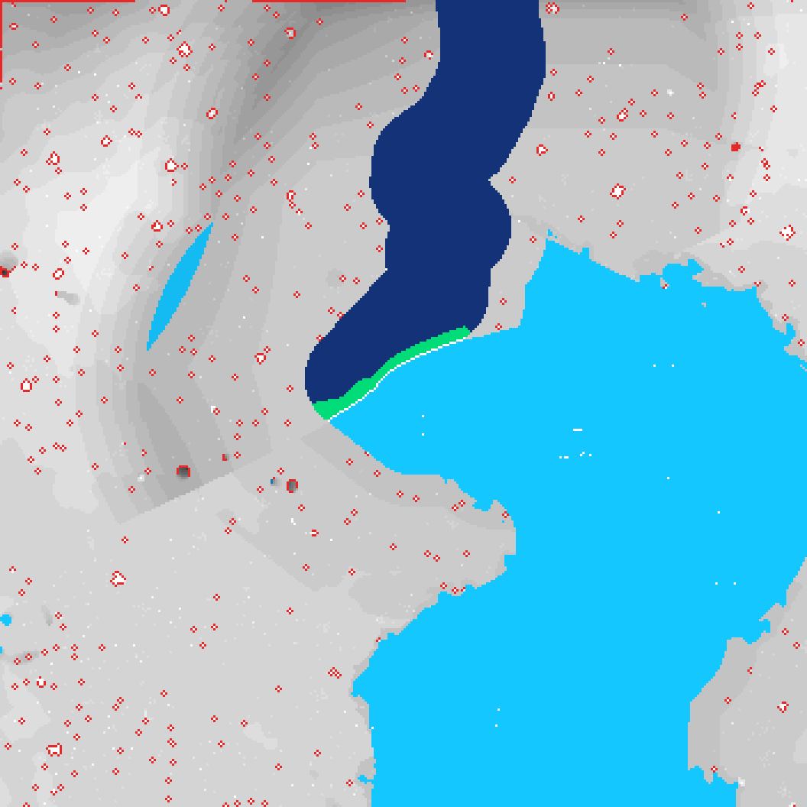

# Lake rims (pool layout 4), 2026-10-23

The user played Niagara Falls in a 1M-wide world (Earth 0.16.5, pool layout 3):

> falls are much wider than river below and lot of fall cliff is without water basin below and water blocks stand next
> to edge without rapids

## What it was

A server world 1 024 000 wide (height 384, seed 386217) at Niagara (`testruns/niagara1m-20261023`):
- **The lake data reaches past the falls.** Earth's lake data includes the upper Niagara. It reaches past the listed
  fall, and the lower river (11 blocks lower) runs about 85 blocks along its edge. That whole edge became one curtain:
  131 columns of upper water beside the lower river, which is about 55 wide.
- **The valley cut the lake's shore.** The lower river's valley lowers the land beside it, and on the lake's north side
  it cut through the lake's shore. In 65 columns the lake's still water stood 6–11 blocks (usually 10) above dry land,
  with nothing holding it and no curtain. Nothing runs off until a block update. These are the "water blocks next to the
  edge without rapids".
- **At 256k it hardly shows.** The same falls have no such walls and a lake edge of 62 columns along the lower water.
  Distances in blocks are 4× larger at 1M, so a lake outline that roughly fit at 256k overshoots by kilometres.

## Pool layout 4

New worlds only ([decision 0024](../decisions/0024-hydrology-water-mod.md), pool layout 4):
1. **The lake gives way beside a lower river.** A lake column more than 3 blocks above the river nearest to it, within
   the river's half width + bank + 2, becomes land. Then the river's channel, bank or valley is cut into it as anywhere
   else. The lake meets the lower river only where the river's own water is at the lake's level, that is, at the drop.
2. **Banks and valley keep the lake's shore.** In the ring of such a lake, the river's banks and valley keep the land as
   high as the lake's eased shore holds it (decision 0011: just above the lake next to it, sinking away from it), but
   never above the natural ground. A lake column turned to land counts as next to the lake, so it becomes a rim at
   lake level + 1.
3. **Lake banks when settling.** When the world generator settles the water, dry land next to any lake water (not the
   sea) is raised to the water's top, as it already was next to river water.

## Server worlds

Same seed and places, Earth 0.16.6 build ([servers.sh](lake-rims-test-2026-10-23/servers.sh); dumps measured with
[view.py](lake-rims-test-2026-10-23/view.py) and [stats.py](lake-rims-test-2026-10-23/stats.py)):

| Niagara | 1M, layout 3 | 1M, layout 4 | 256k, layout 3 | 256k, layout 4 |
|---|--:|--:|--:|--:|
| Upper water above dry land 2+ lower (columns) | 65 (6–11 high) | **0** | 0 | 0 |
| Upper water beside lower water (curtain edge) | 131 | **61** | 62 | 55 |
| Falling-water columns | 180 | 113 | 66 | 58 |
| Dry cliffs of 5+ within 40 blocks of the falls | 469 | 403 | 178 | 140 |

 

How to read the pictures: light blue is the upper water, dark blue the lower river, white the curtains, green rapid
water, red dry cliffs of 5+.
- The curtain now runs across the river at the drop instead of along the gorge.
- West of the gorge the land stays at the lake's level instead of a valley sloping down to the lower river.
- A shallow pond (1 deep, at 194) lies in a dip between the natural ground and that rim. Earth's model has no water
  there, so it is vanilla's.

## Offline

Audit and suite at 256k and at 1M (`WORLD=1024000 BANDINNER=672`), layouts 3 and 4
([offline.sh](lake-rims-test-2026-10-23/offline.sh)):
- **256k.** The audit goes from 101 blocked / 93 uphill / 125 falls to 101 / **92** / 125. Only Niagara changes in the
  suite: the curtain goes from 64 to 55 columns, and the lake edge against lower water from 42 to 33.
- **1M.** The audit goes from 243 / 81 / 132 to 243 / **79** / 131. Again only Niagara changes in the suite: lake walls
  go from 63 to 0, the lake edge from 131 to 45, and the falls check's curtain from 103 to 59 columns.
- **The 1M suite's 5 failures are the same with both layouts.** Its checks are tuned to the 256k layout: jump lines,
  ship channel depth, Bakhtegan's seed. One of them is that 2 of the 14 listed waterfalls aren't on a river at 1M. That
  one may matter in the user's 1M worlds and is not looked into here.
- **Lake Geneva** fails the same way as before ("no steeper steps than before (6)"), with both layouts at 256k.

**Where the rims act.** `lakerims` lists every place where lake water stands more than 3 blocks above a river beside it
([256k](lake-rims-test-2026-10-23/rims-256k.txt), [1M](lake-rims-test-2026-10-23/rims-1m.txt)). There are 12 cells of
256 blocks at each size. Besides Niagara they include:
- the Angara leaving Lake Baikal (1M, 19 blocks);
- Lake Como at Lecco;
- the Reuss below Lake Zug;
- the Fraser valley;
- lakes on Baffin Island, Labrador, Kola and Vancouver Island.

The river check around each, with layout 3 and then 4 ([256k](lake-rims-test-2026-10-23/rimcheck-256k-p3.txt) →
[p4](lake-rims-test-2026-10-23/rimcheck-256k-p4.txt), [1M](lake-rims-test-2026-10-23/rimcheck-1m-p3.txt) →
[p4](lake-rims-test-2026-10-23/rimcheck-1m-p4.txt)):
- **Lake walls:** 0 everywhere with layout 4. With layout 3 they were up to 112 columns at 256k (Labrador) and 131 at
  1M (Thunder Bay).
- **Curtains:** the lake edge against lower water shrinks or stays the same at every place, for example Baikal 50 → 20
  and the Fraser 70 → 24.
- **Water walls beside river water:** 0 before and after.

## Not verified

- Not played in the client.
- The rule study (Hydrology `73d8898`) lists the blocks Earth should generate at lips, curtains and chute steps so
  nothing changes on the first update. Earth 0.16.6 still generates 0.16.5's blocks there, so a lip still turns rapid
  when touched.
- The dry cliff on the west side of the 256k falls (a straight line where the lower reach's valley meets the upper
  shore) is unchanged.
