# Base metals at their real size (decision 0065)

Research note for the base-metals group: Cu, Sn, Pb, Zn, Ag, Bi, Hg, W, Mo, Sb. Session `ore-base-metals`, branch
`claude/ore-base-metals`, 8 November 2026. Contract: `docs/decisions/0065-ores-at-their-real-size.md` and
`tools/ore-data/README.md` (catalogue schema v1).

## What was built

| File | What it is |
|---|---|
| `assets/earth/config/ore-deposits-v1/base-metals.json` | The catalogue: 1,933 deposits and 94 stratiform areas (1.3 MB, minified) |
| `tools/ore-data/base-metals/fetch_base_metals.py` | Downloads what is not on disk yet into `rawdata/ore/base-metals/` (Singer 2008 porphyry database, USGS MCS 2024 chapters) |
| `tools/ore-data/base-metals/build_catalogue.py` | Builds the catalogue and `build-report.json` (counts, contained metal, checks, dropped rows, pre-1318 workings) |
| `tools/ore-data/base-metals/named-*.csv` | 224 authored rows of named deposits with citations (Sn-W-Mo-Bi, Hg-Sb-Ag-Pb-historic Cu, additions) |
| `tools/ore-data/base-metals/build_evidence.py` | Heat-map evidence `evidence.geojson` and `heatmap-overrides.json` for the ten codes |
| `tools/ore-data/base-metals/validate.py` | Compares the catalogue with USGS Mineral Commodity Summaries 2024; writes `validation` into the report |
| `tools/ore-data/base-metals/render_heatmaps.py`, `check_heatmaps.py` | Before/after map PNGs and the map-versus-catalogue check used below |
| `tools/ore-data/base-metals/ATTRIBUTION.txt` | Sources, licences, citations |

Rebuild (no network once `rawdata/ore/base-metals` exists):

```bash
.venv/Scripts/python.exe -I tools/ore-data/base-metals/build_catalogue.py
```

```bash
.venv/Scripts/python.exe -I tools/ore-data/base-metals/build_evidence.py
```

```bash
.venv/Scripts/python.exe -I tools/ore-data/base-metals/validate.py
```

Deposits by heat-map layer: Cu 1,244, Zn 451, Ag 56, Sn 56, Pb 48, W 26, Mo 23, Hg 17, Sb 8, Bi 4 (the layer is the
metal that adds most value per tonne of ore; by-products carry their own grades and ores). By source: VMS database 865,
porphyry Cu 536, MVT/SEDEX 231, named 212, sediment-hosted Cu 89 (+ 94 areas). By shape: lens, stock, veins, and 16
blankets (the tin placers). Quality: A 1,630 (database figures), B 141, C 162.

## Sources and licences

| Source id | Data | Licence | Used for |
|---|---|---|---|
| `usgs-gcra-pcu` | Dicken et al. 2016, USGS SIR 2010-5090-Z, porphyry Cu deposits and prospects | public domain | porphyry bodies (tonnage, grades, ages) |
| `usgs-gcra-sedcu` | same, sediment-hosted stratabound Cu | public domain | Kupferschiefer and Copperbelt areas, other sediment-hosted lenses |
| `usgs-porcu-2008` | Singer, Berger and Moring 2008, USGS OFR 2008-1155 | public domain | ore-zone areas and axes of porphyries (footprints), ages |
| `usgs-vms-2009` | Mosier, Berger and Singer 2009, USGS OFR 2009-1034 | public domain | VMS lenses |
| `usgs-sedexmvt-2009` | Taylor et al. 2009, USGS OFR 2009-1297 | public domain | MVT and clastic-dominated (SEDEX) Pb-Zn lenses |
| `earth-named-2026` | published figures, one citation per row (`ref`) | facts with citation, q B or C | Sn, W, Mo, Bi, Hg, Sb deposits, silver and lead districts, workings before 1318, IOCG, Keweenaw |
| MRDS | USGS Mineral Resources Data System | public domain | heat-map evidence for the minor metals (capped, below) |
| USGS MCS 2024 | Mineral Commodity Summaries 2024 | public domain | validation only |
| Natural Earth admin-0 | 1:10m countries | public domain | land and country checks only |

Not used: Mindat, and any NC, ND or SA compilation. Rows whose citation says the figure was recalled rather than read,
or that it is an estimate or order of magnitude, are q C whatever the table said (8 rows lowered by the build).

## Decisions

1. **Tonnage is pre-mining ore**: production + reserves + resources at the source's cut-off, as the contract asks. For
   giant porphyries this is the lowest-cut-off resource (El Teniente 20.7 Bt at 0.62 % Cu). Database records without
   tonnage (1,679 porphyry and 1,016 sediment-hosted prospects, 222 VMS) stay heat-map background only: no body is
   invented for them.
2. **Shapes and footprints** (`build_catalogue.py`, `finish`, `stock_dims`, `lens_dims`). Volume = mt / density. Where
   the source gives a footprint it is used and the other dimension follows from the volume; otherwise a type rule fills
   it and `est` names the estimated fields.
   - Porphyry `stock`, density 2.65: Singer's ore-zone area gives the height (clamped 150–1,800 m); without an area,
     height = 200·(mt/100)^0.3 m (150–1,500 m) and a 1.3:1 ellipse. Source footprints are used for 159 porphyries
     (Singer's ore-zone area and axes) and 278 VMS bodies.
   - `lens` by type (length : down-dip width : thickness, thickness cap, default dip): VMS 1 : 0.5 : 0.05, 80 m, 60°;
     SEDEX 1 : 0.6 : 0.02, 60 m, 45°; MVT 1 : 0.4 : 0.01, 40 m, 5° (flat-lying carbonate replacement); sediment-hosted
     Cu 1 : 0.5 : 0.004, 25 m, 15°. Densities: VMS 3.6, SEDEX 3.3, MVT 2.9, sediment-hosted Cu 2.65.
   - `veins`: the footprint holds the swarm and about 3 % of its volume is ore (typical of lode districts such as
     Cornwall, Freiberg, Kutná Hora); 600 m deep unless the source says otherwise.
   - `blanket`: only tin placers (`earth-placertin`), density 1.9, with `layers: ["alluvial", "outwash"]` (0065
     addition 50420af: without it a blanket would also take laterite and saprolite). Hard-rock bodies carry no `layers`
     and take the 0060 table (bed and basement); oxidised caps are `zone: top` shares of the hard-rock body.
3. **Depth.** VMS and porphyry tops = the cover depth the database states (Miami-Inspiration 100 m), else 0;
   Resolution 1,370–2,130 m (named row; the global copper assessment has it only as a prospect); Olympic Dam 330 m
   under cover to 2,000 m; Kamoa-Kakula 400 m. Kupferschiefer beds: Lubin-Sieroszowice 600 m, Konrad 500 m, the deep
   East German fields 700–900 m, but Mansfeld 60 m, Richelsdorf 60 m and Sangerhausen 150 m where the bed rises to its
   outcrop and was worked from the 12th century. Bodies with top ≥ 300 m feed the deep heat-map plane.
4. **Ores share a body by the value each metal adds per tonne of ore** (`common.make_ores`; long-run prices, Mo taken at
   half its price because by-product molybdenite is recovered at only 50–60 %). Shares under 3 % are dropped. Oxidised
   ores sit in the top zone: malachite/azurite, cerussite, smithsonite/hemimorphite (porphyry 10 % where the top is
   under 50 m, VMS 5 % where it crops out, MVT and SEDEX 8 %, sediment-hosted Cu lenses 10 %, Katanga Copperbelt 45 %,
   Zambian Copperbelt 10 %).
5. **Stand-ins**: `wulfenite` for molybdenite and `tetrahedrite` for stibnite (the game has neither); `wolframite` for
   all W (scheelite skarns included); `silver` for silver ores. Each ore's tier follows its own metal's grade through
   the top-level `oreMetal` map (tetrahedrite: Sb where the body has Sb, else Ag).
6. **Gold and uranium; one deposit, one catalogue.** Each real deposit appears in one group catalogue only, owned by
   the group of its main commodity by value, with its co-products as ore shares (coordinator rule, 8 November). The
   precious-gems group leaves the gold of porphyry Cu-Au, VMS and Ag-Au epithermal bodies and the uranium of Olympic Dam
   to this group, so `gold` and `uranium` join a body's ores by value like the other metals (gold in 810 bodies:
   Grasberg 44 %, Bingham 21 %, Oyu Tolgoi 22 %, Comstock 76 % of ore blocks; Olympic Dam 55 % chalcopyrite, 28 %
   uranium, 14 % gold). The precious group's Au bands (1/4/10 g/t) and U bands (0.1/0.5/2 %) are copied so a gold or
   uranium block means the same grade in both files. Four deposits belong to precious-gems and are left out here
   (`OWNED_BY_PRECIOUS`): Mount Morgan and Zijinshan (gold main, listed there with chalcopyrite shares), Musariu
   (inside their Barza-Brad district) and Jáchymov (uranium main). Neighbours within a few km that are different
   deposits keep their own bodies: Roșia Poieni and Roșia Montană, Bolcana and Săcărâmb, Březové Hory and the Příbram
   uranium field, Schneeberg and Schlema-Alberoda, VMS lenses and ophiolite chromite pods. No magmatic Ni-Cu-PGE
   deposit is in this catalogue (iron-ferro owns them). `nearOtherGroups` in the build report lists every pair within
   5 km for review.

   Iron-ferro handed over the co-products of three of these deposits and removed its own bodies there (`GOSSAN` and
   `OXIDISED_EXTRA` in build_catalogue.py, graded with iron-ferro's Fe bands 30/45/60 % and V2O5 bands 0.3/0.8/1.4 %):
   - **Rio Tinto**: the limonite-hematite gossans (Cerro Colorado and others), about 100 Mt at about 45 % Fe
     (iron-ferro's estimate, q C).
   - **Tharsis** (the USGS record Filón Sur-Esperanza, alternative name Tharsis): 15.5 Mt of gossan with 29 g/t Ag and
     1.74 g/t Au. These figures are from Leistel and others (1998), quoted in the USGS record.

   A gossan is extra material above the sulphides. So its tonnage joins the body: `mt` becomes 434.3 and 125.5 Mt, and
   the density and thickness are recomputed. `limonite` takes the gossan's share of the tonnage in the top zone: 0.230
   at Rio Tinto and 0.124 at Tharsis. A new field, `gossanMt`, marks that part of `mt`. The other metals' grades stay
   over the sulphide tonnage (`mt - gossanMt`), so the contained base metals and the heat-map evidence are unchanged.

   **Berg Aukas** gets a `vanadinite` share of 0.10 in the top zone, at 1.0 % V2O5. Vanadinite stands for descloizite,
   the vanadate of its oxidised ore. This is oxidised ore inside the body, so `mt` stays 3.2 Mt.
7. **Grade bands** (catalogue `gradeBands`), chosen so typical porphyries are medium, Copperbelt and good VMS rich, and
   only exceptional ore bountiful:

   | Metal | medium | rich | bountiful |
   |---|---:|---:|---:|
   | Cu | 0.4 % | 1.2 % | 3.0 % |
   | Zn | 3 % | 7 % | 15 % |
   | Pb | 2 % | 5 % | 10 % |
   | Ag | 60 g/t | 200 g/t | 800 g/t |
   | Sn | 0.4 % | 1.0 % | 2.5 % |
   | W | 0.2 % WO3 | 0.6 % | 1.5 % |
   | Mo | 0.04 % | 0.12 % | 0.3 % |
   | Sb | 2 % | 5 % | 15 % |
   | Bi | 0.1 % | 0.3 % | 1.0 % |
   | Hg | 0.3 % | 1 % | 4 % |
   | Au | 1 g/t | 4 g/t | 10 g/t |
   | U (precious-gems' bands) | 0.1 % U3O8 | 0.5 % | 2 % |
   | Fe (iron-ferro's, gossans) | 30 % | 45 % | 60 % |
   | V (iron-ferro's, Berg Aukas) | 0.3 % V2O5 | 0.8 % | 1.4 % |

   Resulting share of each metal's ore tonnage by tier:

   | Metal | poor | medium | rich | bountiful |
   |---|---:|---:|---:|---:|
   | Cu | 26 % | 72 % | 2 % | 0 % |
   | Zn | 27 % | 48 % | 22 % | 2 % |
   | Pb | 37 % | 33 % | 25 % | 5 % |
   | Ag | 84 % | 7 % | 9 % | 0 % |
   | Sn | 98 % | 1 % | 1 % | 0 % |
   | W | 61 % | 35 % | 4 % | 0 % |
   | Mo | 39 % | 53 % | 8 % | 0 % |
   | Sb | 15 % | 84 % | 0 % | 0 % |
   | Bi | 29 % | 64 % | 5 % | 1 % |
   | Hg | 0 % | 62 % | 31 % | 7 % |
   | Au | 97 % | 3 % | 0 % | 0 % |

   Tin is 98 % poor by tonnage because the placers (Kinta, Bangka, Belitung, Phuket, Jos: 0.02–0.05 % Sn in gravel)
   are most of the tonnage; hard-rock tin is medium to bountiful (Gejiu, Dachang 1 %, Renison, San Rafael). Silver and
   gold are mostly poor because most of their tonnage is by-product metal in copper and zinc ore. Placers being poor
   under hard-rock bands is shared with precious-gems' gold placers; if placer blocks should grade differently, that is
   a runtime or contract rule (bands per ore code), not a catalogue figure.
8. **Kupferschiefer and Central African Copperbelt as `areas`.** Each district from the sediment-hosted database is an
   ellipse around its deposit sized so the bed covers about 70 % of it at the district's real thickness (Kupferschiefer
   1–3 m ore shale, Copperbelt 12–15 m); overlapping ellipses of one belt merge. Beds: chalcopyrite, a malachite top bed
   where the ore reaches the surface (Katanga), and a silver bed where Ag ≥ 30 g/t (Lubin-Sieroszowice: 2.3 m
   chalcopyrite + 0.7 m silver at 600 m; KGHM is the world's largest silver producer from this bed). Kamoa-Kakula is
   authored (1,551 Mt at 2.70 % + 1,046 Mt at 1.70 %, 400 m deep). Mansfeld (from 1199), Sangerhausen (1200) and
   Richelsdorf (1300) carry `firstWorked`.
9. **Named deposits** fill what the databases lack: tin (Cornwall, Erzgebirge, Bolivia, Gejiu, Dachang, Renison, San
   Rafael, Bisie, the Southeast Asian placers, Rondônia, Jos), tungsten (Shizhuyuan, Zhuxi, Dahutang, Xihuashan,
   Sangdong, Mittersill, Panasqueira, Nui Phao), molybdenum (Climax, Henderson-Urad, Endako, Chalukou, Luanchuan),
   bismuth (NICO, Tasna, Ustarasai, Schneeberg), mercury (Almadén, El Entredicho, Idrija, Monte Amiata, Huancavelica,
   New Almaden, New Idria, Nikitovka, Khaidarkan, Wanshan, Sızma), antimony (Xikuangshan, Woxi, Consolidated Murchison,
   Kadamjay, Hillgrove, Sentachan, Wadley, Lake George), silver and lead districts (Potosí, Fresnillo, Pachuca,
   Zacatecas, Comstock, Freiberg, Kutná Hora, Laurion, Iglesias, Clausthal, Schwaz, Coeur d'Alene), workings before 1318
   (Falun, Rio Tinto, Timna, Faynan, Cyprus, Ergani, Kargaly, Great Orme, Mitterberg, Ai Bunar, Rudna Glava, Rammelsberg),
   the IOCG Olympic Dam and Mantoverde, Keweenaw native copper (8 lodes, `nativecopper`), Resolution, Udokan and
   Jinding. The named tables were compiled by two delegated passes and reviewed here row by row for duplicates,
   coordinates and q; the largest q C tonnages are listed under "Limits".
10. **Duplicates.** A named row that repeats a database entry (same metal group within 6 km, or the same name within
    25 km) is dropped and its history (`firstWorked`, notes) moves onto the database entry: Rio Tinto, Timna, Faynan,
    Mavrovouni, Skouriotissa, Ergani (the database's "Weiss"), Broken Hill, Bawdwin, Cannington, Jinduicheng. Copper
    stands apart from lead-zinc-silver here, so a silver vein district above a porphyry stays two bodies
    (Morococha/Toromocho, Lucky Friday/Snowstorm). A named district worth three times the database entry it meets
    replaces that entry (Zawar over Mochia, Mantoverde over the Farola mine, Resolution over Superior East, the older
    lower-grade estimate of the same buried body). Reviewed exceptions: Iwami Ginzan versus the
    Iwami kuroko deposit 11 km away, Banská Štiavnica veins versus its buried porphyry. Rows of one authored table are
    never merged with each other (Monte Amiata is split on purpose).
11. **Coordinates** are checked with the bake's own country check so the catalogue and the heat maps agree: 6 sign flips
    repaired (Constancia lat; Allenwood West, Rickardstown, Boston Hill, Chance, Copper King lon) and one reviewed move
    (Touissit-Bou Beker to the Moroccan side, 25 km west of the source point).
12. **Heat-map evidence** (`build_evidence.py`): every catalogue body is a point for its layer and for each by-product
    whose grade reaches half the medium band. Size by contained metal: world-class peak 0.95 / 60 km, large 0.85 / 50 km,
    deposit 0.75 / 40 km, small 0.6 / 30 km; by-products one step weaker (at least 0.5); bodies with top ≥ 300 m go to
    the deep plane at their depth. Areas are polygons at 0.8 (0.6 for the silver bed). 28 Sn-W(-Mo-Bi) belt polygons are
    potential at 0.3. The authored best-guess districts are dropped for these codes and carried only where the catalogue
    has nothing of that code within 40 km (77 kept, e.g. Kentau, Dalnegorsk, Garpenberg, Nerchinsk, Antamina). For Sn, W,
    Mo, Bi, Hg and Sb, MRDS (49–88 % US records) is dropped and re-stamped per 0.5° cell at 0.45 (three or more
    producers), 0.35 (one producer) or 0.25, 25 km, so MRDS alone never makes a district.

## Validation

### World totals against USGS Mineral Commodity Summaries 2024

The catalogue counts pre-mining metal (mined + remaining), MCS reserves count only what is economic today, and MCS
identified resources count what remains. The catalogue should therefore sit above reserves and near identified
resources plus historical production.

| Metal | Catalogue | MCS 2024 reserves | Catalogue / reserves | MCS identified resources | 2023 mine output | Catalogue in years of 2023 output |
|---|---:|---:|---:|---:|---:|---:|
| Cu | 2,493 Mt | 1,000 Mt | 2.49 | 2,100 Mt | 22.0 Mt | 113 |
| Sn | 22.6 Mt | 4.3 Mt | 5.24 | – | 290 kt | 78 |
| Pb | 344 Mt | 95.0 Mt | 3.62 | 2,000 Mt | 4.5 Mt | 77 |
| Zn | 800 Mt | 220 Mt | 3.64 | 1,900 Mt | 12.0 Mt | 67 |
| Ag | 1.9 Mt | 610 kt | 3.16 | – | 26 kt | 74 |
| Bi | 531 kt | – | – | – | – | – |
| Hg | 789 kt | – | – | 600 kt | 1.2 kt | 657 |
| W (as W) | 7.8 Mt | 4.4 Mt | 1.78 | – | 78 kt | 101 |
| Mo | 69.5 Mt | 15.0 Mt | 4.63 | 25.4 Mt | 260 kt | 267 |
| Sb | 3.4 Mt | 2.0 Mt | 1.69 | – | 83 kt | 41 |

- **Cu** 2.49 Bt against about 2.1 Bt identified plus roughly 0.75 Bt mined since 1900: close to 0.9 of the expected
  total, good for a catalogue of named deposits.
- **Pb and Zn** are under-represented: 344 Mt Pb and 800 Mt Zn against 2.0 and 1.9 Bt identified. The USGS compilations
  cover VMS, SEDEX and MVT but not carbonate-replacement, skarn and vein deposits (much of Mexico, Peru, China and
  Central Asia); the named tables add only the main historic districts.
- **Sn** 22.6 Mt pre-mining is plausible: world tin output has run at roughly 150–300 kt a year for over a century,
  most of it from Southeast Asian placers, and 4.3 Mt remain in reserves.
- **Mo** is about twice the expected total (25.4 Mt identified + about 9 Mt mined): by-product Mo of the giant
  porphyries is counted at the database's lowest cut-off (Chile 21.7 Mt). Block shares use half the Mo price so the
  excess does not flood porphyries with wulfenite.
- **Hg** 789 kt against 600 kt identified: the catalogue includes the historic output of Almadén (about 280 kt),
  Idrija (about 145 kt) and Monte Amiata (about 100 kt), which MCS resources exclude.
- **Bi** has no MCS reserves; 531 kt is dominated by Shizhuyuan and Nui Phao (China and Vietnam), as expected.
- **Sb** 3.4 Mt is only 1.7 times today's reserves although antimony has been mined for over a century: only 8
  antimony bodies are catalogued (China's many smaller deposits are map evidence only).

### By country (largest six per metal)

| Metal | Country | Catalogue | MCS reserves | MCS 2023 mine |
|---|---|---:|---:|---:|
| Cu | Chile | 705 Mt | 190 Mt | 5.0 Mt |
| Cu | United States | 384 Mt | 50 Mt | 1.1 Mt |
| Cu | Peru | 128 Mt | 120 Mt | 2.6 Mt |
| Cu | DR Congo | 127 Mt | 80 Mt | 2.5 Mt |
| Cu | Australia | 97 Mt | 100 Mt | 0.81 Mt |
| Cu | Canada | 94 Mt | 7.6 Mt | 0.48 Mt |
| Sn | China | 5.8 Mt | 1.1 Mt | 68 kt |
| Sn | Indonesia | 3.5 Mt | NA | 52 kt |
| Sn | Malaysia | 3.2 Mt | NA | 6.1 kt |
| Sn | Bolivia | 2.8 Mt | 400 kt | 18 kt |
| Sn | Thailand | 1.2 Mt | – | – |
| Sn | Peru | 1.1 Mt | 130 kt | 23 kt |
| Pb | Australia | 81 Mt | 35 Mt | 440 kt |
| Pb | United States | 40 Mt | 4.6 Mt | 270 kt |
| Pb | Canada | 36 Mt | – | – |
| Pb | Russia | 32 Mt | 8.7 Mt | 200 kt |
| Pb | China | 27 Mt | 20 Mt | 1.9 Mt |
| Pb | Spain | 12 Mt | – | – |
| Zn | Australia | 135 Mt | 64 Mt | 1.1 Mt |
| Zn | Canada | 115 Mt | – | – |
| Zn | China | 87 Mt | 44 Mt | 4.0 Mt |
| Zn | Russia | 86 Mt | 25 Mt | 310 kt |
| Zn | United States | 64 Mt | 6.6 Mt | 750 kt |
| Zn | India | 36 Mt | 7.4 Mt | 860 kt |
| Ag | United States | 236 kt | 23 kt | 1.0 kt |
| Ag | Mexico | 228 kt | 37 kt | 6.4 kt |
| Ag | Poland | 221 kt | 63 kt | 1.3 kt |
| Ag | Chile | 206 kt | 26 kt | 1.4 kt |
| Ag | Australia | 178 kt | 94 kt | 1.2 kt |
| Ag | Russia | 122 kt | 92 kt | 1.2 kt |
| W | China | 5.2 Mt | 2.3 Mt | 63 kt |
| W | Canada | 572 kt | – | – |
| W | Australia | 351 kt | – | 0.8 kt |
| W | Russia | 323 kt | 400 kt | 2.0 kt |
| W | United Kingdom | 317 kt | – | – |
| W | South Korea | 268 kt | – | – |
| Mo | Chile | 21.7 Mt | 1.4 Mt | 46 kt |
| Mo | United States | 16.9 Mt | 3.5 Mt | 34 kt |
| Mo | China | 11.8 Mt | 5.8 Mt | 110 kt |
| Mo | Peru | 3.7 Mt | 1.5 Mt | 37 kt |
| Sb | China | 2.4 Mt | 640 kt | 40 kt |
| Sb | South Africa | 375 kt | – | – |
| Sb | Kyrgyzstan | 260 kt | 260 kt | – |
| Sb | Australia | 160 kt | 140 kt | 2.3 kt |
| Hg | Spain | 278 kt | – | – |
| Hg | Slovenia | 143 kt | – | – |
| Hg | Italy | 90 kt | – | – |
| Hg | United States | 77 kt | – | – |
| Hg | Peru | 60 kt | – | – |
| Bi | China | 280 kt | – | – |
| Bi | Canada | 78 kt | – | – |
| Bi | Vietnam | 76 kt | – | – |

The country order matches the real one for Cu (Chile, US, Peru, DRC), Sn (China, Indonesia, Malaysia, Bolivia), W
(China far ahead), Mo (Chile, US, China), Sb (China), Hg (Spain, Slovenia, Italy) and Ag (Mexico, Poland, Peru, Chile
among the leaders; US silver is mostly by-product of porphyries and Coeur d'Alene). Canada and the US are high for Zn
and Pb against the rest of the world because the USGS compilations document North American deposits best. Full tables:
`validation` in `tools/ore-data/base-metals/build-report.json`.

### The 20 largest entries (by value of the layer metal)

| # | Deposit | Country | Ore (Mt) | Grade | Contained |
|---:|---|---|---:|---:|---:|
| 1 | El Teniente | Chile | 20,731 | 0.62 % Cu | 128.5 Mt |
| 2 | Chuquicamata | Chile | 21,277 | 0.59 % Cu | 126.0 Mt |
| 3 | Los Bronces/Rio Blanco | Chile | 16,816 | 0.60 % Cu | 101.1 Mt |
| 4 | Escondida | Chile | 11,158 | 0.77 % Cu | 85.8 Mt |
| 5 | Lubin-Sieroszowice (Kupferschiefer area) | Poland | 3,612 | 1.99 % Cu | 71.9 Mt |
| 6 | Olympic Dam | Australia | 10,800 | 0.6 % Cu | 64.8 Mt |
| 7 | Kamoa-Kakula (Copperbelt area) | DR Congo | 2,597 | 2.30 % Cu | 59.7 Mt |
| 8 | Los Pelambres | Chile | 7,458 | 0.62 % Cu | 46.0 Mt |
| 9 | Oyu Tolgoi | Mongolia | 3,755 | 0.98 % Cu | 36.8 Mt |
| 10 | Continental/Butte | United States | 5,220 | 0.67 % Cu | 35.1 Mt |
| 11 | Morenci-Metcalf | United States | 6,470 | 0.52 % Cu | 33.9 Mt |
| 12 | Safford | United States | 7,260 | 0.44 % Cu | 32.0 Mt |
| 13 | Pebble | United States | 7,510 | 0.42 % Cu | 31.2 Mt |
| 14 | Cananea | Mexico | 7,140 | 0.42 % Cu | 30.0 Mt |
| 15 | Bingham | United States | 3,230 | 0.88 % Cu | 28.5 Mt |
| 16 | Resolution | United States | 1,787 | 1.54 % Cu | 27.5 Mt |
| 17 | Udokan | Russia | 2,700 | 1.0 % Cu | 27.0 Mt |
| 18 | Collahuasi | Chile | 3,100 | 0.86 % Cu | 26.7 Mt |
| 19 | Grasberg | Indonesia | 4,000 | 0.6 % Cu | 24.0 Mt |
| 20 | Almalyk Group | Uzbekistan | 6,080 | 0.39 % Cu | 23.7 Mt |

All twenty are known giants of their type, with tonnages and grades as published. Largest of the other layers: Zn Red
Dog (165 Mt, 16.6 % Zn), Hilton-George Fisher, Broken Hill (280 Mt, 8.5 % Zn, 10 % Pb, 148 g/t Ag); Pb Gorevsk
(300 Mt, 6.5 % Pb, database figure); Ag Fresnillo district (400 Mt at 250 g/t, back-calculated from >3.2 Boz),
Cerro Rico de Potosí (300 Mt, 200 g/t Ag, 0.3 % Sn), Pachuca-Real del Monte; Sn Gejiu (300 Mt, 1 % Sn) and the Kinta
and Bangka placers; W Zhuxi (530 Mt, 0.54 % WO3), Dahutang, Shizhuyuan; Mo Chalukou (2,830 Mt, 0.087 %), Luanchuan,
Shapinggou; Sb Xikuangshan (75 Mt, 2.8 %); Hg Almadén (5.2 Mt, 5 %), Idrija; Bi NICO (45 Mt, 0.14 %), while most
catalogued bismuth is by-product of Shizhuyuan and Nui Phao.

### Coordinates

- **Outside the stated country: 0** after 7 repairs (decision 11).
- **Off land: 4**, all accepted: Svanø, Grevdal and Valaheien are Norwegian island and fjord-shore VMS deposits and
  Miles Cove is on Newfoundland's coast; the 10m coastline misses them by a few hundred metres. Offshore tin placers
  (Bangka offshore, Andaman shelf) are typed offshore and not counted.

### Ages against the 0060 layer rules

- Every hard-rock body (stock, lens, veins) goes to bed or basement, which 0060 allows at any age; the 16 tin placers
  are blankets of Cenozoic alluvium and are the only bodies in cover. Shape-layer conflicts: 0.
- Host age older than ore age everywhere (VMS ages come from the ore age in Mosier, not the younger host); 0 conflicts.
- 26 bodies have no age (Arizona Laramide prospects, Philippine and Bulgarian porphyries, Boleo, Tujuh Bukit, Ganesh
  Himal). Hard-rock bodies need no age under 0060, so they stay without one rather than with a guessed era.

### Workings before 1318

55 entries carry `firstWorked` at or before 1318, from Sızma (cinnabar, c. 6000 BCE), Ai Bunar and Rudna Glava (c. 5000
BCE), Faynan and Timna, Laurion, Rio Tinto, Ergani, Cyprus, Kargaly, Great Orme, Mitterberg and the Cornish tin streams
to the medieval mines: Rammelsberg (968), Falun (c. 1000), Freiberg (1168), Mansfeld (1199), the Upper Harz (1200),
Kutná Hora (1260), Novo Brdo, Trepča, Krupka, Příbram (1311). The list is in `preWorked1318` of the build report, for
the Earth Ruins and 1318-state work (decision 0065 does not use it).

## Heat maps before and after

Before = test bake of the contract branch (`tools/bake_ore_heatmaps.py --out <scratch>`, settings as committed); after =
the same with this group's `evidence.geojson` and `heatmap-overrides.json`. Each image shows heat = max(observed,
potential) per 0.5° cell, before on top and after below; teal contours mark deep evidence.

Check (`check_heatmaps.py`): "missed" = world-class or large catalogue deposits whose own cell has heat < 0.5;
"unsupported" = hot cells (heat ≥ 0.5) more than 150 km from every catalogued deposit and carried district of this
group for the code and outside its areas and provinces (the capped MRDS cells do not count as support). Unsupported
heat is not wrong by itself: it marks records this catalogue has not turned into bodies.

| Code | Hot cells before | after | Unsupported before | after | Big deposits missed before | after |
|---|---:|---:|---:|---:|---:|---:|
| Cu | 7,174 | 7,183 | 2,770 | 2,770 | 0 | 0 |
| Sn | 640 | 455 | 329 | 207 | 6 | 0 |
| Pb | 2,137 | 2,145 | 918 | 918 | 0 | 0 |
| Zn | 2,308 | 2,313 | 651 | 651 | 1 | 0 |
| Ag | 2,257 | 2,272 | 1,059 | 1,059 | 4 | 0 |
| Bi | 192 | 132 | 164 | 112 | 2 | 0 |
| Hg | 228 | 131 | 179 | 86 | 3 | 0 |
| W | 525 | 362 | 307 | 206 | 4 | 0 |
| Mo | 580 | 487 | 274 | 178 | 26 | 0 |
| Sb | 881 | 793 | 825 | 739 | 1 | 0 |

- **Sn, W, Mo, Bi, Hg**: the US-heavy MRDS no longer makes districts on its own, so hot cells drop by 16–43 % (US
  Sn 66 → 52 unsupported, Hg 56 → 37) while the real belts carry the heat (Southeast Asian tin belt, Nanling,
  Central Andes, Erzgebirge, Cornwall, Kibaran). Every large deposit the shipped maps missed is now hot: tin at Man
  Maw, Dulong, Yinyan, Xianghualing and the Bangka shelf; tungsten at Zhuxi, Dahutang, Sisson and Pine Creek; 26
  molybdenum deposits including Rio Blanco, Kale Kafi, Zuun Mod, Chehugou and Chalukou; bismuth at NICO and Chorolque;
  mercury at Sulphur Bank, McDermitt and Terlingua; silver at Schwaz, White Pine, Dachang and Rudnik; antimony at
  Woxi. What stays unsupported comes from the specialist compilations and USGS PP 1802 (real records in Russia,
  Kazakhstan, Australia, the US) that this catalogue has no tonnage for.
- **Cu, Pb, Zn, Ag** change little in area: the shipped maps already used the same USGS compilations. What changes is
  strength by size (world-class districts 0.95, small deposits 0.6) and the deep plane under Olympic Dam, Resolution,
  Kamoa-Kakula and the Polish Kupferschiefer (49 deep Cu cells; 13 deep Mo cells, among them Resolution, Henderson-Urad and Mount Emmons). The remaining "unsupported" Cu heat is almost all
  (2,642 cells) permissive-tract potential at 0.5 with no record in the cell (see the tract proposal below); the rest
  is prospects without tonnage. Pb-Zn-Ag unsupported heat is MRDS producers and the specialist compilations (US,
  Mexico, Canada, Australia), real records left as they are.
- **Sb** keeps most of its unsupported heat in China (from the antimony specialist compilation, 448 records worldwide): real
  deposits that this catalogue has not catalogued yet (only 8 Sb bodies).

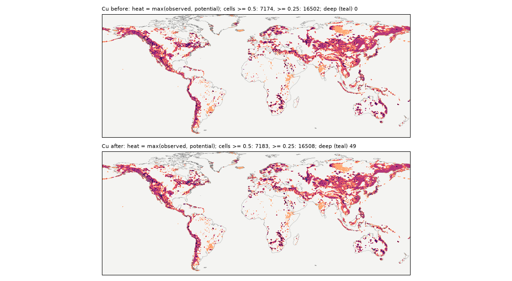
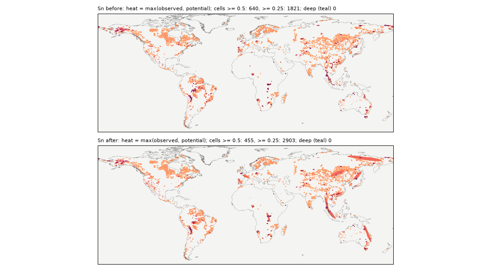
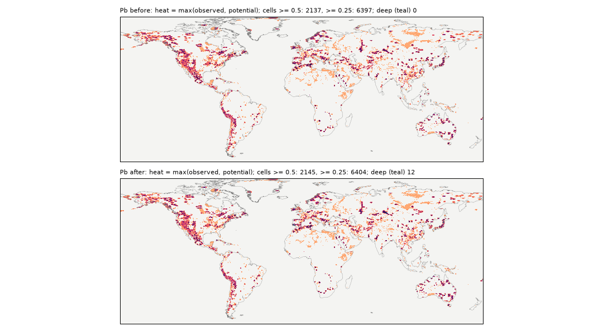
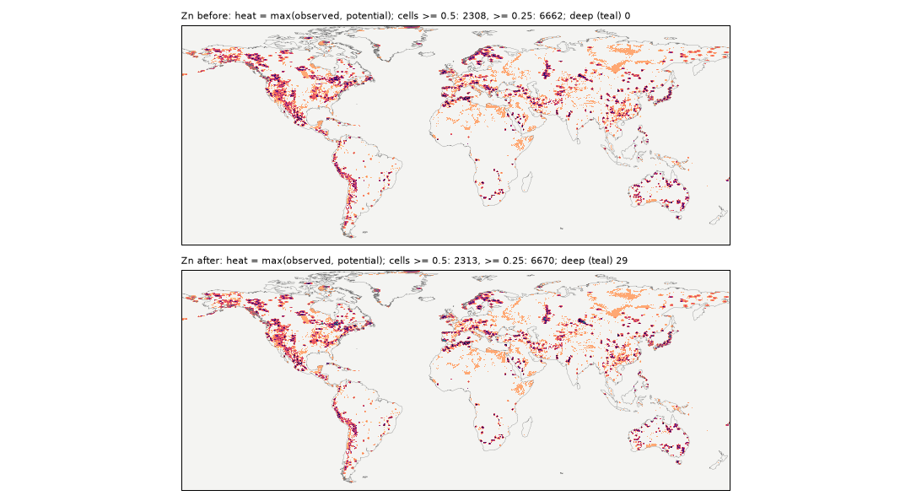
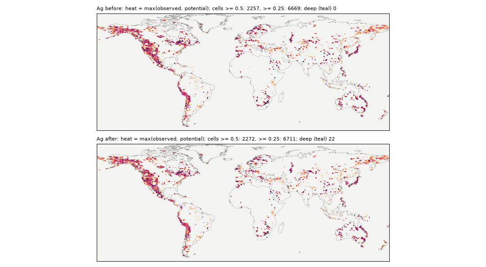
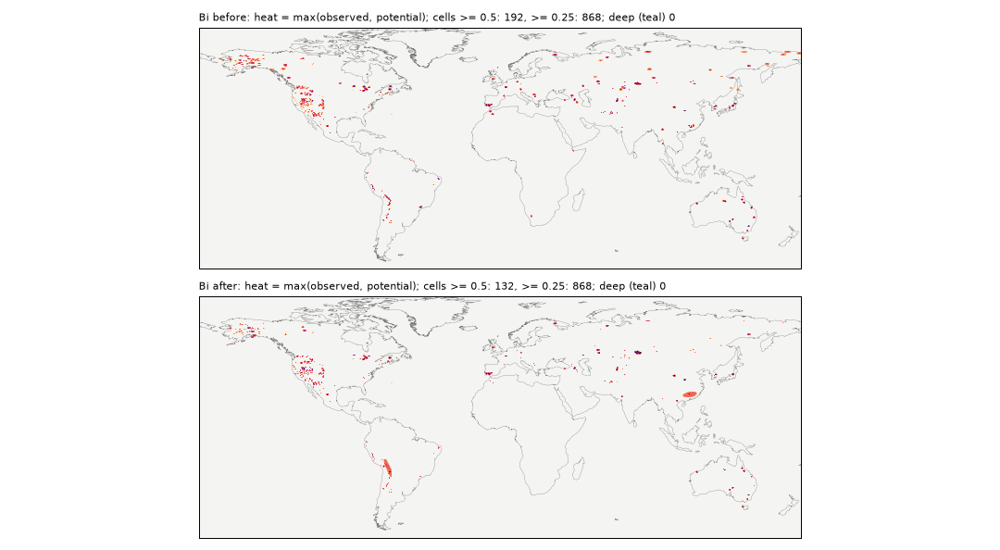
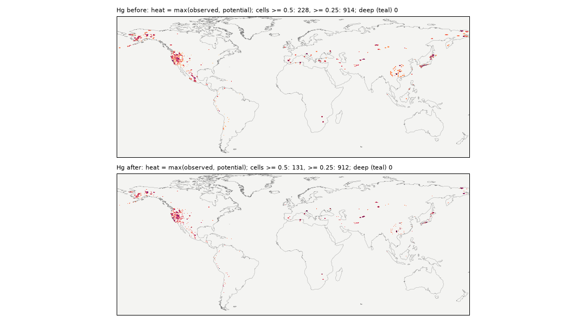
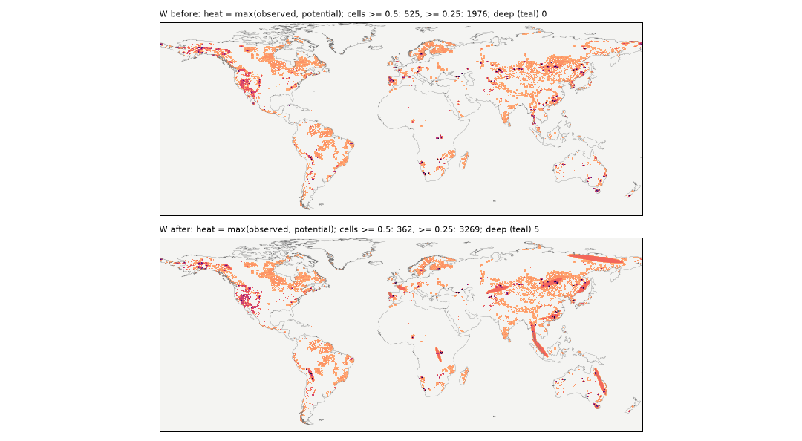
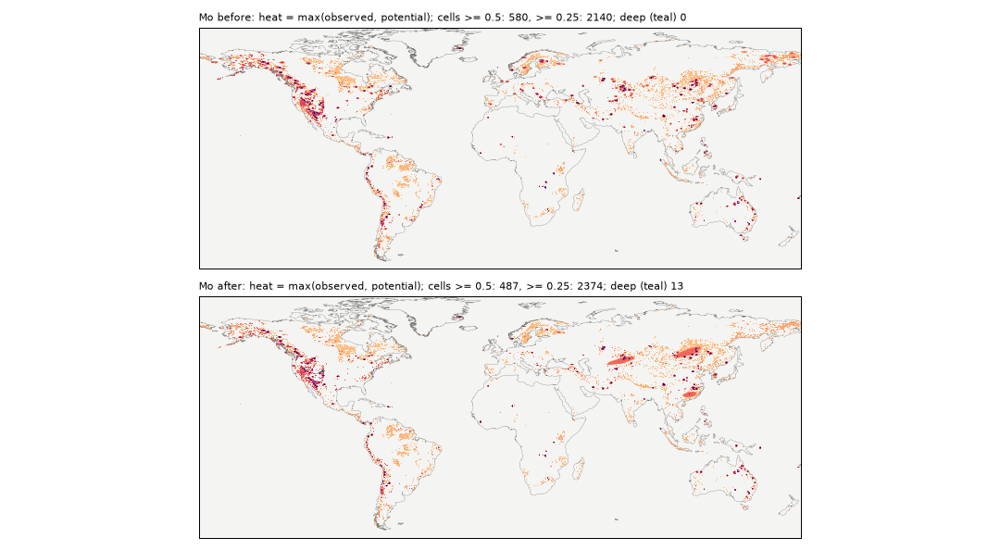
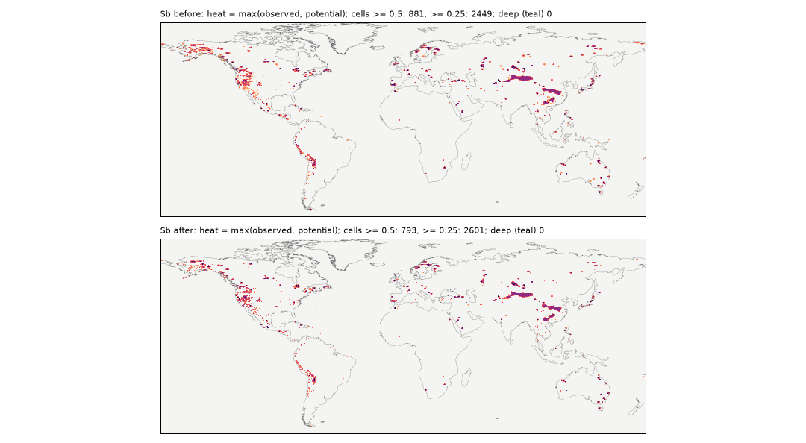

Cell statistics: `base-metals/heatmap-stats.json`; check results: `base-metals/check-before.json`,
`base-metals/check-after.json`.

## Proposed settings changes (sent to the coordinator, not applied)

**1. Copper permissive tracts below district level.** 2,642 of copper's 7,183 hot cells are USGS permissive tracts
(porphyry and sediment-hosted) covering a cell completely at `tractWeight` 0.5 with no deposit or prospect in it: whole
arcs of Russia, China, Mongolia and Canada read as districts. A tract says the geology allows the deposit type, not that
one is there. Proposal: `tractWeight` 0.5 → 0.35, the same rule as the MRDS cap (background stays below 0.5). Estimated
from the test bake: Cu hot cells 7,183 → 4,541, cells ≥ 0.25 unchanged; no catalogued deposit loses heat, since each
has its own point at 0.6–0.95.

**2. Tin and tungsten priors.** `tools/ore-heatmap-settings.json` gives tin and tungsten potential to every acid pluton (GLiM class 9: Sn 0.2, W 0.2)
and its aureole (Sn 0.15, W 0.15), so the Canadian Shield, Siberia, Scandinavia and Brazil are speckled with tin
potential while real tin sits in a few granite belts. Proposal: drop Sn and W from both priors; the 28 belt polygons
above keep potential where tin and tungsten really are. Test bake with the change: Sn potential cells 12,231 → 2,254,
W 12,387 → 2,416; hot cells unchanged (Sn 455, W 362) and no big deposit missed (`check-prop.json`).

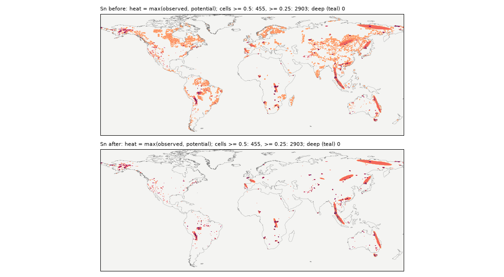
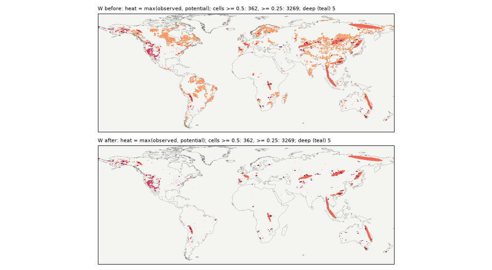

Also reported: the bake's group override `"mrds"` only matches source names that begin with "mrds", so per-commodity
MRDS files (`W-occurrences.csv.gz` and others) must be named one by one; this group's overrides do so.

## Limits and what is left

- **Lead-zinc is under-catalogued** (decision on validation above): carbonate-replacement, skarn and vein deposits of
  Mexico, Peru, China and Central Asia need a source with tonnages (national inventories, company reports) before they
  can be bodies; until then the shipped evidence keeps them on the map.
- **Antimony and bismuth** have only 8 and 4 bodies; Chinese antimony (Xikuangshan aside) and Bolivian antimony are
  map-only.
- **q C rows** (162) are order-of-magnitude tonnages for historic districts and stand-in figures; each says so in `est`
  and `ref`. Worth re-checking against primary reports when time allows, starting with the largest by value
  (Luanchuan, Kajaran, the Kinta Valley and Bangka placers, Olkusz-Zawiercie, Dachang, Mantoverde, Bytom, Zacatecas,
  Llallagua).
- **Cross-group duplicates** are settled by a reviewed list (decision 6), so the build does not depend on the other
  catalogues; `nearOtherGroups` (31 pairs within 5 km, all reviewed) reads them from the shared folder after the merge
  or the sibling worktrees before it. Two same-orefield cases for the coordinator: the Derbyshire Peak District (lead
  here, fluorite in precious-gems; lead is the larger value) and Outokumpu (copper here, an uvarovite occurrence in
  precious-gems).
- The test-bake maps were made before the four precious-owned bodies left this catalogue; their cells keep heat from
  the shipped copper sources and from precious-gems' own evidence, so the maps would change only marginally.
- **Placer tiers** (decision 7) and the **settings proposal** wait on the coordinator.
- Not done here (outside this group's files): any runtime use of `grades`, `oreMetal`, `thickM`, areas' silver bed.
