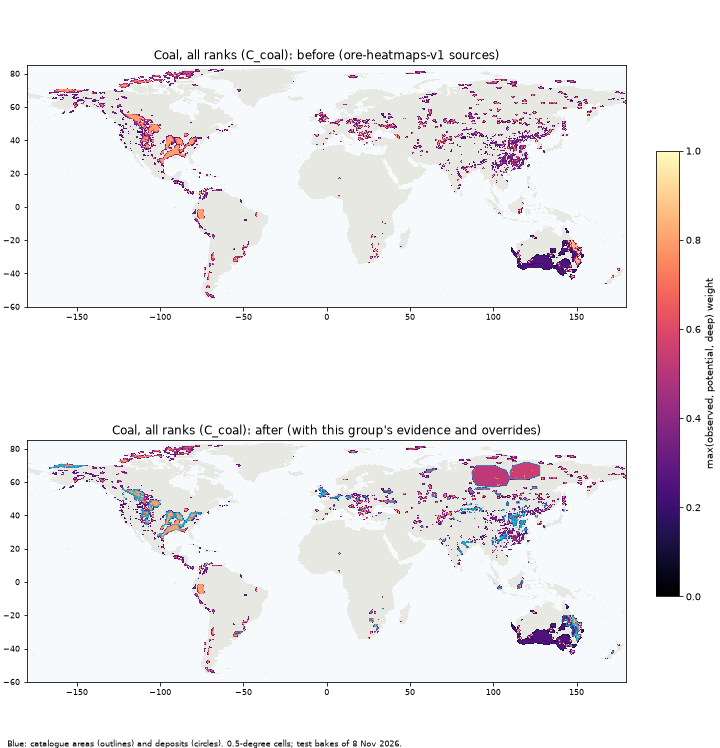
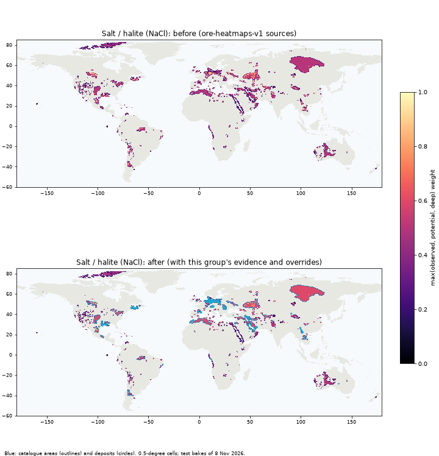
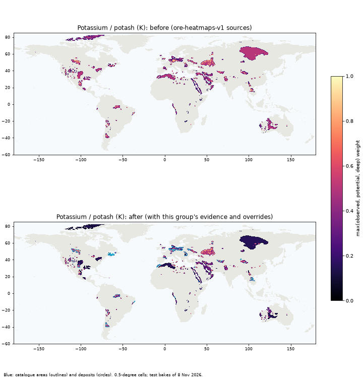
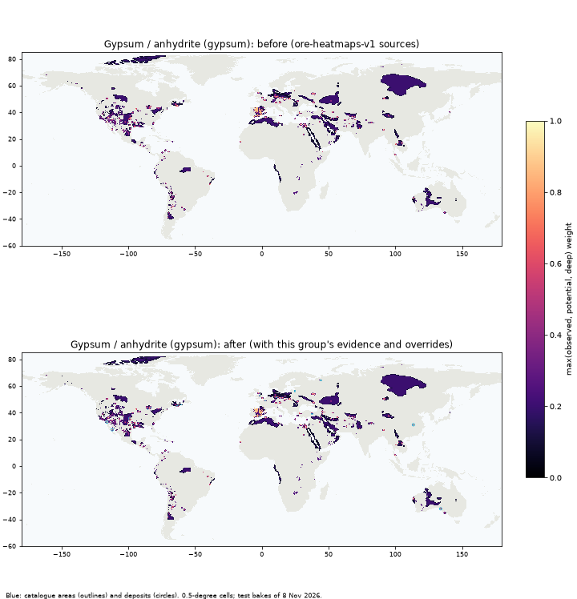
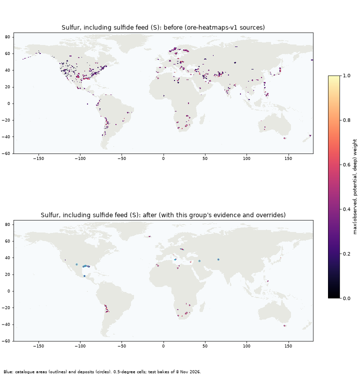
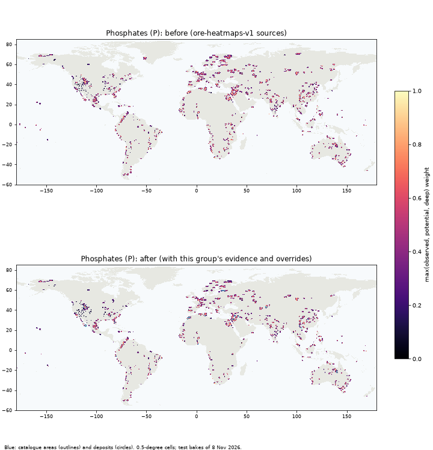
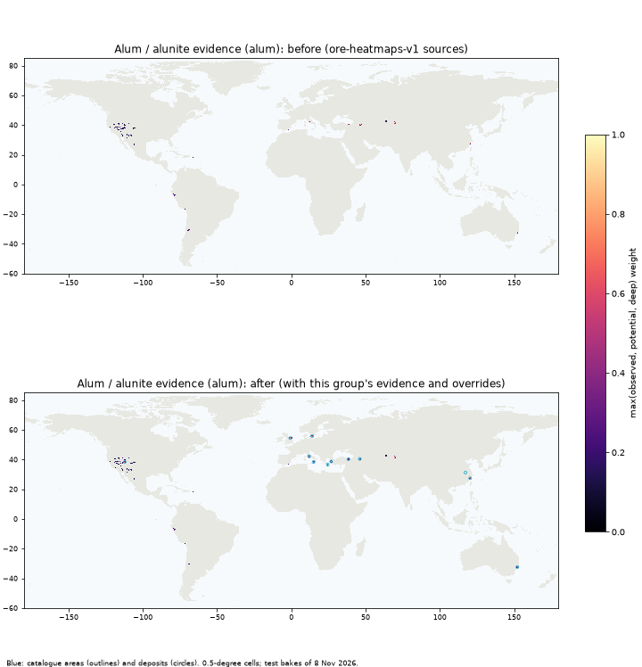

# Coal and evaporites: real deposits and heat maps (decision 0065)

8 November 2026, branch `claude/ore-coal-evaporites`. Group codes: `C_coal`, `NaCl`, `K`, `gypsum`, `B`, `S`, `P`, `N`,
`alum`. This is a data package for ore rules v4 (0065). It does not change the runtime, the bake script, the bake settings
or the shipped heat maps.

| File | What it is |
|---|---|
| `assets/earth/config/ore-deposits-v1/coal-evaporites.json` | The catalogue: 216 areas (basins with beds) and 76 deposits, about 0.77 MB |
| `tools/ore-data/coal-evaporites/tables.py` | The authored entries: outlines or source recipes, beds, tonnage, age, sources and confidence |
| `tools/ore-data/coal-evaporites/build_catalogue.py` | Builds the catalogue, `evidence.geojson` and `validation.json` from `tables.py` and the source layers |
| `tools/ore-data/coal-evaporites/evidence_fixes.py` | Filtered replacements for the heat-map sources dropped in `heatmap-overrides.json` |
| `tools/ore-data/coal-evaporites/evidence.geojson`, `heatmap-overrides.json` | The group's heat-map evidence (1,697 features) and dropped sources |
| `tools/ore-data/coal-evaporites/fetch_sources.py` | Downloads the public-domain archives to `rawdata/ore/coal-evaporites/` and checks the on-disk inputs |
| `tools/ore-data/coal-evaporites/report_tables.py`, `render_compare.py` | The validation tables and the before and after heat-map images in this note |
| `tools/ore-data/coal-evaporites/ATTRIBUTION.txt` | Source credits and licences |
| `docs/research/ore-deposits-2026-11-08/coal-evaporites/` | Images, `validation-tables.md`, `entries.csv` (every entry with its checks), `heatmap-cell-counts.json` |

Rebuild (from the Earth root of a worktree after `tools/ore-data/link-raw.ps1`):

```
C:\VS mods\Earth\.venv\Scripts\python.exe -I tools/ore-data/coal-evaporites/fetch_sources.py
C:\VS mods\Earth\.venv\Scripts\python.exe -I tools/ore-data/coal-evaporites/build_catalogue.py
C:\VS mods\Earth\.venv\Scripts\python.exe -I tools/ore-data/coal-evaporites/report_tables.py
```

## What is in the catalogue

| Layer | Areas | Deposits | Bed and body codes |
|---|---:|---:|---|
| `C_coal` | 119 | 0 | `bituminouscoal` (83 beds), `lignite` (28), `anthracite` (12) |
| `NaCl` | 30 | 39 | `halite`, `earth-saltflat`; 35 salt domes and diapirs, 4 rock-salt bodies (Wieliczka, Bochnia, Turda, Praid) |
| `K` | 24 | 0 | `sylvite` with `halite` in the same basin; `earth-saltflat-sylvite` on potash brines (Qarhan, Atacama, Bonneville, Danakil) |
| `gypsum` | 14 | 4 | `earth-gypsum` |
| `P` | 26 | 1 | `phosphorite` |
| `S` | 3 | 8 | `sulfur`: 5 Frasch salt domes (sulfur as the top zone of the halite column), Culberson, Mishraq, Gaurdak; areas Tarnobrzeg, Yavoriv-Rozdil and the Sicilian basin (sulfur, gypsum and salt beds) |
| `B` | 0 | 12 | `borax`, with `kernite` at the bottom of Boron |
| `alum` | 0 | 12 | `alum` (alunite and alum shale) |
| `N` | 0 | 0 | evidence only (Atacama nitrate fields); saltpeter in VS is a cave-air product |

Coalfields worked or exposed before 1318 carry a `worked` note: Northumberland-Durham, Yorkshire, South Wales, the
Scottish Midland Valley, Lancashire and Flintshire, the English Midlands, the Forest of Dean, Liège, Haine-Sambre
(Charleroi, Borinage), Limburg-Aachen, Saint-Étienne, the Ruhr outcrop, the Saar, Zwickau, Shanxi, Fushun, the Western
Hills of Beijing, Henan (Hebi) and Shandong (Zibo). Salt, alum, gypsum and sulfur worked by 1318 are marked the same way
(63 entries in all, for example Lüneburg, Wieliczka, Bochnia, Hallstatt, Hall in Tirol, Turda, Cheshire, Salins,
Taghaza, Bilma, Baskunchak, Phocaea, Karahisar, Paris plaster and Volterra alabaster).

## Sources and licences

Only redistributable sources are used. The shipped files hold derived values only: simplified outlines, positions,
tonnage, depth and thickness. No source file is redistributed. Full credits are in `ATTRIBUTION.txt`.

| Source | Used for | Licence |
|---|---|---|
| USGS OFR 2012-1205, coal fields of the conterminous US | US basin outlines (Appalachian, Illinois, Western Interior, Powder River, Fort Union, Green River, Uinta, San Juan, Gulf lignite) | public domain |
| USGS OFR 2008-1257, coal-bearing areas of the Americas | Alaska, Canada, Mexico, Colombia, Brazil, Chile | public domain |
| USGS OFR 2014-1219, Chinese coal-mining areas | China by province and rank | public domain |
| USGS OFR 2011-1296, coal-bearing areas of India (after GSI) | Damodar, Mahanadi, Son-Hasdeo, Godavari | public domain |
| USGS PP 1809 (Luppens and others 2015) | Powder River basin tonnage (q B) | public domain |
| USGS SIR 2010-5090-S, global potash tracts | Evaporite basin outlines and the ranked potash and salt evidence | public domain |
| USGS world phosphate deposits; USGS MRDS | Sedimentary phosphate and native-sulfur evidence | public domain |
| USGS OFR 01-104, FSU coal deposits | Cross-check of the authored former-Soviet basin outlines | public domain |
| BGS Coal Resources for New Technologies | UK coalfields, exposed and concealed | OGL v3 |
| PIG-PIB MIDAS | Upper Silesia, Lublin and Lower Silesia hard coal | PIG-PIB reuse conditions (attribution, date, processing) |
| GD NRW IS RK500 | Ruhr (Steinkohle to 2,000 m) and Rhenish lignite | dl-de/by-2.0 |
| LfULG Saxony RoeK400 | Zwickau-Lugau, Central German and Lusatian lignite | dl-de/by-2.0 |
| NSW Mining Coalfields; Victorian Coal Fields 2006; GA Australian Coal Basins 2013 | Sydney-Gunnedah; Latrobe Valley; Bowen, Surat, Galilee | CC BY; CC BY 4.0; CC BY 3.0 AU |
| Natural Earth admin-0 | Land and country checks only (not shipped) | public domain |
| BGR Energy Study 2023; USGS Mineral Commodity Summaries 2025 | Country totals for validation only | facts cited; MCS public domain |
| Published basin figures (`lit`) | Tonnage, seam depth and thickness, working dates | facts with citation, q B or C |

Not used: Mindat, OneGeology WMS tiles, and anything NC, ND or SA licensed. Where no open outline exists (the
former-Soviet basins, most of Europe outside the UK, Germany and Poland, and most evaporite and phosphorite districts),
the outline is authored from the general geography of the named field and marked `est: ["geometry"]`. The FSU coal
boundary shapefile (OFR 01-104) has arcs without polygons and no `.shx`, so it could only be used as a cross-check.

Literature behind the `lit` figures, by entry group. These are published headline figures used as facts:

- **UK coalfields:** BGS coal resource maps (1999 to 2004) and Coal Authority summaries; Hatcher, *The History of the
  British Coal Industry* vol. 1 (pre-1700 working).
- **Low Countries, France and Germany:**
  - Belgian and Dutch Carboniferous coal: Geological Survey of Belgium and TNO summaries.
  - Ruhr, Saar and Ibbenbüren: GD NRW and RAG figures.
  - Lignite: DEBRIV figures.
- **Poland and Czechia:** PGI *Bilans zasobów złóż kopalin*; Czech Geological Survey mineral yearbook.
- **Former Soviet Union:**
  - Soviet basin totals as repeated in the USGS FSU coal report (OFR 01-104) and in BGR country notes.
  - Kuzbass, Kansk-Achinsk, Pechora, Donbas, Karaganda, Ekibastuz, Tunguska and Lena: geological resources to 1,800 m.
- **China:** USGS OFR 2014-1219 text; China Mineral Resources (Ministry of Natural Resources) provincial summaries.
- **India:** Geological Survey of India coal and lignite inventory.
- **Pakistan:** Thar coal, Geological Survey of Pakistan.
- **Australia:**
  - Geoscience Australia AIMR.
  - Victorian brown coal: GSV.
  - Bowen, Surat and Galilee: Queensland government.
- **Americas:**
  - Powder River: USGS PP 1809.
  - Illinois, Appalachian, Fort Union and San Juan: USGS National Coal Resource Assessment summaries.
  - Alberta: AER ST98 ultimate potential.
  - Alaska North Slope: USGS hypothetical resources.
- **Africa:** Council for Geoscience (Witbank, Waterberg); Botswana Department of Geological Survey; Moatize and Hwange
  company resource statements.
- **Evaporites:**
  - USGS SIR 2010-5090-S tract and deposit tables (potash tonnage).
  - Warren, *Evaporites* (2016) for basin ages and salt thickness.
  - Halbouty, *Salt Domes* (Gulf Coast dome sizes and cap rocks).
- **Borates:** Garrett, *Borates* (1998); USGS MCS boron chapters.
- **Sulfur:** Ober (USGS) sulfur chapters for Frasch domes, Culberson, Tarnobrzeg, Mishraq and Sicily.
- **Phosphorite:**
  - USGS phosphate compilation and MCS.
  - OCP figures (Khouribga, Gantour, Meskala).
  - Notholt and others, *Phosphate Deposits of the World* vol. 2.
- **Alum and alunite:** Singer, *The Alum Trade* (Phocaea and Tolfa); Pliny and medieval trade histories for Milos,
  Lipari and Karahisar.

## Decisions

1. **Basins are areas with beds, and their size comes from published tonnage.**
   - Each bed has the depth to its top and the cumulative workable seam thickness. For coal this is the sum of workable
     seams, not the gross coal measures.
   - The cover share comes from the published tonnage:
     `cover = authored cover x published Mt / (area x sum of thickness x density)`, clamped to 0.0005..1.
   - Densities used (t/m3): lignite 1.2, bituminous 1.35, anthracite 1.5, halite 2.16, sylvite 2.0, salt flat 2.0,
     gypsum 2.3, borax and kernite 1.9, sulfur 2.3, phosphorite 2.3, alum 2.6.
   - Every area with a tonnage reproduces it within 0.8 to 1.25. 170 of 172 are within 1.0 ± 0.02; Svalbard is 0.9,
     because its cover reaches 1 on the outline, and the Maritimes 1.02.
   - The runtime reads `cover x thickM` over the polygon, as it notes in its own write-up. So the volume in the world is
     the real volume, scaled to the world.
2. **Exposed and concealed coal are separate areas.**
   - BGS gives the UK coalfields split into outcropping and concealed coal. Concealed areas get the depth of the
     concealed measures (Durham under the Permian 150 m; East Pennine concealed 400 m).
   - The Ruhr is split by hand the same way: the outcrop south of the Emscher at 0 m, and the concealed field to the
     north at 600 m to 2,000 m (RK500 "Steinkohle bis 2000 m").
   - So the coal worked in 1318 is at the surface and the bulk of the basin is deep, as it was.
3. **Rank by basin and age, with three VS codes.**
   - Subbituminous coal (Powder River, Alberta plains, Kansk-Achinsk, Indonesia) is written as `lignite`. VS has only
     lignite, bituminous coal and anthracite, and subbituminous coal is closer to lignite in heat and moisture.
   - Anthracite is used where the field is anthracite: western South Wales, Pennsylvania, eastern Donbas (east of
     38.8° E), Qinshui, Quang Ninh, Pyongan, Ibbenbüren and Kuzbass in part.
4. **Evaporites.**
   - Bedded salt and potash basins use the USGS potash tract outlines where they exist, with halite and sylvite beds in
     the same area. In a `K` area `mt` counts sylvite only, and halite takes the basin's salt thickness.
   - Salt domes and diapirs are `dome` deposits. Their size is a halite column of the published diameter from the top of
     the salt (or cap rock) to 3 to 5 km. Their `mt` is that column's tonnage, so they are very large. That is real:
     one Gulf Coast dome holds tens of Gt of salt.
   - Salt flats are `earth-saltflat` areas at 0 m (the playa layer). Potash brine flats are `earth-saltflat-sylvite`.
5. **Gypsum** areas are the gypsum formations worked or exposed in thick beds: Paris basin, Südharz, Windsor, Sorbas,
   Sivas, Blaine, Fort Dodge, Michigan, Midlands alabaster, Volterra, Sicily, Vena del Gesso, Salaspils, Biržai-Pasvalys
   and Pinega. Gypsum and anhydrite cap rock on salt domes (Bad Segeberg, the Gulf Coast) is not catalogued separately;
   the domes carry halite only.
6. **Borates are Cenozoic evaporite deposits only, following 0060.** These are Boron (borax over a kernite zone at the
   bottom), Searles, Furnace Creek, Kırka, Bigadiç, Emet, Kestelek, Tincalayu, Loma Blanca, Surire, Ascotán and Zabuye.
   Inder (Permian, Kazakhstan) is outside the 0060 borate rule, so it is heat-map evidence only.
7. **Sulfur is native sulfur in sediments.** The deposits are:
   - Frasch salt domes: Boling, Sulphur Mines, Grand Ecaille, Spindletop and Jáltipan. Each is one `dome` body owned by
     S: the sulfur-bearing cap rock (published ore tonnage at about 25 % S) is the `top` zone of the dome's halite
     column, and its evidence point goes to S and NaCl. S tiers and country totals count the sulfur ore only
     (`mainMt` in the build).
   - Culberson, Mishraq and Gaurdak.
   - The Miocene sulfur fields of Tarnobrzeg, Yavoriv-Rozdil and Sicily.

   Volcanic sulfur (Aucanquilcha, Námafjall, Vulcano, Ijen) is evidence only. VS sulfur comes from sedimentary beds.
8. **Phosphorite in any bed (0060).** This includes the Precambrian phosphorites of Patos de Minas, Kaiyang and Yichang,
   and the Baltic Obolus phosphorite of Estonia (Ordovician, q B).
9. **Alum and alunite.** The deposits are the alunite of Phocaea, Karahisar (Şebinkarahisar), Tolfa, Vulcano, Milos,
   Zaglik, Fanshan, Lujiang, Bulahdelah and Marysvale, plus the alum shales of Andrarum and Whitby.
   - Phocaea and Karahisar were the alum of the Genoese trade in 1318.
   - Tolfa was found only in 1460, so it has no `worked` note.
10. **Nitrates (N) are evidence only.** VS saltpeter is not a bedded deposit. The Atacama nitrate fields enter the `N`
    heat map at weight 0.85.
11. **Heat-map evidence from the catalogue.**
    - Every area becomes an observed polygon. Its weight is the confidence weight (A 0.8, B 0.7, C 0.6), times a
      richness factor for coal and potash: `0.8 + 0.35 log10(Mt per km2)`, clamped to 0.25..1. A giant thin basin
      (Surat 0.27, Galilee 0.29, Gulf lignite 0.37, Bowen 0.38, Amazonas potash 0.15) is therefore not as hot as the
      Ruhr, Shanxi or Upper Silesia (0.7).
    - A basin whose shallowest main bed starts at 300 m or deeper goes to the deep plane with that depth, so the
      background does not put surface coal or salt over buried beds. Examples are the concealed Ruhr, Campine,
      Zechstein potash and Elk Point.
    - Deposits become points with a tier from their size.
12. **Tonnage basis.**
    - The catalogue uses geological resources in place (identified plus inferred) from basin literature, in line with
      BGS, PGI, GSI and USGS assessments.
    - Where the only published basin total is a forecast to great depth (Tunguska, Lena, the Alaska North Slope,
      Alberta's ultimate potential), that figure is used. The deep part is compressed by the depth curve anyway.
    - This mixed basis shows in the country totals (Russia 1.6 and Canada 2.1 times BGR) and is left for the author:
      the figures are real published values, and cutting them would need a per-basin split nobody publishes.
13. **One body per real deposit (coordinator's rule, 8 November).** Co-products are `ores` shares inside one body
    (the Frasch domes above). Three areas over the Caltanissetta basin (Messinian salt, gypsum and sulfur) became one
    S area with gypsum, sulfur and halite beds. The Khewra mine is part of the Salt Range area, not a second entry.
    Basin areas still hold the bedded mother salt with the domes and diapirs that rise from it as separate bodies; those
    are different bodies, as they are in the ground. Fifteen overlapping outlines of the same bed (open polygons clipped
    by box catch shared fields: Lancashire and the Midlands, Mahanadi and Son-Hasdeo, Upper Silesia and Ostrava, the
    exposed and concealed UK pairs and others) are cut in `tables.OVERLAP_CUTS`, so no coal is counted twice. Stacked
    basins of different age (Surat over Bowen and Sydney-Gunnedah, Rhenish lignite over Limburg-Aachen) are real and
    stay.
14. **Layers for blankets (0065 contract addition, commit 50420af).** Salt-lake and playa blankets (Searles, Surire,
    Ascotán, Zabuye, Lake MacDonnell) carry `layers: ["playa"]`; the alum shales of Andrarum and Whitby carry
    `["bed"]`. Beds and domes keep the 0060 table, where salt-flat codes already go to the playa layer.
15. **Ages as period names.** Hormuz-series diapirs and the Salt Range are recorded as Cambrian, where the salt is
    from, not where the diapirs now reach the surface.
    - The Moscow basin is recorded as Carboniferous `lignite` and is the one 0060 conflict, kept on purpose. Its coal is
      real low-rank brown coal of Early Carboniferous age, never buried deep enough to mature.
    - The runtime's basin rule lets catalogue coal use any sedimentary bed in its area, so the conflict does not stop
      it generating.

## Heat maps: what was wrong and what changed

Test bakes of 8 November with `tools/bake_ore_heatmaps.py --out ... --report ...` (before: the sources of
`ore-heatmaps-v1`; after: with this group's `evidence.geojson` and `heatmap-overrides.json`). Neither bake was
committed. Cell counts are 0.5° cells with any weight on any plane.

| Code | Any cells before | after | Observed before | after | Deep before | after | Cells >= 0.5 before | after |
|---|---:|---:|---:|---:|---:|---:|---:|---:|
| `C_coal` | 9,246 | 10,995 | 8,072 | 9,966 | 23 | 92 | 2,627 | 4,184 |
| `NaCl` | 7,139 | 7,157 | 3,245 | 3,476 | 349 | 3,559 | 3,189 | 3,417 |
| `K` | 6,272 | 6,242 | 2,085 | 2,136 | 349 | 937 | 2,900 | 1,079 |
| `gypsum` | 6,780 | 6,798 | 1,695 | 1,725 | 0 | 0 | 364 | 374 |
| `B` | 582 | 584 | 582 | 584 | 0 | 0 | 116 | 118 |
| `S` | 1,975 | 303 | 1,975 | 297 | 0 | 10 | 324 | 106 |
| `P` | 4,627 | 3,989 | 4,627 | 3,989 | 0 | 0 | 1,370 | 1,111 |
| `N` | 97 | 103 | 97 | 103 | 0 | 0 | 17 | 25 |
| `alum` | 113 | 165 | 113 | 165 | 0 | 0 | 12 | 29 |

### "Background coal across Latvia"

The heat maps never had it. In both bakes `C_coal` is 0 on every plane at Riga, Liepāja, Daugavpils, Valmiera, Tartu,
Vilnius and Minsk. The coal players saw in Latvia came from the rules v3 runtime floor, which gave every layer a
minimum background everywhere. 0065 removes that floor ("no evidence and no geological potential means no background
attempts"), so it is fixed by the runtime, not by data. What the Baltic does have is real:

- gypsum near Riga: observed 0.85, the Salaspils and Sauriesi Devonian gypsum, a catalogue area;
- Lithuanian gypsum at Biržai-Pasvalys;
- Estonian Obolus phosphorite;
- Zechstein salt and potash on the deep plane at Kaliningrad (potential 0.45, deep 0.54 at 600 m).

### Faults found and fixed

- **S was mostly sulfide mines.**
  - The MRDS "Sulfur" records are largely sulfide mines that sold by-product sulfur or pyrite (Pyhäsalmi, Palabora,
    the Witwatersrand gold mines). USGS mineral facilities add refineries and gas plants, and the Afghan additional
    evidence is sulfide showings.
  - All three are dropped for S. Back in come the 100 MRDS records whose own text names native sulfur, Frasch,
    salt-dome cap rock, solfataras or fumaroles and that list no sulfide ore, plus the catalogue.
  - S observed cells: 1,975 to 297.
- **P mixed in Ni-Cr-PGE and magmatic apatite.**
  - `P-specialist.geojson` read the USGS Ni-Cr-PGE compilation (platinum as P) and carbonatite apatite (Khibiny,
    Kovdor, Siilinjärvi, Palabora) as phosphorite.
  - It is replaced by the 1,099 sedimentary, residual and guano-replacement phosphate records and the sedimentary major
    deposits, with the bake's own tiers. 348 records were left out.
- **K tracts were all equal.**
  - Every USGS permissive potash tract carried the full weight 0.5, so sylvite background covered all of East Siberia
    (1.8 million km2) and the Sahara, where no potash is known.
  - Tracts are now ranked: 0.5 where potash is mined or being developed (33 tracts), 0.35 where the tract has potash
    sites or resources (36), and 0.15 otherwise or for any tract over 300,000 km2 without mining (15).
  - Halite keeps 0.5 on every tract, since all are salt basins.
  - K cells at 0.5 or above: 2,900 to 1,079.
- **Buried basins were surface heat.** The deep plane now carries them (deep cells: K 349 to 937, NaCl 349 to 3,559,
  C_coal 23 to 92).
- **Coal was missing where the open coal layers do not reach:** Europe outside the UK, Germany and Poland, the former
  Soviet basins, Turkey, Iran, Mongolia and Southern Africa. The catalogue areas fill these gaps.

Checked and kept:

- Coal heat more than 1° from any catalogue entry is real: Arctic Canada, Peru, south China, Afghanistan and
  Uzbekistan, and the Balkans.
- The faint southern-Australian coal comes from the GA basins (Eucla, Murray, Arckaringa, Perth). These are real
  lignite and Permian coal basins at low weight.
- The IGME permissive gypsum formations in Spain are intended in the bake file.

### Before and after

Blue outlines and circles on the "after" panels are catalogue areas and deposits. `NaCl` panels also show the `K`
areas, whose basins hold halite.











## Validation

Generated by `report_tables.py` (also in `coal-evaporites/validation-tables.md`; every entry with its age verdict,
country and land checks is in `coal-evaporites/entries.csv`).

How to read the coal table:

- BGR "resources" include hypothetical coal to 1,500 to 2,000 m, so a catalogue built from assessed basin resources
  should come in below BGR. It does for most countries (world 0.6).
- The country figures could not be downloaded: BGR's site refused automated access on 8 November. They are BGR's
  headline numbers as published and widely repeated, and are approximate (about ±20 %), q C.
- Shortfalls with a known reason:
  - **China (0.29):** BGR adds about 3,800 Gt of forecast resources. Against China's identified resources of about
    2,070 Gt (MNR 2022) the ratio is 0.82.
  - **Australia (0.12):** BGR's resources are far above GA's identified resources.
  - **UK (0.36):** BGR counts deep and offshore coal; the catalogue counts the BGS onshore coalfields.
  - **Turkey (0.30), Mongolia (0.33) and Kazakhstan (0.72):** smaller basins are not catalogued yet (see "Left to
    do"). Turgai and the East Mongolian lignite basins were added after the first check, which had shown Mongolia at
    0.04 and Kazakhstan at 0.36.
- The two above BGR are Russia and Canada (decision 12).
- MCS reserves are economic reserves. The catalogue holds geological resources in place, so ratios well above 1 are
  expected. The check there is that the countries and their ranking agree.

The bake's own coordinate and country check (final test bake) dropped nothing from the catalogue, the native-sulfur
records or the potash tracts. It dropped 23 of the 1,099 sedimentary phosphate records:

- offshore and seamount phosphorites (Chatham Rise, Blake Plateau, offshore guyots);
- island guano without a land cell (Raine, Browse, Ashmore);
- records whose coordinates fall outside their country (Oron, Kingisepp, a Tennessee district at 51.75° W).

### Coal by country against published totals

| Country | Catalogue (Gt) | Published (Gt) | Ratio | Published basis |
|---|---:|---:|---:|---|
| Russia | 5,270 | 3,300 | 1.60 | BGR: hard coal ~2,600 Gt resources + lignite ~540 Gt + reserves ~160 Gt |
| United States of America | 4,341 | 8,000 | 0.54 | BGR: hard coal ~6,500 Gt resources + lignite ~1,400 Gt + reserves ~250 Gt |
| China | 1,688 | 5,800 | 0.29 | BGR: hard coal ~5,300 Gt resources + lignite ~300 Gt + reserves ~140 Gt |
| Canada | 662 | 310 | 2.14 | BGR: hard coal ~180 Gt + lignite ~120 Gt resources + reserves ~6 Gt; Alberta alone ~620 Gt ultimate potential (AER ST98) |
| India | 317 | 407 | 0.78 | Geological Survey of India inventory 1 April 2022: coal 361 Gt + lignite 46 Gt |
| Australia | 240 | 2,000 | 0.12 | BGR: hard coal ~1,500 Gt + lignite ~400 Gt resources + reserves ~150 Gt |
| Botswana | 200 | 212 | 0.94 | BGR: hard coal resources ~212 Gt |
| Pakistan | 175 | 186 | 0.94 | BGR: lignite resources ~176 Gt (Thar 175 Gt) + reserves ~3 Gt + hard coal ~7 Gt |
| Ukraine | 142 | 90 | 1.58 | BGR: hard coal ~32 Gt reserves + ~50 Gt resources + lignite ~8 Gt |
| Germany | 135 | 155 | 0.87 | BGR: hard coal ~83 Gt resources + lignite ~36 Gt resources + ~35 Gt reserves |
| Indonesia | 130 | 99 | 1.31 | Indonesian MEMR 2021: coal resources ~99 Gt (reserves ~35 Gt are part of them) |
| Kazakhstan | 122 | 170 | 0.72 | BGR: hard coal ~26 Gt reserves + ~123 Gt resources + lignite ~20 Gt |
| South Africa | 118 | 215 | 0.55 | BGR: hard coal ~10 Gt reserves + ~205 Gt resources |
| United Kingdom | 67 | 187 | 0.36 | BGR: hard coal resources ~187 Gt (includes deep and offshore coal) |
| Poland | 67 | 88 | 0.76 | PGI 2022 balance resources: hard coal ~64 Gt + lignite ~23 Gt |
| Mongolia | 58 | 173 | 0.33 | Mongolian government: geological resources ~173 Gt (BGR ~40 Gt hard coal + ~120 Gt lignite) |
| Brazil | 28 | 32 | 0.88 | BGR: lignite and subbituminous ~6.6 Gt reserves + ~25 Gt resources (Rio Grande do Sul) |
| Czechia | 25 | 23 | 1.09 | BGR: hard coal ~16 Gt + lignite ~7 Gt resources |
| Mozambique | 25 |  |  |  |
| Kosovo | 12 |  |  |  |
| Belgium | 12 |  |  |  |
| Japan | 12 |  |  |  |
| Colombia | 11 | 15 | 0.73 | BGR: hard coal ~4.5 Gt reserves + ~11 Gt resources |
| France | 10 |  |  |  |
| Iran | 10 |  |  |  |
| Vietnam | 10 |  |  |  |
| Turkey | 6 | 21 | 0.30 | MTA: lignite ~19 Gt + hard coal ~1.5 Gt (Zonguldak) |
| North Korea | 6 |  |  |  |
| Chile | 5 |  |  |  |
| Zimbabwe | 5 |  |  |  |
| Greece | 4 |  |  |  |
| Norway | 3 |  |  |  |
| Mexico | 3 |  |  |  |
| Republic of Serbia | 3 |  |  |  |
| Bulgaria | 2 |  |  |  |
| Nigeria | 2 |  |  |  |
| Spain | 2 |  |  |  |
| Thailand | 1 |  |  |  |
| New Zealand | 1 |  |  |  |

World total in the catalogue: 13,932 Gt (BGR world coal resources plus reserves: about 23,000 Gt).

### Phosphorite by country against USGS MCS 2025 reserves

| Country | Catalogue (Mt rock) | MCS 2025 reserves (approx.; - not listed or not quantified) | In both |
|---|---:|---:|---|
| Morocco | 50,000 | 50,000 | yes |
| United States of America | 21,000 | 1,000 | yes |
| China | 7,000 | 3,700 | yes |
| Peru | 5,000 | 210 | yes |
| Kazakhstan | 4,000 | 260 | yes |
| Australia | 4,000 | 1,100 | yes |
| Estonia | 3,700 | - | catalogue only |
| Tunisia | 2,500 | 2,500 | yes |
| Vietnam | 2,500 | 30 | yes |
| Algeria | 2,000 | 2,200 | yes |
| Jordan | 2,000 | 1,000 | yes |
| Syria | 1,700 | - | catalogue only |
| Western Sahara | 1,000 | - | catalogue only |
| Israel | 1,000 | 60 | yes |
| Saudi Arabia | 1,000 | 1,400 | yes |
| Iraq | 1,000 | - | catalogue only |
| Egypt | 1,000 | 2,800 | yes |
| Mexico | 500 | 30 | yes |
| Brazil | 400 | 1,600 | yes |
| Togo | 300 | 30 | yes |
| Senegal | 300 | 50 | yes |
| Russia |  | 2,400 | MCS only |

### Potash by country against USGS MCS 2025 reserves

| Country | Catalogue (Mt sylvite (MCS: Mt K2O)) | MCS 2025 reserves (approx.; - not listed or not quantified) | In both |
|---|---:|---:|---|
| Canada | 151,000 | 1,100 | yes |
| Thailand | 50,000 | - | catalogue only |
| Russia | 20,000 | 400 | yes |
| Germany | 20,000 | 150 | yes |
| Belarus | 15,000 | 750 | yes |
| United States of America | 7,050 | 220 | yes |
| Republic of the Congo | 5,000 | - | catalogue only |
| Brazil | 3,500 | 2 | yes |
| China | 3,000 | 180 | yes |
| Ethiopia | 3,000 | - | catalogue only |
| Ukraine | 2,500 | - | catalogue only |
| Turkmenistan | 2,000 | - | catalogue only |
| Israel | 2,000 | - | catalogue only |
| United Kingdom | 1,500 | - | catalogue only |
| Spain | 1,500 | 44 | yes |
| Argentina | 1,500 | - | catalogue only |
| France | 500 | - | catalogue only |
| Chile | 500 | 100 | yes |
| Morocco | 500 | - | catalogue only |
| Laos |  | 75 | MCS only |

### Borates by country against USGS MCS 2025 reserves

| Country | Catalogue (Mt ore (MCS: Mt B2O3)) | MCS 2025 reserves (approx.; - not listed or not quantified) | In both |
|---|---:|---:|---|
| Turkey | 2,010 | 1,100 | yes |
| United States of America | 1,150 | 40 | yes |
| Chile | 80 | 35 | yes |
| Argentina | 50 | - | catalogue only |
| China | 20 | 24 | yes |
| Bolivia |  | - | MCS only |
| Russia |  | 40 | MCS only |
| Peru |  | 4 | MCS only |

S catalogue tonnage by country (Mt): Poland 2,000, United States of America 820, Iraq 800, Ukraine 600, Italy 300, Turkmenistan 200, Mexico 100

gypsum catalogue tonnage by country (Mt): China 1,000, Mexico 500, Australia 200, United States of America 100

NaCl catalogue tonnage by country (Mt): Iran 424,116, Germany 200,148, United States of America 185,842, Poland 63,145, Denmark 51,912, Israel 33,929, Austria 10,178, Netherlands 8,482, Romania 7,393, Spain 7,083, Algeria 5,726, Ukraine 5,611

alum catalogue tonnage by country (Mt): China 300, Azerbaijan 160, Italy 52, Sweden 50, United Kingdom 50, Turkey 40, Greece 5, Australia 5, United States of America 5

### The 20 largest entries

| # | Entry | Layer | Mt | Area km2 | Country | Age | q |
|---:|---|---|---:|---:|---|---|---|
| 1 | Tunguska coal basin (`coal:tunguska`) | C_coal | 2,000,000 | 1,349,832 | Russia | Permian | C |
| 2 | North Slope of Alaska (Nanushuk, Colville) (`coal:alaska-north-slope`) | C_coal | 2,000,000 | 51,185 | United States of America | Cretaceous | C |
| 3 | Lena coal basin (`coal:lena`) | C_coal | 1,600,000 | 761,655 | Russia | Jurassic | C |
| 4 | Powder River basin (Fort Union, Wyodak) (`coal:powder-river`) | C_coal | 970,000 | 52,480 | United States of America | Paleogene | B |
| 5 | Xinjiang Jurassic coal (Junggar, Turpan-Hami, Ili) (`coal:xinjiang`) | C_coal | 800,000 | 24,072 | China | Jurassic | C |
| 6 | Kuznetsk basin (Kuzbass) (`coal:kuzbass`) | C_coal | 640,000 | 24,318 | Russia | Permian | C |
| 7 | Kansk-Achinsk lignite basin (`coal:kansk-achinsk`) | C_coal | 600,000 | 47,131 | Russia | Jurassic | C |
| 8 | Alberta plains coal (Horseshoe Canyon, Paskapoo, Scollard) (`coal:alberta-plains`) | C_coal | 600,000 | 173,767 | Canada | Cretaceous | C |
| 9 | Pechora coal basin (Vorkuta, Inta) (`coal:pechora`) | C_coal | 340,000 | 30,558 | Russia | Permian | C |
| 10 | Illinois basin (`coal:illinois`) | C_coal | 300,000 | 129,723 | United States of America | Carboniferous | C |
| 11 | Fort Union lignite region (Williston basin) (`coal:fort-union-lignite`) | C_coal | 300,000 | 166,336 | United States of America | Paleogene | C |
| 12 | Shanxi coal province (Datong, Ningwu, Xishan, Hedong) (`coal:shanxi`) | C_coal | 220,000 | 24,705 | China | Carboniferous | B |
| 13 | Ordos basin Jurassic coal (Shendong, Shenfu-Dongsheng) (`coal:ordos`) | C_coal | 220,000 | 11,675 | China | Jurassic | C |
| 14 | Hormuz Island salt diapir (`dome:hormuz-island`) | NaCl | 212,058 |  | Iran | Cambrian | C |
| 15 | Namakdan salt diapir (Qeshm) (`dome:namakdan`) | NaCl | 212,058 |  | Iran | Cambrian | C |
| 16 | Botswana Karoo coalfields (Morupule, Mmamabula) (`coal:botswana-kalahari`) | C_coal | 200,000 | 45,220 | Botswana | Permian | C |
| 17 | Thar lignite field (`coal:thar`) | C_coal | 175,000 | 10,843 | Pakistan | Paleogene | B |
| 18 | Inner Mongolian lignite (Shengli, Huolinhe, Yimin, Baorixile) (`coal:inner-mongolia-lignite`) | C_coal | 150,000 | 6,234 | China | Cretaceous | C |
| 19 | San Juan basin (Fruitland) (`coal:san-juan`) | C_coal | 150,000 | 39,800 | United States of America | Cretaceous | C |
| 20 | Elk Point basin, Prairie Evaporite potash (Saskatchewan) (`evap:elk-point`) | K | 150,000 | 184,171 | Canada | Devonian | C |

### Locations

- Areas: 216; in their country (largest overlap or any overlap): 215; land share under 0.5: 0 (none).
- Deposits: 76; on land: 74; in their country: 76. Off land: dome:cote-blanche, sul:grand-ecaille.
- Evidence-only entries: 5; in their country: 5.
- Country problems: phos:bou-craa (catalogue Western Sahara, Natural Earth Morocco).

### Ages against the 0060 layer rules

| Layer | Codes | Age | Entries |
|---|---|---|---:|
| B | borax | Neogene | 6 |
| B | borax | Quaternary | 4 |
| B | borax/kernite | Neogene | 2 |
| C_coal | anthracite | Carboniferous | 5 |
| C_coal | anthracite | Jurassic | 1 |
| C_coal | anthracite | Permian | 1 |
| C_coal | anthracite | Triassic | 1 |
| C_coal | anthracite/bituminouscoal | Permian | 4 |
| C_coal | bituminouscoal | Carboniferous | 40 |
| C_coal | bituminouscoal | Cretaceous | 6 |
| C_coal | bituminouscoal | Jurassic | 7 |
| C_coal | bituminouscoal | Neogene | 1 |
| C_coal | bituminouscoal | Paleogene | 8 |
| C_coal | bituminouscoal | Permian | 17 |
| C_coal | lignite | Carboniferous | 1 |
| C_coal | lignite | Cretaceous | 4 |
| C_coal | lignite | Jurassic | 3 |
| C_coal | lignite | Neogene | 15 |
| C_coal | lignite | Paleogene | 5 |
| K | earth-saltflat/earth-saltflat-sylvite | Quaternary | 4 |
| K | halite/sylvite | Carboniferous | 3 |
| K | halite/sylvite | Cretaceous | 4 |
| K | halite/sylvite | Devonian | 2 |
| K | halite/sylvite | Jurassic | 1 |
| K | halite/sylvite | Neogene | 2 |
| K | halite/sylvite | Paleogene | 2 |
| K | halite/sylvite | Permian | 4 |
| K | halite/sylvite | Quaternary | 1 |
| K | halite/sylvite | Triassic | 1 |
| NaCl | earth-saltflat | Quaternary | 7 |
| NaCl | earth-saltflat/earth-saltflat-sylvite | Quaternary | 1 |
| NaCl | halite | Cambrian | 5 |
| NaCl | halite | Cretaceous | 1 |
| NaCl | halite | Jurassic | 9 |
| NaCl | halite | Neogene | 9 |
| NaCl | halite | Paleogene | 3 |
| NaCl | halite | Permian | 23 |
| NaCl | halite | Silurian | 1 |
| NaCl | halite | Triassic | 10 |
| P | phosphorite | Cambrian | 4 |
| P | phosphorite | Cretaceous | 4 |
| P | phosphorite | Neogene | 4 |
| P | phosphorite | Ordovician | 1 |
| P | phosphorite | Paleogene | 10 |
| P | phosphorite | Permian | 1 |
| P | phosphorite | Precambrian | 3 |
| S | earth-gypsum/halite/sulfur | Neogene | 1 |
| S | halite/sulfur | Jurassic | 5 |
| S | sulfur | Jurassic | 1 |
| S | sulfur | Neogene | 3 |
| S | sulfur | Permian | 1 |
| alum | alum | Cambrian | 1 |
| alum | alum | Carboniferous | 1 |
| alum | alum | Cretaceous | 3 |
| alum | alum | Jurassic | 2 |
| alum | alum | Neogene | 4 |
| alum | alum | Quaternary | 1 |
| gypsum | earth-gypsum | Carboniferous | 2 |
| gypsum | earth-gypsum | Devonian | 2 |
| gypsum | earth-gypsum | Jurassic | 1 |
| gypsum | earth-gypsum | Neogene | 5 |
| gypsum | earth-gypsum | Paleogene | 3 |
| gypsum | earth-gypsum | Permian | 3 |
| gypsum | earth-gypsum | Quaternary | 1 |
| gypsum | earth-gypsum | Triassic | 1 |

Conflicts: coal:moscow-basin (Carboniferous, lignite): lignite must be Cenozoic or Mesozoic.

### Tonnage the beds imply against the published tonnage

172 areas carry a published tonnage; the derived cover reproduces it within 0.8 to 1.25 for 172; outside: none.

## Settings

No change to `tools/ore-heatmap-settings.json` is needed. The K-to-NaCl mirror can stay: this group's evidence writes
NaCl on every potash tract itself, at the same weight the mirror gives, so the two agree.

## Left to do

- **Tonnage basis (decision 12):** decide whether forecast resources (Tunguska, Lena, Alaska North Slope, Alberta) stay
  as published or are cut to identified resources.
- **Not yet catalogued:**
  - the Turkish lignite basins beyond Afşin-Elbistan (Soma, Tunçbilek, Çayırhan, Konya-Karapınar, Thrace);
  - Kazakh Maikuben and Shubarkol;
  - the Mongolian South Gobi basin beyond Tavan Tolgoi;
  - the Gippsland basin beyond the Latrobe Valley fields;
  - the Red River basin lignite under the delta (Vietnam);
  - the smaller Indonesian basins (Ombilin, Bengkulu, Tarakan); Kutai, Barito and South Sumatra are in.
- **Bou Craa** is recorded as Western Sahara; Natural Earth puts it in Morocco. This is a naming question, not a
  position error.
- **Cote Blanche and Grand Ecaille** sit on the Louisiana coast, in Natural Earth's water at 1:10m. Both are real domes
  under coastal marsh and bay (Cote Blanche was mined from an island in the marsh). They were kept at their real
  positions. Whether the runtime places a dome whose top cell is sea is not checked here.
- **Heat-map reach:** the coordinating session's v2 bake of all groups is still to come. The images here are test bakes
  with this group's files only.
