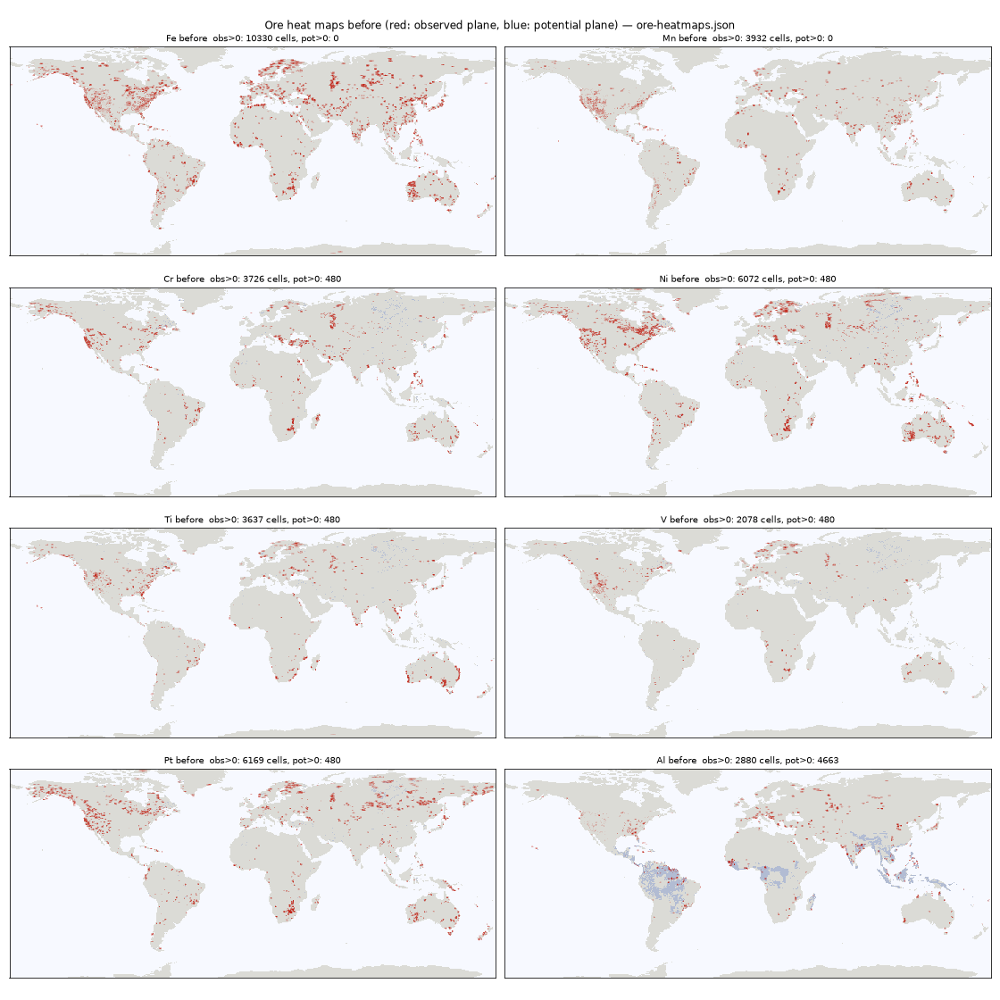
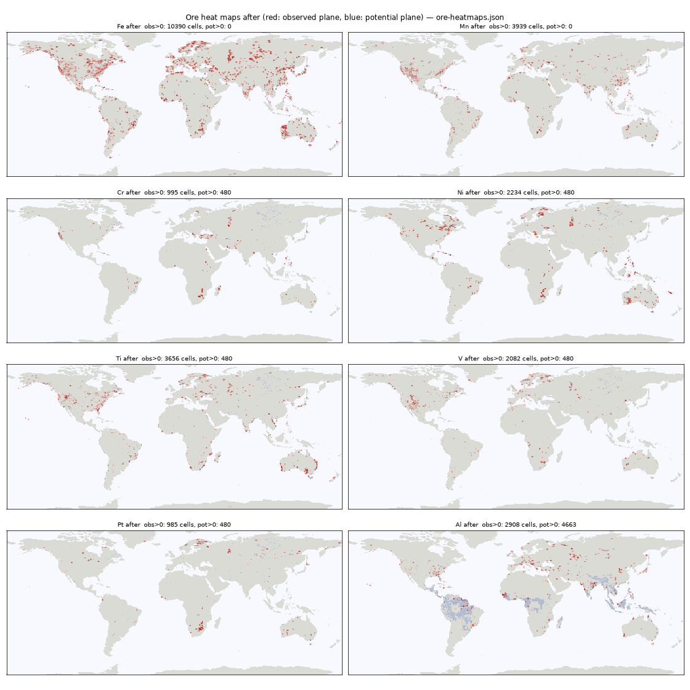
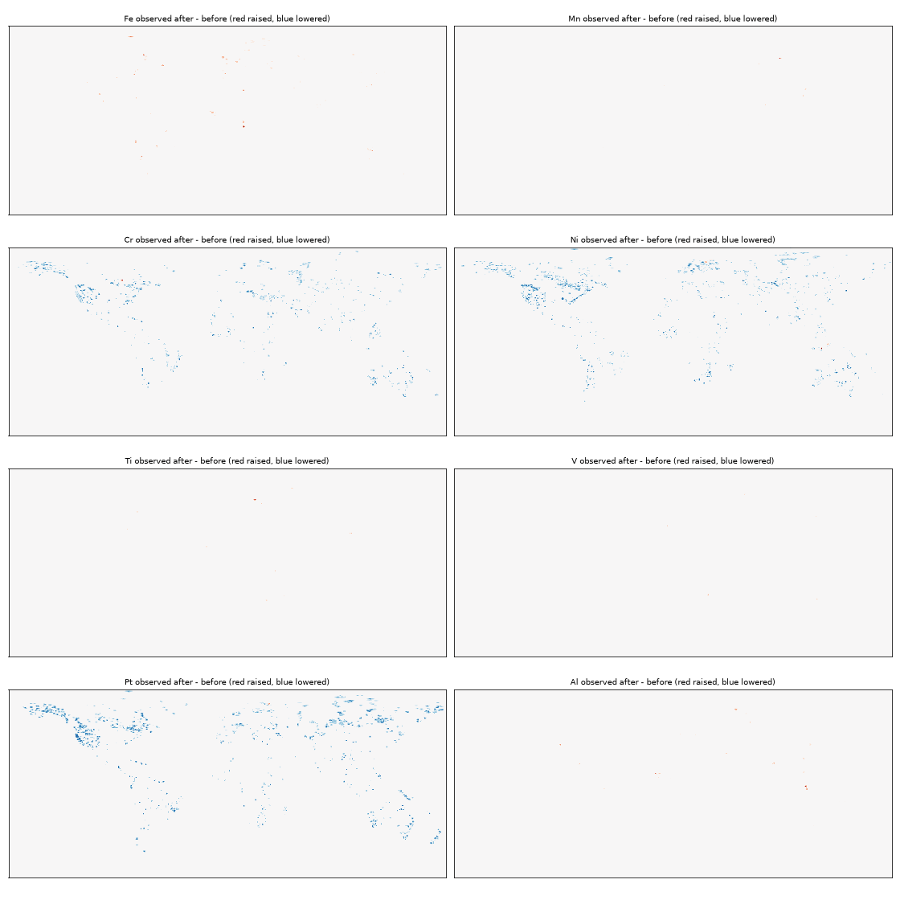

# Iron, ferroalloys and aluminium: ore deposits at their real size (decision 0065)

Group session `iron-ferro`, 8 November 2026, branch `claude/ore-iron-ferro`. Heat-map layer codes Fe, Mn, Cr, Ni, Ti,
V, Pt, Al. Deliverables:

- catalogue [`assets/earth/config/ore-deposits-v1/iron-ferro.json`](../../../assets/earth/config/ore-deposits-v1/iron-ferro.json);
- builders and inputs in [`tools/ore-data/iron-ferro/`](../../../tools/ore-data/iron-ferro/):
  - `authored-deposits.csv`, `authored-areas.json`: the hand-compiled deposits and areas;
  - `build_catalogue.py`, `build_evidence.py`, `validate_catalogue.py`, `fetch_sources.py`, `heatmap_tools.py`;
  - `evidence.geojson`, `heatmap-overrides.json`, `validation.json`, `validation.md`, `ATTRIBUTION.txt`.

Re-run, in order:

```text
C:\VS mods\Earth\.venv\Scripts\python.exe -I tools/ore-data/iron-ferro/fetch_sources.py
C:\VS mods\Earth\.venv\Scripts\python.exe -I tools/ore-data/iron-ferro/build_catalogue.py
C:\VS mods\Earth\.venv\Scripts\python.exe -I tools/ore-data/iron-ferro/build_evidence.py
C:\VS mods\Earth\.venv\Scripts\python.exe -I tools/ore-data/iron-ferro/validate_catalogue.py
```

## Sources and licences

| Source | What it gives | Licence | Use |
|---|---|---|---|
| USGS OFR 2011-1058, Ni-Co laterites (Berger, Singer, Bliss, Moring 2011) | 120 laterites with tonnage, Ni grade, area, thickness, profile type | public domain | Ni `blanket` deposits, q B |
| USGS SIR 2012-5157, podiform chromite (Mosier, Singer, Moring, Galloway 2012) | about 1,000 pods with tonnage and Cr2O3 grade | public domain | Cr `lens` deposits, q A (≥ 10,000 t) or B |
| USGS OFR 2009-1045, PGE-Ni-Cr index (Causey, Galloway, Zientek 2009) | 20,000 site records, mostly occurrences | public domain | heat-map re-adds only, filtered |
| USGS OFR 2005-1294, Major mineral deposits of the world | major deposits, no tonnage | public domain | heat-map re-adds |
| USGS Mineral Commodity Summaries 2025 | reserves and world resources per country | public domain | validation; cited in entries |
| Published endowment figures (company reports, national surveys, review papers named per entry in `ref`) | tonnage and grade of well-known deposits and districts | facts with citation | `authored-deposits.csv`, `authored-areas.json`, q B or C |
| Natural Earth 1:10m admin-0 | country outlines | public domain | validation only |

Nothing from Mindat, NC, ND or SA sources. Downloads (MCS 2025 PDFs) are in `C:\VS mods\Earth\rawdata\ore\iron-ferro\`,
outside git; the USGS compilations were already on disk from the 29 September package.

## Decisions

1. **Endowment, not reserves.** `mt` is pre-mining ore: past production + reserves + resources at the source's cut-off,
   as 0065 asks. Production before 1318 is negligible beside it. So catalogue totals exceed USGS reserves by design
   (validation below); where they exceed published world resources the entry is wrong.
2. **Where the big deposits are listed, the area holds the rest.** Iron formations are `areas` with beds; the giant
   high-grade bodies inside them (Mount Whaleback, Tom Price, Mining Area C, Yandi, Carajás Serra Norte, S11D,
   Itabira, Carol Lake, Mont-Wright, Schefferville, Kremenchuk) are separate deposits with their own grade, so the rich
   ore is concentrated where it really is (0006: "very large deposits very rich") and the area beds carry the leaner
   remaining iron formation. Area tonnages exclude the listed deposits.
3. **Bed cover from tonnage.** Each area bed gives `mt`, `thickM` and `topM`; `cover = mt / (density × area × thickM)`,
   so area × cover × thickness is the bed's real volume. Iron-formation covers come out small (0.002–0.1): the ore is a
   small share of its districts, as it is (decision 11, "Bed cover").
4. **Grade bands** (`gradeBands`, with `basis`): Fe % Fe 30 / 45 / 60 (taconite poor, minette and BIF medium, Kiruna,
   Hamersley and Carajás hematite bountiful); Mn % Mn 20 / 35 / 45; Cr % Cr2O3 25 / 38 / 46; Ni % Ni 0.8 / 1.5 / 2.5;
   Ti % TiO2 3 / 10 / 25 (mineral sands poor, Kerala beach sands and Tellnes rich, Lac Tio bountiful); V % V2O5
   0.3 / 0.8 / 1.4; Pt g/t PGE 1.5 / 4 / 8 (Platreef medium, Merensky and UG2 rich, Stillwater bountiful); Al % Al2O3
   40 / 48 / 55. The numbers are medium / rich / bountiful lower bounds; below medium is poor.
5. **Game ores standing in for real minerals** (recorded per entry in `ref`):
   - siderite (Erzberg, Siegerland, Bakal, Bilbao carbonate ore, Cleveland) → `limonite`, its weathering product and the
     game's brown ore;
   - Ni silicate and Ni limonite ore of laterites → `pentlandite` (zone `bottom`, the saprolite) under a `limonite` cap
     (zone `top`); the split follows the USGS profile type (oxide 70 % limonite, clay 50 %, hydrous Mg silicate 30 %);
   - rutile (Sierra Rutile) → `ilmenite`; descloizite (Abenab) → `vanadinite`;
   - vanadium in titanomagnetite → a 5 % `vanadinite` share beside `magnetite` and `ilmenite`;
   - PGE reefs → `sperrylite`; PGE placers → `earth-placerplatinum` (Earth's platinum placer; `nativeplatinum`
     until 8 November, see below).

   Earth's `ore-graded.json` defines `vanadinite` (limestone, dolostone and sandstone variants only) and `sperrylite`
   (peridotite and basalt variants only); `nativeplatinum` comes from Geology Additions. The runtime skips a code
   that has no block and gives its share to the body's other codes. Later on 8 November (branch
   `claude/ore-tungsten-platinum`) the five placers moved to `earth-placerplatinum`, Earth's own platinum-bearing
   gravel and sand like `earth-placergold` and `earth-placertin`, so they are placed without other mods; Geology
   Additions' `nativeplatinum` is a hard-rock ore and keeps its own deposit.
6. **One body per real deposit**, owned by the group of its main commodity by value, with co-products as `ores`
   shares (the coordinating session's rule for all groups). Magmatic Ni-Cu-PGE deposits are this group's and carry
   their copper as `chalcopyrite` shares (Norilsk-Talnakh 60 %, Sudbury 40 %, Duluth 70 %) and their PGE as a
   `sperrylite` share (5 %) in layer Ni; Norilsk-1's PGE-rich disseminated ore is its own Pt entry. Bayan Obo carries
   its fluorite as a 15 % share. Bodies owned by other groups were removed here: the Rio Tinto and Tharsis gossans
   (base-metals' massive sulphides; the limonite cap belongs in their bodies as a `top` share), Berg Aukas
   (base-metals' Zn-Pb mine; vanadium as a share there) and the Uravan mineral belt (precious-gems' uranium; vanadium
   as a share there). No IOCG deposit is listed; Marcona is an iron mine (its copper neighbour Mina Justa is
   base-metals').
7. **Shapes**: BIF-hosted high-grade bodies, skarns and Kiruna-type bodies are `lens` or `stock` with their published
   footprint where known; flat ironstones and channel-iron deposits are flat lenses; laterites, bauxites, heavy-mineral
   sands, ironsands, gossans and PGE placers are `blanket`. Missing dimensions are estimated from the volume and listed
   in `est`.
8. **Heat maps.** The catalogue is also heat-map evidence (deposits as points with a peak from their tonnage, areas as
   polygons at weight 0.8). For Pt, Ni and Cr the specialist files and the MRDS occurrence files are dropped and
   re-added selectively (`heatmap-overrides.json`, `build_evidence.py`). The reason: the nicrpge index lists every
   ultramafic occurrence with any Ni, Cr or PGE mention (5,112 Pt, 8,710 Ni and 7,072 Cr records, 60 % in North
   America), and MRDS lists by-product PGE in gold placers, so together they lit Pt over the whole western US and
   Canada. Re-added:
   - USGS major deposits, at tier major;
   - nicrpge sites that were worked (peak Pt 0.5, Ni 0.75, Cr 0.6) or are past producers (Pt 0.4, Ni 0.55), and only
     where every commodity of the record belongs to the code's deposit family. For Pt that family is PGE alone. For Ni
     it is Ni with Cu, Co, PGE, Au, Ag, Fe, Cr and S. For Cr it is Cr with Fe, Ni, PGE, Au and silica.
   - Cr past-producing pods come back with their tonnage from the podiform catalogue.

   nicrpge's source commodity order is not "main commodity first": Esterley Chrome Mine reads Pd;Cr;Ir;Rh;Ru;Pt;PGE.
   So the first commodity cannot decide the filter. An earlier version of this filter still let US chromite mines and
   gold placers through as platinum sites.
9. **Latvia.** The baked Fe, Mn, Ti and Al planes are zero over Latvia (probe at Riga, Kurzeme, Vidzeme, Latgale). The
   hematite seen there in worlds comes from the runtime's background floor, which 0065 section 5 removes; Latvian bog
   iron stays with the runtime's peat layer deposit. No heat-map change was needed for it.
10. **Layers per body** (0065 as amended in 50420af). Each body that does not follow its codes' 0060 table names its
    layer classes in `layers`: Ni laterites `["laterite", "saprolite"]`, bauxite, iron caps and lateritic iron
    `["laterite"]`, mineral sands and ironsands `["alluvial", "cover"]`, PGE placers `["alluvial", "outwash"]`, the
    two buried bauxites `["bed"]`. Hard-rock bodies have no `layers` and keep bed and basement.
11. **Area outlines are the ore districts.** Areas are drawn around the districts where the ore lies (for example the
    Hamersley Chichester, Solomon-Eliwana, Tom Price-Paraburdoo and Mining Area C-Newman belts, not the whole
    province), so that `cover` is the share of those districts the bed fills. See "Bed cover" below.

## Catalogue contents

1,232 deposits and 20 areas (573 KB minified). Every deposit has `mt`, `grade`, `unit`, `density`, `topM`, `baseM`,
`lenKm`, `widKm`, `strikeDeg`, `dipDeg`, `age` (a 0060 era; the period, where known, is kept in `period`), `src` and `q`;
188 have `layers` (decision 10). 1,092 have one or more dimensions estimated from their volume and list them in `est`.

| Layer | Deposits | From | Shapes | Areas |
|---|---:|---|---|---:|
| Fe | 116 | published endowment (115 q C, 1 q B) | 96 lens, 15 stock, 4 blanket, 1 veins | 11 |
| Mn | 17 | published endowment (q C) | 17 lens | 3 |
| Cr | 876 | 869 USGS podiform chromite (240 q A, 629 q B), 7 published (q C) | 876 lens | 2 |
| Ni | 142 | 117 USGS Ni-Co laterites (q B), 25 published (q B or C) | 121 blanket, 19 lens, 2 stock | 0 |
| Ti | 22 | published endowment (21 q C, 1 q B) | 15 blanket, 4 lens, 3 stock | 0 |
| V | 7 | published endowment | 4 lens, 2 stock, 1 veins | 1 |
| Pt | 9 | published endowment | 5 blanket, 3 lens, 1 stock | 3 |
| Al | 43 | published endowment | 41 blanket, 2 lens | 0 |

Areas: iron formations and ironstones (Hamersley, Carajás, Quadrilátero Ferrífero, Kryvbas, KMA, Mesabi, Labrador
Trough, Singhbhum, Lorraine minette, Cleveland, Clinton-Birmingham), manganese basins (Kalahari, Nikopol, Chiatura),
Bushveld and Great Dyke chromitites, PGE reefs (Merensky + UG2, Platreef, Great Dyke Main Sulphide Zone) and the
Bushveld Main Magnetite Layer (V). Named deposits from the brief that are deposits rather than areas: Kiruna,
Malmberget, Erzberg, Bilbao, Elba, limonite caps (Moa-Mayarí, Conakry; the Rio Tinto and Tharsis gossans went to
base-metals, decision 6), Groote Eylandt, Moanda, Norilsk-Talnakh,
Sudbury, Voisey's Bay, Kambalda, Tellnes, Allard Lake (Lac Tio), Stillwater, the Ural PGE placers, Boké, Weipa,
Jamaica, Trombetas and Les Baux.

### Bed cover

`cover = mt / (density × area × thickM)`. After the outlines were cut back from whole provinces to ore districts (on
8 November, at the coordinating session's request) the iron-formation covers rose 1.7 to 5.8 times:

| Area | Outline km² (before → after) | Bed | Cover (before → after) |
|---|---|---|---|
| Hamersley iron province | 79,239 → 14,217 | hematite 40 m | 0.0012 → 0.0069 |
| Hamersley iron province | 79,239 → 14,217 | magnetite 150 m | 0.0010 → 0.0055 |
| Carajas iron formation | 4,963 → 2,182 | hematite 150 m | 0.0019 → 0.0042 |
| Quadrilatero Ferrifero itabirites | 6,820 → 3,086 | hematite 200 m | 0.0052 → 0.0116 |
| Kursk Magnetic Anomaly | 6,635 → 3,949 | magnetite 200 m | 0.0055 → 0.0093 |
| Kursk Magnetic Anomaly | 6,635 → 3,949 | hematite 80 m | 0.0145 → 0.0243 |
| Labrador Trough | 45,809 → 9,377 | hematite 100 m | 0.0007 → 0.0037 |
| Labrador Trough | 45,809 → 9,377 | magnetite 100 m | 0.0005 → 0.0024 |
| Singhbhum-Bonai-Keonjhar iron ore group | 3,853 → 1,542 | hematite 120 m | 0.0065 → 0.0162 |

Apart from the Mesabi taconite (0.11), the iron-formation covers stay below 0.03 because the beds are thick (40-300 m) and the outlines, drawn at 5-10 km
accuracy, are 15-25 km wide belts. Inside them the ore is a small share: the Hamersley districts hold about 100 km² of
direct-shipping ore 40 m thick in about 14,000 km². This is the real share. It does not need to show up in game as
specks if the runtime sizes its patches from the bed's thickness, for example a patch 10-20 times as wide as the bed
is thick. A 40 m bed would then make 0.5-1 km bodies, about a hundred of them in the Hamersley districts, which is
what the Pilbara has. The giant high-grade bodies are separate deposits in any case (decision 2). Ironstone, manganese,
chromitite, PGE reef and magnetite-layer beds are thin and laterally continuous, and their covers are 0.03-0.45.

## Validation

`validate_catalogue.py` writes `validation.json` and `validation.md`. Figures below are from the final build.

### Country totals against USGS Mineral Commodity Summaries 2025

The catalogue holds endowment (decision 1), so it should exceed reserves and stay below published world resources.
Countries are listed where the catalogue or MCS has a figure; "Catalogue" is in MCS units (iron ore as crude ore, Mn as
Mn content, chromite as shipping-grade ore at 45 % Cr2O3, Ni as metal, Ti as TiO2 in ilmenite and rutile, V as metal,
PGM in kg, bauxite as ore).

| Layer | Country | Entries | Ore Mt | Catalogue | MCS 2025 reserves | Catalogue / reserves |
|---|---|---:|---:|---:|---:|---:|
| Fe | Australia | 16 | 78,700 | 78,700 Mt crude ore | 58,000 | 1.36 |
| Fe | Russia | 8 | 61,550 | 61,550 Mt crude ore | 35,000 | 1.76 |
| Fe | Brazil | 7 | 52,500 | 52,500 Mt crude ore | 34,000 | 1.54 |
| Fe | United States | 11 | 47,640 | 47,640 Mt crude ore | 3,600 | 13.23 |
| Fe | Bolivia | 1 | 40,000 | 40,000 Mt crude ore | - | - |
| Fe | Canada | 6 | 29,400 | 29,400 Mt crude ore | 6,000 | 4.9 |
| Fe | Ukraine | 4 | 26,600 | 26,600 Mt crude ore | 6,500 | 4.09 |
| Fe | China | 6 | 16,950 | 16,950 Mt crude ore | 20,000 | 0.85 |
| Fe | India | 5 | 16,700 | 16,700 Mt crude ore | 5,500 | 3.04 |
| Fe | Sierra Leone | 2 | 11,000 | 11,000 Mt crude ore | - | - |
| Fe | Kazakhstan | 2 | 5,200 | 5,200 Mt crude ore | 2,500 | 2.08 |
| Fe | Sweden | 5 | 4,820 | 4,820 Mt crude ore | 1,300 | 3.71 |
| Fe | Iran | 4 | 2,820 | 2,820 Mt crude ore | 3,800 | 0.74 |
| Fe | South Africa | 3 | 2,700 | 2,700 Mt crude ore | 930 | 2.9 |
| Fe | Peru | 1 | 1,800 | 1,800 Mt crude ore | 2,600 | 0.69 |
| Fe | Turkey | 1 | 150 | 150 Mt crude ore | 150 | 1.0 |
| Fe | World | 127 | 449,454 | 449,454 Mt crude ore | 200,000 | 2.25 |
| Mn | South Africa | 1 | 13,600 | 5,104,000 kt Mn | 560,000 | 9.11 |
| Mn | Ukraine | 2 | 4,700 | 1,100,000 kt Mn | - | - |
| Mn | Mexico | 1 | 1,500 | 405,000 kt Mn | - | - |
| Mn | China | 3 | 1,108 | 223,600 kt Mn | 280,000 | 0.8 |
| Mn | Gabon | 1 | 450 | 207,000 kt Mn | 61,000 | 3.39 |
| Mn | Australia | 2 | 450 | 200,000 kt Mn | 500,000 | 0.4 |
| Mn | India | 2 | 250 | 100,000 kt Mn | 34,000 | 2.94 |
| Mn | Brazil | 3 | 200 | 87,400 kt Mn | 270,000 | 0.32 |
| Mn | Ghana | 1 | 100 | 35,000 kt Mn | 13,000 | 2.69 |
| Mn | World | 20 | 23,188 | 7,676,000 kt Mn | 1,700,000 | 4.52 |
| Cr | South Africa | 1 | 8,600 | 8,313,333 kt chromite at 45 % Cr2O3 | 200,000 | 41.57 |
| Cr | Zimbabwe | 2 | 5,040 | 5,264,889 kt chromite at 45 % Cr2O3 | 540,000 | 9.75 |
| Cr | Kazakhstan | 1 | 800 | 853,333 kt chromite at 45 % Cr2O3 | 320,000 | 2.67 |
| Cr | India | 1 | 200 | 200,000 kt chromite at 45 % Cr2O3 | 79,000 | 2.53 |
| Cr | Finland | 1 | 150 | 86,667 kt chromite at 45 % Cr2O3 | 8,300 | 10.44 |
| Cr | Brazil | 1 | 50 | 44,444 kt chromite at 45 % Cr2O3 | 6,600 | 6.73 |
| Cr | United States | 564 | 85 | 17,672 kt chromite at 45 % Cr2O3 | 630 | 28.05 |
| Cr | Turkey | 127 | 12 | 10,992 kt chromite at 45 % Cr2O3 | 27,000 | 0.41 |
| Cr | World | 878 | 15,321 | 15,063,297 kt chromite at 45 % Cr2O3 | 1,200,000 | 12.55 |
| Ni | Indonesia | 14 | 9,452 | 133,586,200 t Ni | 55,000,000 | 2.43 |
| Ni | New Caledonia | 10 | 1,813 | 31,542,760 t Ni | 7,100,000 | 4.44 |
| Ni | Russia | 11 | 3,114 | 30,444,730 t Ni | 8,300,000 | 3.67 |
| Ni | Canada | 8 | 1,991 | 28,506,000 t Ni | 2,200,000 | 12.96 |
| Ni | Cuba | 7 | 1,501 | 19,447,300 t Ni | - | - |
| Ni | Philippines | 17 | 1,493 | 17,488,613 t Ni | 4,800,000 | 3.64 |
| Ni | Australia | 12 | 1,821 | 15,927,408 t Ni | 24,000,000 | 0.66 |
| Ni | Brazil | 14 | 1,229 | 14,554,290 t Ni | 16,000,000 | 0.91 |
| Ni | United States | 2 | 4,005 | 8,175,000 t Ni | 310,000 | 26.37 |
| Ni | China | 1 | 515 | 5,459,000 t Ni | 4,400,000 | 1.24 |
| Ni | World | 142 | 31,024 | 344,548,331 t Ni | 130,000,000 | 2.65 |
| Ti | China | 2 | 5,800 | 548,000 kt TiO2 | 110,000 | 4.98 |
| Ti | Poland | 1 | 1,500 | 105,000 kt TiO2 | - | - |
| Ti | Norway | 1 | 550 | 99,000 kt TiO2 | 37,000 | 2.68 |
| Ti | Mozambique | 1 | 8,000 | 96,000 kt TiO2 | 720 | 133.33 |
| Ti | Russia | 1 | 640 | 64,000 kt TiO2 | - | - |
| Ti | Australia | 3 | 2,700 | 48,500 kt TiO2 | 215,000 | 0.23 |
| Ti | India | 3 | 320 | 45,000 kt TiO2 | 15,670 | 2.87 |
| Ti | Canada | 1 | 125 | 42,500 kt TiO2 | 51,000 | 0.83 |
| Ti | South Africa | 1 | 2,000 | 40,000 kt TiO2 | 34,100 | 1.17 |
| Ti | United States | 2 | 600 | 28,000 kt TiO2 | 2,000 | 14.0 |
| Ti | Ukraine | 1 | 500 | 15,000 kt TiO2 | 5,900 | 2.54 |
| Ti | Madagascar | 1 | 300 | 7,500 kt TiO2 | 30,000 | 0.25 |
| Ti | Sierra Leone | 1 | 600 | 6,600 kt TiO2 | 2,900 | 2.28 |
| Ti | World | 22 | 26,595 | 1,168,650 kt TiO2 | 556,000 | 2.1 |
| V | South Africa | 1 | 1,000 | 8,960 kt V | 430 | 20.84 |
| V | Russia | 1 | 9,000 | 6,552 kt V | 5,000 | 1.31 |
| V | Australia | 2 | 520 | 1,337 kt V | 8,500 | 0.16 |
| V | China | 1 | 300 | 672 kt V | 4,100 | 0.16 |
| V | World | 8 | 10,851 | 17,572 kt V | 18,000 | 0.98 |
| Pt | South Africa | 2 | 21,000 | 88,800,000 kg PGM | 63,000,000 | 1.41 |
| Pt | Zimbabwe | 1 | 2,500 | 8,750,000 kg PGM | 1,200,000 | 7.29 |
| Pt | United States | 2 | 260 | 4,020,000 kg PGM | 820,000 | 4.9 |
| Pt | Russia | 5 | 760 | 2,015,000 kg PGM | 16,000,000 | 0.13 |
| Pt | Canada | 1 | 100 | 150,000 kg PGM | 310,000 | 0.48 |
| Pt | World | 12 | 24,645 | 103,785,000 kg PGM | 81,000,000 | 1.28 |
| Al | Guinea | 6 | 7,800 | 7,800,000 kt bauxite | 7,400,000 | 1.05 |
| Al | Australia | 4 | 7,200 | 7,200,000 kt bauxite | 3,500,000 | 2.06 |
| Al | Brazil | 4 | 4,300 | 4,300,000 kt bauxite | 2,700,000 | 1.59 |
| Al | Vietnam | 2 | 4,000 | 4,000,000 kt bauxite | 3,100,000 | 1.29 |
| Al | Jamaica | 3 | 2,500 | 2,500,000 kt bauxite | 2,000,000 | 1.25 |
| Al | Indonesia | 3 | 2,300 | 2,300,000 kt bauxite | 2,800,000 | 0.82 |
| Al | India | 2 | 1,500 | 1,500,000 kt bauxite | 650,000 | 2.31 |
| Al | Cameroon | 1 | 1,000 | 1,000,000 kt bauxite | - | - |
| Al | China | 2 | 600 | 600,000 kt bauxite | 680,000 | 0.88 |
| Al | Russia | 2 | 550 | 550,000 kt bauxite | 480,000 | 1.15 |
| Al | Kazakhstan | 1 | 200 | 200,000 kt bauxite | 280,000 | 0.71 |
| Al | Saudi Arabia | 1 | 200 | 200,000 kt bauxite | 180,000 | 1.11 |
| Al | United States | 1 | 100 | 100,000 kt bauxite | 20,000 | 5.0 |
| Al | World | 43 | 33,835 | 33,835,000 kt bauxite | 29,000,000 | 1.17 |

Reading the table:

- **World ratios** are between 0.98 (V) and 4.5 (Mn) times reserves, except Cr at 12.6 times (MCS reserves leave out
  most of the Bushveld and Great Dyke resource). Every world total is within the USGS world resource figure where MCS
  gives one: iron ore 450 Gt against more than 800 Gt crude ore; Ni 345 Mt against at least 350 Mt in deposits of
  0.5 % Ni or more; bauxite 34 Gt against 55-75 Gt; Cr 15 Gt shipping-grade equivalent against
  "more than 12 Gt", 95 % in Kazakhstan and southern Africa (the catalogue has 96 % there).
- **High country ratios are known resource-rich, reserve-poor cases**: US iron ore 13× (Mesabi taconite; US resources
  are 110 Gt crude ore), South African Mn 9× (the whole Kalahari field; South Africa holds most of the world's
  identified Mn resources), South African Cr 42× and Zimbabwe 10× (MCS reserves are a small fraction of the Bushveld and
  Great Dyke chromitite resources), Canadian Ni 13× and US Ni 26× (Sudbury endowment, Duluth Complex low-grade
  resource), South African V 21× (Main Magnetite Layer endowment against a small reserve), Mozambique Ti 133× (MCS
  lists only a small rutile reserve for Moma's ilmenite sands).
- **Low ratios mark gaps, not errors**: Chinese iron ore (0.85×) and Mn (0.80×), Brazilian Mn (0.32×), Australian Mn
  (0.40×), Ni (0.66×), Ti (0.23×, the many Murray Basin and Western Australian mineral-sand deposits are not listed
  one by one) and V (0.16×), and Russian Pt (0.13×, because the Norilsk-Talnakh PGE sits as a sperrylite share in
  the layer Ni entries). The heat maps still carry these regions from their other sources.

### The 20 largest entries

| # | Entry | Layer | Country | Ore Mt | Grade | Shape | Source, q |
|---:|---|---|---|---:|---|---|---|
| 1 | Hamersley iron province (Brockman and Marra Mamba iron formations) (area) | Fe | Australia | 55,000 | 58 % | area | published-endowment, C |
| 2 | Kursk Magnetic Anomaly (Belgorod-Stary Oskol and Mikhailovsky districts) (area) | Fe | Russia | 55,000 | 34 % | area | published-endowment, C |
| 3 | El Mutun | Fe | Bolivia | 40,000 | 50.0 % | lens | published-endowment, C |
| 4 | Mesabi Range taconite (Biwabik Iron Formation) (area) | Fe | United States | 40,000 | 28 % | area | published-endowment, C |
| 5 | Quadrilatero Ferrifero itabirites (Caue Formation) (area) | Fe | Brazil | 25,000 | 45 % | area | published-endowment, C |
| 6 | Kryvyi Rih iron basin (Saksagan suite) (area) | Fe | Ukraine | 20,500 | 35 % | area | published-endowment, C |
| 7 | Labrador Trough (Sokoman Formation) (area) | Fe | Canada | 20,000 | 32 % | area | published-endowment, C |
| 8 | Bushveld Merensky Reef and UG2 chromitite (area) | Pt | South Africa | 15,000 | 5.5 g/t | area | published-endowment, C |
| 9 | Kalahari manganese field (Hotazel Formation) (area) | Mn | South Africa | 13,600 | 38 % | area | published-endowment, C |
| 10 | Singhbhum-Bonai-Keonjhar iron ore group (horseshoe synclinorium) (area) | Fe | India | 12,000 | 60 % | area | published-endowment, C |
| 11 | Anshan-Benxi BIF | Fe | China | 10,000 | 31.0 % | lens | published-endowment, C |
| 12 | Tonkolili | Fe | Sierra Leone | 10,000 | 30.0 % | lens | published-endowment, C |
| 13 | S11D (Serra Sul) | Fe | Brazil | 10,000 | 66.5 % | lens | published-endowment, C |
| 14 | Kachkanar (Gusevogorsk) | V | Russia | 9,000 | 0.13 % | stock | published-endowment, C |
| 15 | Bushveld Critical Zone chromitites (LG6, MG1-MG4) (area) | Cr | South Africa | 8,600 | 45 % | area | published-endowment, C |
| 16 | Moma (Namalope-Pilivili) | Ti | Mozambique | 8,000 | 1.2 % | blanket | published-endowment, C |
| 17 | Zanaga | Fe | Congo | 6,900 | 32.0 % | lens | published-endowment, C |
| 18 | Lorraine-Luxembourg minette (Aalenian oolitic ironstone) (area) | Fe | France | 6,000 | 32 % | area | published-endowment, C |
| 19 | Platreef (Bushveld northern limb) (area) | Pt | South Africa | 6,000 | 1.8 g/t | area | published-endowment, C |
| 20 | Urucum-Corumba | Fe | Brazil | 5,000 | 55.0 % | lens | published-endowment, C |

Iron formations dominate, as they should: the largest iron provinces are the world's largest ore accumulations. El Mutún
(40 Gt at 50 % Fe, Bolivian survey figure) is the least certain large entry and stays q C. Areas carry the province's
remaining lean iron formation at low bed cover (decision 3), so their tonnage does not concentrate into rich ore.

### Coordinates on land and in their country

All 20 areas lie in their country with a land share of 0.997 or more (the rest is coastline generalisation). Of 1,232
deposits, 14 points are off the Natural Earth 1:10m land or outside the labelled country:

- Kerch ironstone: in Crimea, which Natural Earth's ADMIN field gives as Russia; labelled Ukraine. Correct place.
- Manicani (11 km) and Nonoc (7 km), Philippine Ni laterites: on small islands that Natural Earth 1:10m does not
  draw. Correct place; at Earth's terrain scale the islands may also be missing, so these two may fall in the sea.
- Claim Point pods (8, 0.9-1.7 km) on Alaska's Kenai Peninsula, Mindoro Mineral Enterprises (5 km) and Omasdang
  (0.4 km) in the Philippines, La Constancia in Cuba (on the coastline): USGS coordinates on the shore, offset by the
  generalised coastline. Left as published.

Goodnews Bay (moved about 12 km onto the Salmon River placers), Fedorova Tundra, Usinsk, Grande Côte, Cerro Negro Norte, Musan
and the Mesabi natural ores were corrected during the build. The validator also checks country labels (Côte d'Ivoire's
U+FFFD-damaged label in the laterite file is repaired in the build).

### Ages and 0060's layer rules

- All hard-rock entries (lens, stock, veins) carry codes that 0060 puts in bed or basement.
- Every `blanket` names cover classes only in `layers` (decision 10), as 0065 now allows for catalogue bodies.
- 41 blankets have a pre-Cenozoic weathering age (Mesozoic Ni laterites, mainly in the Urals, Kazakhstan and
  Brazil). Kept: these are old weathering profiles that are still at the surface.
- The 2 buried bauxites (Henan Carboniferous diaspore bauxite at Gongyi, North Urals Devonian bauxite) have
  `layers: ["bed"]`, so they no longer conflict with 0060's laterite-only table.
- Ages use 0060's eras; Devonian, Carboniferous and Permian entries are Paleozoic with the period in `period`.

## Heat maps before and after

Test bakes with `tools/bake_ore_heatmaps.py --out <scratch>/ore-heatmaps.json --report <scratch>/report`: "before" from
the branch start (no iron-ferro evidence or overrides), "after" with this group's `evidence.geojson` and
`heatmap-overrides.json`. Rendered with `heatmap_tools.py render` and compared with `heatmap_tools.py diff` (observed
plane, 0.5° cells; red observed, blue potential).







| Code | Observed cells before | after | Cells raised | Cells lowered | Observed sum before | after |
|---|---:|---:|---:|---:|---:|---:|
| Fe | 10,330 | 10,390 | 345 | 0 | 3,668 | 3,731 |
| Mn | 3,932 | 3,939 | 27 | 0 | 1,165 | 1,171 |
| Cr | 3,726 | 995 | 11 | 3,323 | 1,440 | 454 |
| Ni | 6,072 | 2,234 | 39 | 4,568 | 2,378 | 1,042 |
| Ti | 3,637 | 3,656 | 54 | 0 | 1,193 | 1,206 |
| V | 2,078 | 2,082 | 19 | 0 | 649 | 652 |
| Pt | 6,169 | 985 | 9 | 5,583 | 2,275 | 430 |
| Al | 2,880 | 2,908 | 94 | 0 | 938 | 959 |

What changed and why:

- **Pt, Ni and Cr no longer cover North America.** Before, Pt had 6,169 observed cells, most of them in the western
  US and Canada, from nicrpge and MRDS records of PGE as a by-product of gold placers and chromite pods. Ni and Cr
  were spread the same way by every ultramafic occurrence. The specialist files and MRDS occurrences are dropped for
  these codes and re-added from three sources: the USGS major deposits, the catalogue (with tonnage), and worked
  nicrpge sites whose commodities all belong to the code's deposit family. Pt keeps only sites whose sole commodity is
  PGE, so the remaining Pt is the Urals, Bushveld, Great Dyke, Norilsk, Stillwater, Sudbury, Kola, Japanese and
  Australian placers and Goodnews Bay.
- **Fe, Mn, Ti, V and Al gain cells only.** Catalogue deposits and areas raise the provinces the existing sources
  under-weighted: Hamersley, Carajás, Simandou, the Labrador Trough, KMA, Kryvbas, Gara Djebilet, El Mutún, Kalahari,
  Moma, Weipa, Boké and others. No cell is lowered for these codes.
- **Latvia.** The probes at Riga, Kurzeme, Vidzeme and Latgale read 0 in every plane of Fe, Mn, Ti and Al both
  before and after (decision 9).
- **Left as they are:**
  - About 81 % of the Fe and Mn point records are in the US, because MRDS is a US database. The eastern US iron ranges and the
    south-western Mn districts are real, but they are drawn in more detail than anywhere else. Evening this out is a
    bake-settings question (MRDS weights per code) for the coordinating session.
  - Al shows observed cells at high latitudes from MRDS clay, alunite and nepheline records. This has no effect in
    game: background bauxite goes only into laterite.
  - The 480-cell potential plane of Cr, Ni, Ti, V and Pt comes from the bake's prior, not from this group.

## Overlaps with other groups' catalogues

The final catalogues on the base-metals and precious-gems branches were compared within 15 km (8 November, 10:10 UTC),
and the one-body-per-deposit rule applied (decision 6):

- Removed here, to be shares in the owning group's body: the Rio Tinto and Tharsis gossans (limonite, zone `top`, in
  base-metals' Rio Tinto and Tharsis bodies), Berg Aukas vanadium (`vanadinite` in base-metals' Berg Aukas) and Uravan
  vanadium (`vanadinite` in precious-gems' Uravan uranium body). Both groups were asked to add those shares.
- Kept here with the other group's commodity as a share: Bayan Obo (fluorite 15 %); precious-gems was asked to drop
  its separate Bayan Obo fluorite body.
- Base-metals lists no Cu body at Norilsk-Talnakh, Sudbury, Voisey's Bay, Duluth or Jinchuan, so those Ni-Cu bodies'
  chalcopyrite shares are the only copper there. Near neighbours that are different deposits stay separate (Kambalda
  nickel and St Ives gold, Nsuta manganese and the Tarkwa reefs).

## Decided with the coordinating session

- Layers per body (decision 10): proposed here, adopted in 0065 and the README in 50420af.
- One body per deposit (decision 6) and district outlines with a real cover (decision 11): the coordinating session's
  rules, applied here.

## Still open (sent to the coordinating session)

- The bake's `"mrds"` drop alias never matches: MRDS records reach `dropped()` with the source name
  `<code>-occurrences.csv.gz`, and the alias only checks names that start with `MRDS` or `mrds`. This group's overrides
  name the files explicitly.
- Patch size from bed thickness (see "Bed cover").
- Earth's `sperrylite` exists only in peridotite and basalt, and `vanadinite` only in limestone, dolostone and
  sandstone. Bushveld reefs in norite and pyroxenite, and the vanadium in the Main Magnetite Layer (gabbro), may
  find no block variant for their host rock.

## Built

- Branch `claude/ore-iron-ferro`. First partial catalogue 0c0bb89 (09:45 UTC, for the runtime smoke test); the final
  catalogue, evidence, validation and this note in 234abde; layers, deduplication and district outlines in the
  commit after that.
- `iron-ferro.json`: 1,232 deposits (Fe 116, Mn 17, Cr 876, Ni 142, Ti 22, V 7, Pt 9, Al 43) and 20 areas.
- `evidence.geojson`: 4,277 features (iron-ferro catalogue 1,232; iron-ferro catalogue areas 20; usgs major deposits (iron-ferro re-add) 367; usgs nicrpge primary (iron-ferro re-add) 2,658).

## What is left

- The open points above (the bake's `mrds` alias, patch size, host-rock variants of `sperrylite` and `vanadinite`),
  and the shares the base-metals and precious-gems groups were asked to add.
- Coverage gaps from the low country ratios: Chinese iron and Mn, Australian mineral sands and Ni sulphides,
  Brazilian Mn; Stillwater's stratiform chromitite is not entered.
- The hand-drawn area outlines (q C, about 5-10 km) could be replaced by geological-survey polygons where an open
  licence allows (Geoscience Australia for Hamersley, CPRM for Carajás and the Quadrilátero).
- Norilsk-Talnakh PGE is counted in layer Ni (sperrylite share), so layer Pt alone under-states Russian PGE.
